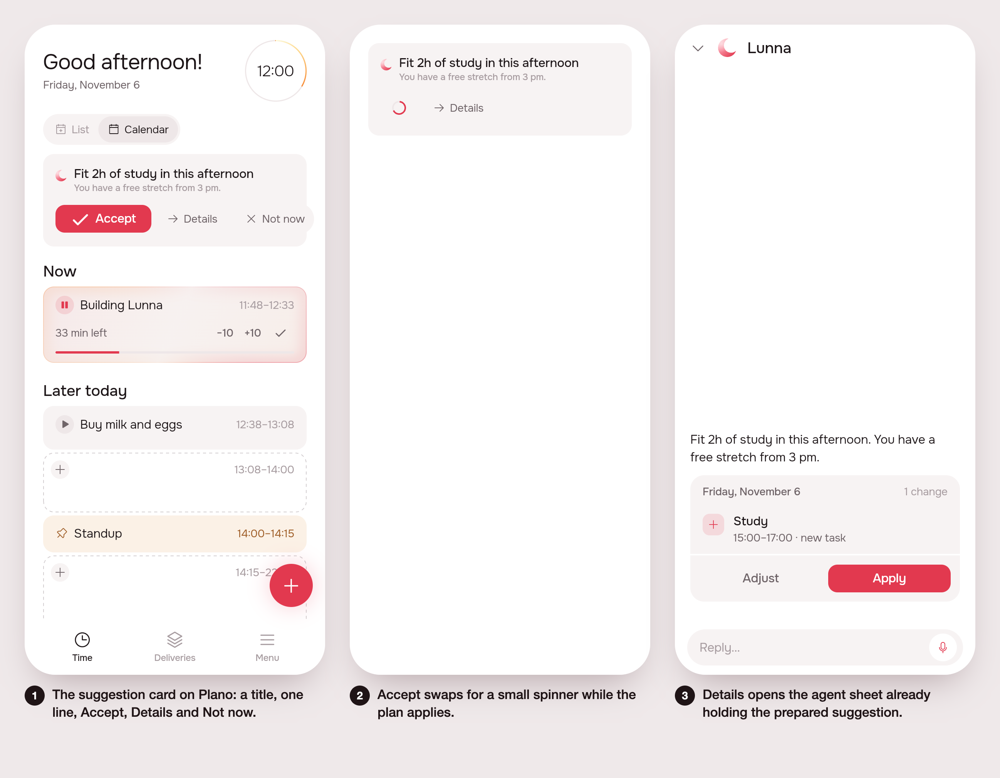

# Re-enable agentic suggestions (#120)

Status: built.

## 1. The prompt

> Re-enable agentic suggestions
>
> Agentic suggestions were a major part of lunna, we disabled temporarily to take care of other stuff on home, but I feel we could take advantage of it again.
>
> But I want a new design, because the current one takes too much space. It should be a small height, beatiful card, with a appealing title and a succint description. We have three options: accept, deny, or details...
>
> If tapping details it should open the agentic screen with the full suggestion (A2UI) embedded on it (so we can keep the current way of having a prepared A2UI for the suggestion before opening the screen). User can talk and change anything or accept it by the chat page.
>
> The accept should have a small spinner on the card while the changes are taking place, and the deny should just dismiss the card and a new suggestion will come when there is time.
>
> Also, I think we can drop suggestions from 4h to 4h at least in the working hours, that way this is more often.

Review reply (revision 1):

> The card contrast against the button looks awful, can we have a highlight on accept? Also some icons with the button would be good. Also make the left spacing good enough so it aligns with the now task spacing.

Review reply (revision 2):

> adjust the card background, it could be gray.

Review reply (revision 3):

> spacing is a bit bad on the right button. after that, approve

The plan (by /create, ~2.5 % of the week):

- Turn the suggestion back on in Plano (`kSuggestionOnPlan = true`).
- Redraw `SuggestionCard` as a compact card: a title, a one-line description, and Accept, Deny and Details.
- Accept applies the plan through the existing apply route, with a small spinner on the card while it runs. The card goes away when it is done.
- Deny calls the existing dismiss route and removes the card. The next suggestion comes on the timer.
- Details opens the agent sheet with the prepared A2UI surface already embedded, so no new turn is needed.
- Server: follow-up default 4 h, clamp 1 to 4 h (was 3 to 24, default 24). `intoWorkDay` keeps it inside working hours.
- New strings in `app_pt.arb` / `app_en.arb`, regenerate l10n.
- One widget test for the card states and one server spec for `nextAtOf`.

Not doing: no change to how the model picks the content; no animation polish beyond the spinner; no change to the landing demo; no new routes or tables; no change to suggestion push notifications.

## 2. The design

1. The card sits at the top of Plano, two lines of text and three actions: **Aceitar** (filled accent button, check icon: the highlight), **Detalhes** (arrow icon), **Agora não** (x icon). The card is gray (`AppColors.fill`, not the pink wash). Its inner padding is `AppSpacing.s4`, so its text and mark line up with the Now card's. **Agora não** is shifted out by its own pill padding (`AppSpacing.s3`), so its label ends on the card's inner edge, like the text above it (revision 3).
2. Aceitar swaps for a small spinner while the plan applies; the card goes when it is done (on failure the button returns and a snackbar says why).
3. Detalhes opens the agent sheet already holding the prepared surface (preview, plan, Adjust/Apply), no new turn.

Decisions the screens don't show:

- Title = the first sentence of the suggestion's `text`; description = the rest, one line, ellipsis. No new field, so the model's content is untouched.
- A suggestion with no plan (a question, the welcome) shows Detalhes (and Agora não) only.
- Deny reuses `SuggestionCubit.dismiss()`.

## 3. What was built

The prints show the card on Plano, Aceitar's spinner, and Detalhes opening the agent sheet with the prepared suggestion.

The rule: a suggestion comes at most every 4 h inside working hours, and the first of the day at its start. The model may ask for sooner (1 h); `nextAtOf` still moves the hour into the work day (`intoWorkDay`).

Server (`server/src/agent/`), no new routes, tables, env vars or analytics rows:

- `agent.service.ts`: `DEFAULT_FOLLOW_UP = 4` (was 24), `FOLLOW_UP_RANGE = { min: 1, max: 4 }` (was 3 to 24). Dismiss with no held `nextAt`, the template's next, and the `validUntil` fallback all use 4 h.
- `work-quality.ts` (`requestOf`) and `agent.prompt.ts` (the prompt line and the `answer` tool's `followUp` schema, 1 to 4) tell the model 1 to 4.
- Comments in `suggestion.store.ts` and `db/schema.ts` updated. No migration: the column is an integer either way.

App:

- `app/lib/plan/view/home_page.dart`: `kSuggestionOnPlan = true`.
- `app/packages/agent/lib/src/view/suggestion_card.dart`: the compact gray card. Aceitar (filled accent `AppButton.icon`, check), Detalhes (arrow), Agora não (close). The stateful `_Offer` holds the accepting flag; `SuggestionCard(accepting:)` is for tests.
- Strings `agentSuggestionAccept` and `agentSuggestionDetails` in `app_pt.arb` / `app_en.arb`. The mockup's preview-only strings and `app/lib/suggestion_preview.dart` were removed after the prints.

Tests:

- Server `npm test -- src/agent`: 10 suites, 102 tests pass. `work-quality.spec.ts` covers the clamp 1 to 4, default 4, and a new `nextAtOf` default case; `agent.controller.spec.ts` expectations moved from a day/5 h to 4 h.
- App: new `app/packages/agent/test/suggestion_card_test.dart` (6 tests: title, description and three actions; spinner when accepting; Agora não dismisses; no Aceitar without a plan; `suggestionWords`). The two old card tests in `test/voice_test.dart` were rewritten (32 pass).
- `.tool/check`: all 12 steps green.

Differs from the mockup or plan: nothing visible. The code writing went to opencode (`.tool/oc`); it missed the tool schema's 3 to 24 limits, the `schema.ts` comment and the controller spec's expectations. These were fixed in review.

Decided unattended:

- Title and description split on the first sentence, not a new server field (from the mockup).
- The welcome (no plan) shows only Detalhes and Agora não.
- Follow-up range 1 to 4 h with a 4 h default.
- Preview-only strings removed with the preview entry point.
- The old `voice_test` card tests rewritten, not deleted.

Next:

- The suggestion's push notification still fires at each `nextAt`, now up to every 4 h. Watch whether that is too many.
- A short `title` written by the model would beat the first-sentence split.
- Work Quality evals (`npm run eval:agent`) were not rerun for the new `followUp` wording (costs money).

## 4. How to turn it on

On by default once deployed. There is no flag and no env var.

## 5. Cost and time

Measured by the queue: see the pull request.
