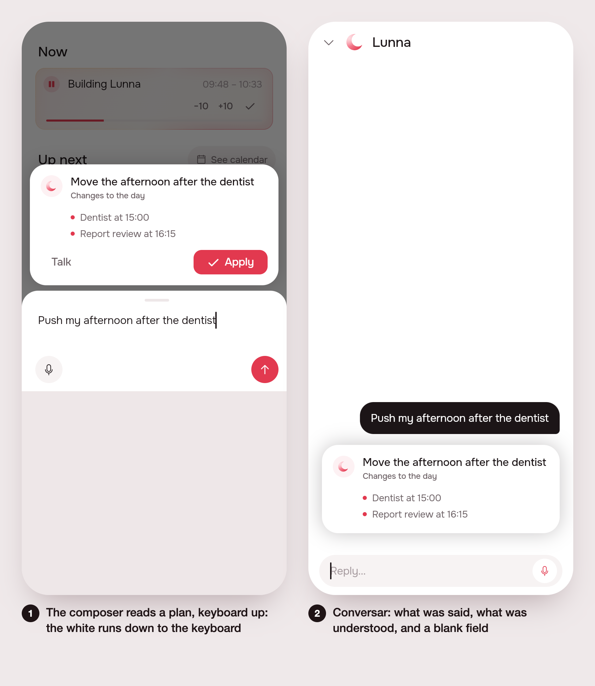

# The composer sheet: no black strip, no full screen, Conversar picks up

> Issue [#124](https://github.com/pietroid/lunna/issues/124), built
> unattended by the queue.

## 1. The ask

From the issue, verbatim:

> Make input more beatiful
>
> Input bottom sheet (when tapping add) is too ugly now for lunna: for web mobile it takes the whole screen mistakenly, for mobile it has a black background between the keyboard and the bottom sheet
>
> Also, if I tap conversar, it selects the text that I just sent, it must show the already understood command in the history, my previous sent message and a blank message for me to actually say anything else.

The plan (by /create, ~1.5 % of the week):

- Composer sheet on mobile web: stop it filling the whole screen (cap its height and use the safe area).
- Composer sheet on native mobile: remove the black strip between the keyboard and the sheet by painting the sheet's own background under the keyboard inset.
- Conversar: open the agent sheet with a blank, unselected field.
- Conversar: seed the agent sheet's history with the message just sent and the understood summary.

Not doing: no visual redesign of the composer beyond the two bug fixes, no change to the server or to `/agent/compose`, no new tests beyond one widget test for the Conversar seeding.

## 2. The plan

- `composer.dart` (`showComposer`, `ComposerSheet`): the keyboard's inset moves from a transparent `Padding` around the whole sheet to the bottom padding inside the field's white box, so the white runs down under the keyboard and nothing dark shows between them. The route gets `useSafeArea: true`, and the inset is clamped on the web so a mis-reported one can't paint the page white.
- `models.dart`: a third entry, `ComposedEntry(ComposeDraft)`, what the composer understood. The sheet draws it with the composer's own `ComposeSummary`, without its buttons; the repository sends it to `/agent/turn` as an assistant line (the plan's title and its changes), so the agent knows what it proposed.
- `AgentCubit.open` takes a `seed` (the entries a new conversation starts with); `showAgentSheet` passes it through. `compose.dart`'s `onTalk` seeds `[UserEntry(text), ComposedEntry(draft)]` and no `draft`, so the field opens blank.
- Proof: a widget test in `history_test.dart` (the sent line and the understood plan in the history, the field empty), `flutter analyze`, `.tool/check`.

### Decided unattended

- The seeded conversation does not reuse the compose turn's `conversationId`: the next turn starts a new conversation, with the seed sent as its context. Reusing it could store the first two messages twice.
- The web clamp (the inset capped at half the screen height) is a guess, not a fix proven on a phone.

## 3. What was built

Two scenes, in English. 1: the composer having read a plan, with a keyboard inset simulated by `MediaQuery`; the white runs down to the keyboard. 2: Conversar, with the sent message, the understood plan and a blank field.

**The rule that matters:** nothing dark may show between the keyboard and the sheet, and Conversar starts from what was already said. App only; no server change, no change to `/agent/compose`.

**App pieces** (`app/packages/agent`, `app/lib/plan`):

- `view/composer.dart`: `showComposer` adds `useSafeArea: true`. In `ComposerSheet` the keyboard inset is no longer a transparent `Padding` around the sheet (it showed the modal's dark barrier between the keyboard and the sheet on phones). It is the bottom padding inside the field's white box. The `SafeArea` bottom is off while the keyboard is up.
- On the web (`kIsWeb`) the inset is clamped to half the screen height. This is a defensive guess at "takes the whole screen on mobile web". **It could not be reproduced here (no mobile browser on this machine), so it is unverified on a real phone.**
- `ComposeSummary` gains `actions` (default true); false hides Ajustar/Conversar and Adicionar/Aplicar.
- `models.dart`: a third `AgentEntry`, `ComposedEntry(ComposeDraft draft)`. The agent sheet (`_Current`, `_Past`) draws it with `ComposeSummary(actions: false)`. `AgentRepository.turn` sends it to `/agent/turn` as an assistant message: the draft's title and its changes, one per line.
- `AgentCubit.open({seed})` and `showAgentSheet({seed})`: a new conversation can open on given entries. `compose.dart`'s `onTalk` (Conversar) seeds `[UserEntry(sent text), ComposedEntry(draft)]` and no longer passes `draft:`, so the field opens blank and unselected.

**Tests:** one new widget test in `app/packages/agent/test/history_test.dart`, "seeds the conversation from a composer read": the sent line and the understood plan are in the history, no buttons, the field is empty. `flutter test` in `packages/agent`: 81 passed. `.tool/check`: app-analyze and test-agent pass.

**Differences from the plan:** the plan said "cap its height"; the build clamps the keyboard inset on the web instead, and adds no height cap. The web part is a guess (see above).

**Notes:** opencode ran and timed out at 9 minutes, but had written all seven files. They were reviewed, formatted, analyzed and kept.

**Next step:** verify the web clamp on a real iPhone Safari and Android Chrome. If the bug persists, look at how Flutter web reports `viewInsets` while Safari pans the page.

## 4. How to turn it on

Nothing to set. No env vars, no flags, no migration. Ship the app; the composer and Conversar behave this way by default.

## 5. Cost and time

Measured by the queue: see the pull request.
