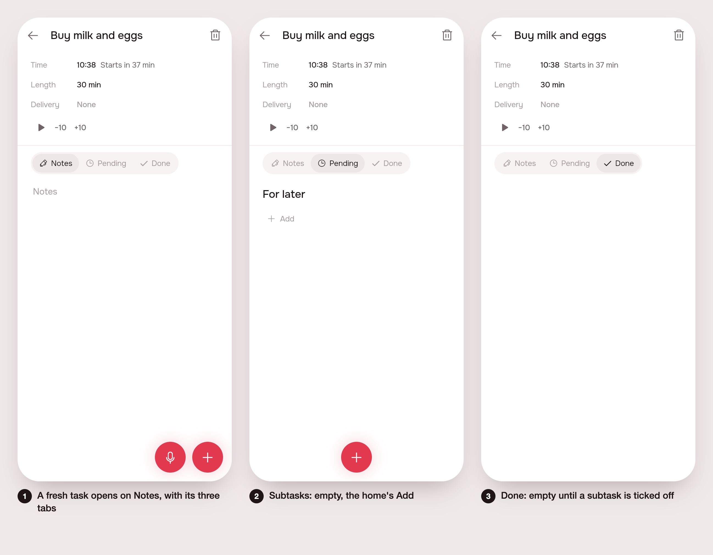

# A task's empty state: always Notes, Subtasks and Done

> Issue [#118](https://github.com/pietroid/lunna/issues/118), built
> unattended by the queue.

## 1. The ask

From the issue, verbatim:

> Tasks still have inconsistent empty state
>
> Freshly created tasks have the ugly + subtarefa, and just a "notes" screen. It should always have in the empty state, notes, subtasks (empty state) and done. We can remove the current legacy screen and just keep the experience. Also reordering is not working properly and the animation should be working similar to the home screen

The plan (by /create, ~1.5 % of the week):

- A loose task (and a freshly created one) opens the same page as a delivery: Notes, Subtasks (empty state with the home's `AppAddRow`) and Done tabs, always present.
- The legacy `EventPage` for tasks, with its `+ Subtarefa` button, is removed. `EventPage` stays only for fixed blocks (events).
- Subtask reordering in the page's Subtasks tab is fixed and given the home's drag lift, drop and settle animation.

Not doing: no server change, no new tabs or redesign, no change to fixed blocks, no reordering changes in Plano outside the task page, one spec at most.

## 2. The plan

- `artifacts`' new `TaskPage` (`task_page.dart`) is what `/evento/:id` opens. A task of a delivery opens the delivery's `ArtifactPage` on Pendentes. A live loose task gets the delivery's three tabs (Notas, Pendentes, Feitas, same `AppSegmented` and labels) under its own summary. Its empty Pendentes is "Para depois" and the home's `AppAddRow`, with the composer's + floating where the notes' dock floats.
- `EventPage` loses `onAddSubtask`, `SubtaskWriter` and the `+ Subtarefa` button; it gains a `tabs` builder that wraps the notes for a live loose task. The `subtaskAdd` string is gone from both ARBs.
- The reorder bug: after a drop the subtask jumped back to where it was until the server's move and the delivery's reload came back, then jumped again. `_Tasks` now holds the order the drag left (`_order`) until the delivery is read again, and the lifted card's elevation rises and settles with the drag's animation.
- Proof: a widget test for the loose task's tabs, the drag test asserting the card stays where it was let go (it fails on `main`: d at y 411, c at 342), and prints of the three tabs.

### Decided unattended

- **The loose task keeps its own summary, not the delivery's.** A loose task has no deadline, value or kind, so `ArtifactPage`'s summary can't draw it without a server change. Its page is `EventPage`'s header (name, hour, length, play) over the delivery's tabs. The moment it has a subtask (the server makes it a delivery), `TaskPage` becomes the delivery's page on Pendentes. So `EventPage` still draws a loose task's header, against the plan's "EventPage only for fixed blocks". Its legacy body (notes only, `+ Subtarefa`) is gone.
- **Adicionar on a loose task asks with the prompt sheet**, the one the `+ Subtarefa` button used (`AppPromptSheet`, then `ArtifactsCubit.addSubtask`). The composer can only file a task under a delivery (`parent` is a delivery's ref), so opening it about a loose task would write a separate task.
- **The drag stays a `SliverReorderableList`.** The home's drag (`PlanDraggable`, `PlanQueue`, the quiet ghost where the card lands) lives in `app/lib/plan`, which the `artifacts` package can't import. Moving it to a package is a refactor the plan didn't ask for. The lift now animates to the home's elevation 6 in `AppColors.shadow` and settles back on drop.
- **opencode was not used.** The diff is a few small edits across files already read while planning, so a brief would have cost more than the edit.

## 3. What was built

1. A fresh loose task opens on Notas, with its three tabs.
2. Pendentes is empty, with the home's Adicionar.
3. Feitas is empty.

App only. No server change, no new routes.

- **`TaskPage`** (`app/packages/artifacts/lib/src/view/task_page.dart`, exported). `/evento/:id` in `app/lib/app/view/app.dart` builds `TaskPage(id, dock: NotesDock.task)` instead of `EventPage`.
  - A card with an `artifactId` opens `ArtifactPage(id: artifactId, initialTab: 1)`.
  - A live loose task opens `EventPage` with a `tabs` builder: the delivery's `AppSegmented` (`artifactNotesTab`, `artifactPendingTab(0)`, `artifactDoneTab(0)`) under the task's own summary. Notas holds the notes and their dock. Pendentes is the "Para depois" heading and `AppAddRow` (prompt sheet, then `ArtifactsCubit.addSubtask`), with `AskDock(about: AgentSubject.task(id))` floating. Feitas is empty.
  - The first subtask makes the task a delivery on the server. The card gets an `artifactId` and `TaskPage` turns into the delivery's page on Pendentes.
  - `TaskPage.initialTab` picks the loose tab (Notas by default).
  - A fixed block and a finished task (Feitas' archive) still get `EventPage` alone.
- **`EventPage`** (`app/packages/timeline/lib/src/view/event_page.dart`): `onAddSubtask`, `SubtaskWriter`, `_subtask` and the "+ Subtarefa" button are gone. New `TaskTabsBuilder tabs`, used only for a live, interactive, loose task. The "Entrega: Sem entrega" row stays as plain text. The `subtaskAdd` string is removed from both ARBs and the gen is regenerated.
- **Reorder fix** (`_Tasks` in `artifact_page.dart`, now stateful). After a drop the subtask jumped back to its old place until the server's move and the reload, then jumped again. It now keeps the order the drag left (`_order`) until the artifact is read again (`didUpdateWidget` clears it). The lift animates elevation 0 to 6 (the home's, `AppColors.shadow`) with `easeInOut` on the drag animation, and settles on drop. `subtaskMove` is unchanged.
- **Tests**: `app/packages/artifacts/test/artifact_page_test.dart`, 19 tests, all pass. New: "a loose task opens on the three tabs, Pendentes an Adicionar". The drag test now also asserts the card stays above its neighbour after the drop; without the fix it fails (d at y 411, c at 342). `.tool/check` passed: app-analyze, test-agent, test-analytics, test-api_client, test-app_ui, test-artifacts, test-cycle, test-notifications, test-timeline.

Differences from the plan: see "Decided unattended" in section 2 (the loose task keeps `EventPage`'s summary; Adicionar uses the prompt sheet; the drag stays a `SliverReorderableList`).

Notes for later:

- Move Plano's drag (`PlanQueue`, the ghost) into a package so the task page can share it exactly.
- Teach the composer to write a subtask about a loose task.

## 4. How to try it

No env vars, no commands, nothing to turn on.

1. Open any loose task from Plano, or create one with the +. It opens on Notas with the three tabs.
2. Pendentes, then Adicionar, writes the first subtask. The page becomes the delivery's.
3. In a delivery with several subtasks, hold one in Pendentes and drag it. It lifts, lands and stays.

## 5. Cost and time

Measured by the queue: see the pull request.
