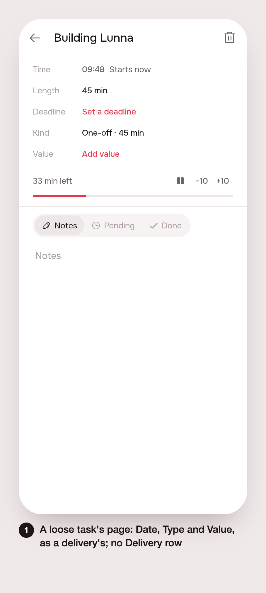

# Unify delivery and task, definitely (#126)

## 1. The ask

> unify delivery and task definetely
>
> There are still some gaps, which show that some parts of delivery vs task are still conceptually split. They must be exactly the same thing.
>
> - When creating an empty task, it still has in its internal page "deliverable" to select, which should have nothing
> - I cant set a task date, just when we have subtasks. We should be able to add the date even without the subtask.
> - Also value and type should be always avaiable.
> - Also I noticed when asking to add subtasks to a new freshly created task (with no subtasks), it sometimes creates a new task, so an adjustment to be done in the agent.

The brief (/create, ~2.0 % of the week):

- Remove the "Delivery" row (`eventArtifactLabel`, "no delivery") from the page of a loose task.
- Show Date (deadline), Type and Value on a loose task's page as well, the same rows and sheets the delivery page uses.
- Make setting any of them on a task with no subtasks turn it into a delivery on the server (one rule, same as adding the first subtask).
- Agent: when the conversation is about a task (`about.taskId`) that has no subtasks, "add subtasks" writes into that task instead of creating a new task.

Not doing: no redesign of the pages beyond reusing the rows; no data migration; no new eval suite.

## 2. The plan

- **Server**: `ArtifactsService.promote(user, taskId)`, the first half of `addSubtask` pulled out: a loose task gets a delivery with its title, notes and length, its own row the first task. New route `PATCH /api/tasks/:id/delivery` (body as `PATCH /artifacts/:id`): promote, then edit. Analytics row `task_delivery_edited`.
- **App**: `EventPage` takes a `details` builder of labelled rows; `TaskPage` hands a loose task Deadline, Kind (read-only "One-off · length", as the delivery page draws a delivery with no type) and Value. Setting a deadline or value calls `ArtifactsCubit.setTaskDeadline`/`setTaskValue`, which reload the day, so the task carries its delivery and the page becomes `ArtifactPage`. `ValueSheet` now takes a value and a save function, so the same sheet serves both. The Delivery row and its two strings are gone.
- **Agent**: `NewThing.subtaskOf`. On a task's page a new task with no delivery named goes into that task's delivery, or, when the task is loose, promotes it as it is applied (`created` in `actions/queue.ts`), so the dry run, the line ("add to Vídeo") and the undo all go through the same path. The page's context tells the model so in one line.
- **Proof**: a controller spec for the route, an agent controller spec for the page, `.tool/check`, and a print of the page.

## 3. What was built

A loose task's page (in English): Time, Length, Deadline "Set a deadline", Kind "One-off · 45 min", Value "Add value". No Delivery row.

**The rule**: a task and a delivery are one thing. Setting a deadline or a value on a loose task makes it a delivery on the server, the same way its first subtask does.

**Server**
- `ArtifactsService.promote(user, taskId, trace)` in `server/src/artifacts/artifacts.service.ts`, pulled out of `addSubtask` (which calls it). A loose task gets a delivery with its title, notes and length, its own row the first task. A task already in a delivery answers that delivery's id.
- `PATCH /api/tasks/:id/delivery` in `artifacts.controller.ts`: body as `PATCH /artifacts/:id` (checked by `requireArtifactEdit`); promote, then edit. Answers Entregas plus `artifactId`.
- Analytics row `'PATCH /tasks/:id/delivery': 'task_delivery_edited'`.
- Agent: `NewThing.subtaskOf` (`agent/plan.ts`). In `agent/actions/queue.ts`, `belongsTo` sends a new non-fixed task with no delivery named, written on a task's page (`about: { taskId }`), into that task's open delivery, or gives a loose task's new task `subtaskOf`. `created()` is async and promotes the task when the gesture is made, so the dry run, the plan line (artifact: the task's title) and undo share one path. The light/off-day refusal counts `subtaskOf` as a delivery's task. `agent.service.ts` adds a line to the task page's context: a new task written here goes in as its subtask.

**App**
- `EventPage` lost the Delivery / Nenhuma row and takes `details` (`TaskDetailsBuilder`: labelled rows drawn under Length for a live loose task).
- `TaskPage` gives a loose task Prazo (day picker, `ArtifactsCubit.setTaskDeadline`), Tipo (read-only "Avulsa · length") and Valor (`showTaskValueSheet`, `setTaskValue`). Both cubit methods call `onDayChanged`, so the day reloads, the task has its `artifactId` and `TaskPage` switches to `ArtifactPage`.
- `ValueSheet` takes `value` + `save` instead of an Artifact; `showValueSheet` is unchanged for its callers.
- `ArtifactsRepository.editTaskDelivery`. l10n: `eventArtifactLabel` and `eventNoArtifact` removed, gen-l10n run.

**Tests**
- `artifacts.controller.spec.ts`: "makes a delivery of a loose task given a deadline or a value" (a deadline promotes, a later value edits the same delivery, one delivery).
- `agent.controller.spec.ts`: "writes a new task on a loose task's page as its subtask, and undoes it" (the line names the task, apply makes the delivery with both tasks, undo restores every row).
- `.tool/check` passed in full: app-analyze, test-agent, analytics, api_client, app_ui, artifacts, cycle, notifications, timeline, server-eslint, server-tsc, server-test.

**Decided unattended**
- opencode was not used: `.tool/oc` answered `limit (Insufficient account funds)`, so it was built by hand.
- The agent's spec is in `agent.controller.spec.ts`, not `actions.spec.ts`: that one only checks the verbs' schema, and the page needs the end-to-end harness the artifact-page case already uses.
- Type stays read-only on a loose task, as on the delivery page (no type picker exists for an existing delivery).
- A route on the task instead of the app creating a delivery then attaching: one request, one rule shared with the first subtask.
- No start sheet or ±1 day buttons on a loose task: once a deadline is set the page is the delivery's, which has them.

**Next**
- A type picker for a delivery (and so a loose task).
- The agent could promote on "set deadline" / "set value" of a loose task the same way.

## 4. How to turn it on

Nothing. It ships with the server and the app. No env vars.

## 5. Cost and time

Measured by the queue: see the pull request.
