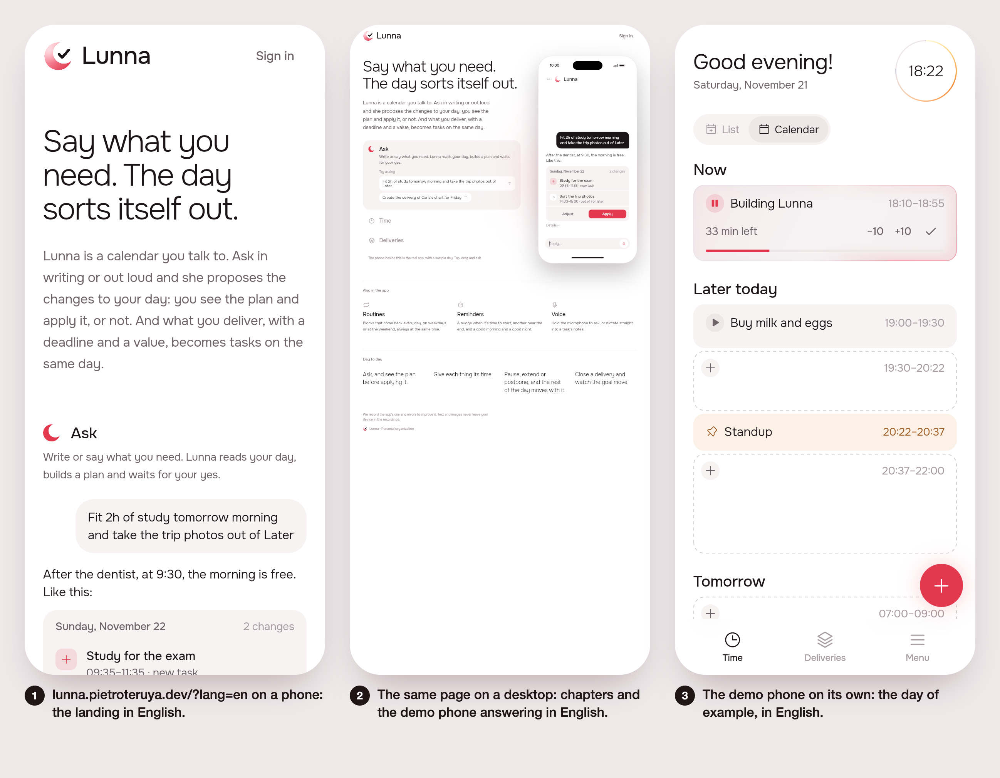

# Landing page in English (#128)

## 1. The ask

> Serve the **signed-out landing page (and its demo phone) in English** for English-speaking visitors, so it can be linked from the portfolio (pietroteruya.dev) for recruiters abroad.
>
> Today https://lunna.pietroteruya.dev is Portuguese only: `app/lib/app/view/app.dart:151` pins `locale: const Locale('pt', 'BR')`, and `app_en.arb` is used only for previews/prints. The English copy already exists, so this should be mostly wiring, not writing.
>
> Done when: the English URL shows the whole landing and demo in English, with a print of it in the PR.

The brief (/create, ~1.3 % of the week):

- Read `?lang=en` from the URL (web only) and set the MaterialApp locale to `en` while signed out; keep pt-BR when signed in.
- Auto-pick English when the browser language is not Portuguese and no `lang` param is given. `?lang=pt` forces Portuguese.
- Audit the landing and demo copy in English and fix `app_en.arb` or any Portuguese leaking from the demo fakes.
- Set the title and meta description in English for the English variant.
- One widget test checking the landing renders English with `lang=en`; a print of the English landing and demo.

Not doing: no in-page language toggle, no `/en` route, no translating the signed-in app, no new languages, no server changes.

## 2. The plan

- **Resolver**: `landingLocale(query, browser)` in `packages/l10n/lib/src/landing_locale.dart`: `lang=en` → English, `lang=pt` → Portuguese, otherwise English when the browser language is not Portuguese. Pure, so it is tested without a browser.
- **App**: `App` reads it once on the web (`Uri.base.queryParameters`, `PlatformDispatcher.instance.locale`); off the web it is always pt-BR. The `MaterialApp` takes that locale only while `AppStatus` is not `authenticated`; signed in it is pt-BR, as today.
- **Page head**: a small inline script in `web/index.html` repeats the same rule and, for English, sets `<html lang="en">` and the meta description in English. The title is the app's name in both languages.
- **Copy**: the landing and the demo already read every string through `l10n` (no hardcoded Portuguese found in `lib/landing` or `lib/demo`); the English ARB is read end to end in the print.
- **Proof**: resolver unit tests, a landing widget test in English, `.tool/check`, and a print of the English landing.

## 3. What was built

The print has three scenes: the landing in English on a phone; the same page
at desktop width, scaled into the phone frame, with the chapters and the demo
phone answering in English; and the demo phone alone.

**The rule.** `?lang=en` gives English, `?lang=pt` gives pt-BR. With no
`lang` (or an unknown one, e.g. `fr`), pt-BR when the browser language is
`pt`, English otherwise. Signed in, the app is always pt-BR.

**Files.**
- `app/packages/l10n/lib/src/landing_locale.dart`: `landingLocale(query, browser)`, exported from `package:l10n/l10n.dart`. The library doc now says `app_en.arb` also serves the signed-out landing abroad.
- `app/lib/app/view/app.dart`: a top-level `_landingLocale`, read once at start (web: `Uri.base.queryParameters` and `PlatformDispatcher.instance.locale`; off the web: pt-BR). `MaterialApp.router` sits in a `BlocSelector<AppBloc, AppState, bool>` (signed in = `AppStatus.authenticated`): pt-BR when signed in, `_landingLocale` otherwise.
- `app/web/index.html`: an inline script repeating the rule. For English it sets `<html lang="en">` and the meta description to "__APP_NAME__: say what you need, the day sorts itself out." (`tool/brand_web.sh` stamps the name.) The title is the app's name in both languages, so it is unchanged.
- Server: nothing changed. No routes.

**Copy audit.** `lib/landing` and `lib/demo` read every string through l10n (demo fakes take `AppLocalizations`). No hardcoded Portuguese found and no ARB string needed changing. The one accented English value is the name "Júlia" in `demoDeliveryJulia`, kept.

**Tests.**
- `app/test/landing/landing_locale_test.dart`: 4 tests for the resolver.
- `app/test/landing/landing_page_test.dart`: one new widget test, "draws the landing and the demo in English for ?lang=en" (English headline, the Tempo chapter title and the demo's study reply; the Portuguese headline absent). `testAt` gained a `locale` parameter.
- Whole app suite: 81 tests pass. `.tool/check` passes (app-analyze and all package tests).

**Differences from the plan.** None in behaviour. The resolver test lives in `app/test/landing` and not in the l10n package, which has no `flutter_test` dev dependency (this avoids a pubspec change). `preview_locale.dart` was left as is; the resolver is its own file. The preview entry point used for the print was deleted.

**Decided unattended.**
- An unknown `lang` value falls back to the browser rule.
- While the auth state is being restored (not yet authenticated), the landing locale is used. A signed-in English-browser user may glimpse the splash in English before pt-BR.
- Only `<html lang>` and the meta description change in `index.html`; the title stays the brand name.
- Opencode was not used: `.tool/oc` returned `limit` (insufficient credits), so the piece was built directly.

**Next.**
- Link https://lunna.pietroteruya.dev/?lang=en from the portfolio.
- An English social preview (`og:description`), if link previews matter.

## 4. How to turn it on

Nothing to set. The deploy uses the same web build, so there are no env vars or switches. Open `https://lunna.pietroteruya.dev/?lang=en` for English, or `?lang=pt` to force Portuguese. Without `lang`, the browser language decides.

## 5. Cost and time

Measured by the queue: see the pull request.
