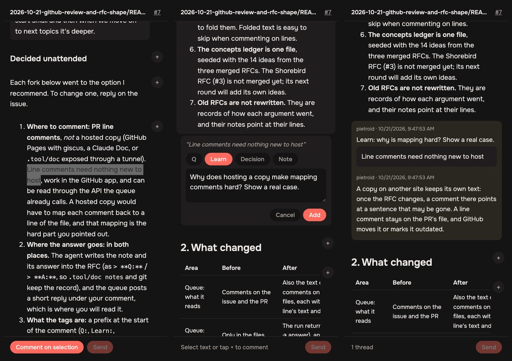
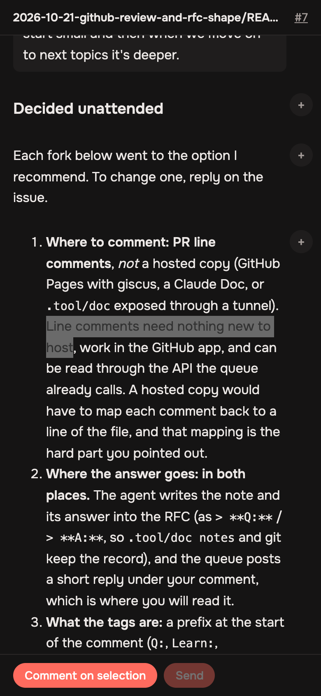
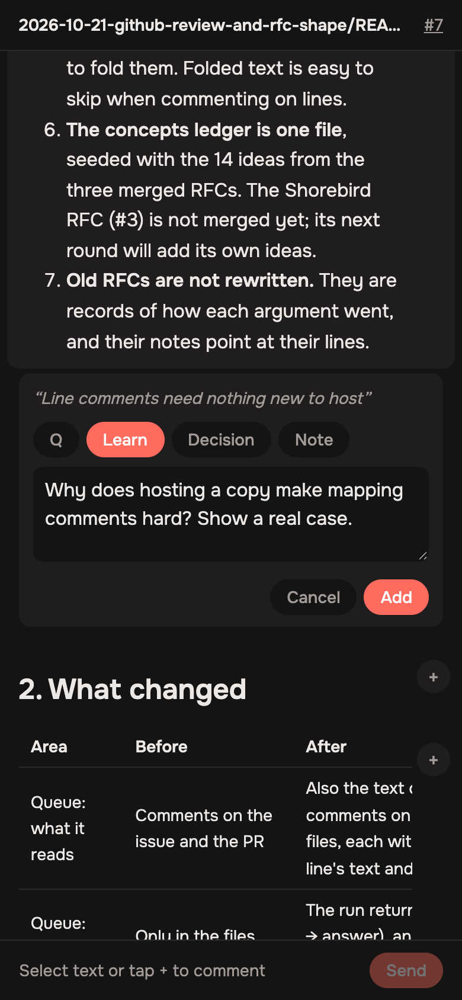
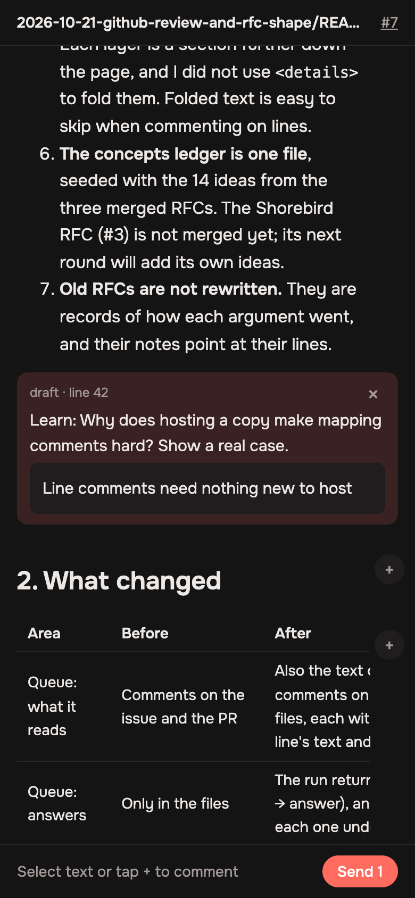
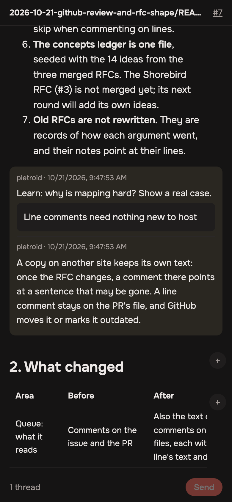

# Review RFCs on GitHub, and RFCs that teach

2026-10-21 · /improve · issue #5, run unattended by the queue

## In one minute

- **Round 2: comment on the page itself.** Each gate now links
  📝 *Read it as a page*: the RFC drawn as on GitHub, on GitHub Pages.
  Select a sentence (or tap a block's **+**), choose `Q`, `Learn`,
  `Decision` or `Note`, and write. **Send** posts all your drafts as one
  PR review of line comments, so the queue and its answers work as in
  round 1, and the answers show up on the page under your text.
- **Round 3: it's on.** Pages is on for the repo, at
  [pietroteruya.dev/lunna/review.html](https://pietroteruya.dev/lunna/review.html)
  (your domain already serves the user site, so project pages go under it).
  The queue's push of this round deploys the page from this branch, so
  this PR's own link should work before you approve. Merging deploys it
  again from main.

  

- **To comment on an RFC from the phone, use GitHub's own line comments.**
  The RFC is already the PR description. In the PR's **Files changed**,
  tap a line of the README and comment (`Q:`, `Learn:`, `Decision:`,
  `Note:`). Until now the queue read only plain comments, so a line
  comment never reached the agent. Now it does, with the line it was
  left on, and the agent's answer is posted under your comment.
- **RFCs are shorter, and come in layers:** *In one minute* (under 200
  words), then *Ideas to keep* (3–5 sentences worth remembering, each
  with a source), then *The change*, then the evidence under *Deeper*.
- **Learning carries over from one RFC to the next.** A new file,
  [`product/research/concepts.md`](../../research/concepts.md), lists the
  14 ideas the RFCs so far taught. The next RFC gives a known idea one
  line and goes a level deeper on it.

## 1. The request

> Improve GitHub flow and RFCs
>
> - now that we are using GitHub issues as to communicate with the system, I want to find ways to have the same features working for reading and commenting RFCs.
>
> - preferably using the system from GitHub to tag, comment.
>
> - we could for example upload an artifact online, the only challenge would be to save comments to it
>
> Get the simples path and more effective also considering sometimes I will be on the phone
>
> Also shorten the structure of RFC so it goes straight to the point and make it favor more the learning process of mine (references and sentences that stick for a person learning much of ai engineering). Like progressive disclosure, start small and then when we move on to next topics it's deeper.

### Decided unattended

Each fork below went to the option I recommend. To change one, reply on
the issue.

1. **Where to comment: PR line comments**, *not* a hosted copy (changed
   in round 2: see below) (GitHub
   Pages with giscus, a Claude Doc, or `.tool/doc` exposed through a
   tunnel). Line comments need nothing new to host, work in the GitHub
   app, and can be read through the API the queue already calls. A hosted
   copy would have to map each comment back to a line of the file, and
   that mapping is the hard part you pointed out.
2. **Where the answer goes: in both places.** The agent writes the note
   and its answer into the RFC (as `> **Q:**` / `> **A:**`, so
   `.tool/doc notes` and git keep the record), and the queue posts a short
   reply under your comment, which is where you will read it.
3. **What the tags are:** a prefix at the start of the comment (`Q:`,
   `Learn:`, `Decision:`, `Note:`), the same four kinds `.tool/doc` uses.
   I did not use GitHub labels, because a label goes on a whole PR, not
   on a line.
4. **A line comment never counts as approval**, even if it says "ok". To
   approve, comment `approve` alone, on the issue or as the text of a
   review.
5. **Depth comes in order, not hidden.** Each layer is a section further
   down the page, and I did not use `
` to fold them. Folded text
   is easy to skip when commenting on lines.
6. **The concepts ledger is one file**, seeded with the 14 ideas from the
   three merged RFCs. The Shorebird RFC (#3) is not merged yet; its next
   round will add its own ideas.
7. **Old RFCs are not rewritten.** They are records of how each argument
   went, and their notes point at their lines.

### Merge with main

Main shipped the RFC → build flow while this was open (an approved RFC
opens its `Implement: …` create issue; `.tool/queue implement`; the plan
track). Three files conflicted, and each keeps both sides:

- `research/SKILL.md` description: the short, layered RFC answering line
  comments, plus "when approved it lands on main and its build is opened
  as a /create issue".
- `ISSUE_TEMPLATE/research.md`: comment on the page or on Files changed,
  "approve" merges, and the queue then opens the build issue.
- `.tool/queue.mjs`: main's `plan` and `rfc` headlines now say "here, or
  on any line of the PR's Files changed" like the others; posting the
  thread replies stays, next to main's `hasBoard`; the CLI keeps the
  import guard (`main`) and gains `implement`.

`.tool/check --all` passes, and `implement --dry-run` prints its issue.

### Round 3

The person, on the issue:

> Proceed with implementing with github pages. I loved the idea

Decided unattended:

1. **I turned Pages on myself** (`POST repos/…/pages`, source *GitHub
   Actions*), because you asked to go ahead with Pages. This was the step
   that round 2 had left to you.
2. **Queue branches deploy the page too**, not only main. The workflow
   runs on a push to `main` or `queue/**` that touches the page, and I
   added `queue/*` to the `github-pages` environment's allowed branches
   (it allowed only `main`). Without that, this PR's 📝 link would answer
   404 until the merge, and you could not try the page on the phone before
   approving it. The cost: a queue branch that changes `review.html` puts
   its version live before review. Only your own runs make queue branches.
   To undo it, delete the `queue/*` policy under Settings → Environments →
   github-pages.
3. **The page is HTTPS only.** Pages gives `http://pietroteruya.dev/lunna/`
   until it has issued the certificate, and you paste the token into this
   page. So the queue writes the link as `https://`, and the page sends
   itself to `https://` if it is ever opened over `http://`. The apex
   already serves HTTPS with the user site's certificate.
4. **The link names the repo** (`?repo=pietroid/lunna`). The page guessed
   the repo from a `*.github.io` host, and that guess fails on a custom
   domain. Until now it worked only because the fallback is this repo.

### Round 2

The person, on the issue:

> Ok maybe I'm a bit too precious but wouldn't I have a way to comment in a produced artifact online? Consider options

The options are compared under *Evidence*. Decided unattended:

1. **A page of our own whose comments are PR line comments.** Selecting
   text on the page writes the same comment you would leave in *Files
   changed*, on the line the selection starts on. The queue, the replies
   and the notes in the file stay as round 1 built them, and the page has
   no store of its own to keep in sync.
2. **Hosted on GitHub Pages**, published by a workflow from
   `.tool/review.html`. I did not turn Pages on: that changes a setting of
   the repo and publishes a site. `.tool/queue setup` turns it on (one
   API call), and until Pages is on the queue leaves the link out.
3. **Signing in is a token you paste once:** a fine-grained token for this
   repo with *Pull requests: read and write*, kept only in the phone
   browser's localStorage. GitHub's OAuth needs a server to trade the code
   for a token, and the page has no server.
4. **Drafts wait until Send**, and Send posts them as one review, so a
   reading session makes one round and not one round per comment.
5. **Where a comment lands:** with text selected, on the line where the
   selection starts, and the selected text is quoted under the comment.
   With **+**, on the whole block (`start_line` to `line`).
6. **If GitHub refuses the review** (a line outside the PR's diff, which
   can only happen on a file that is not new in the PR), the page posts
   the drafts as one plain PR comment, each naming its line.

## 2. What changed

| Area | Before | After |
|---|---|---|
| Queue: what it reads | Comments on the issue and the PR | Also the text of PR reviews, and comments on lines of the PR's files, each with its file, line, the line's text and its thread |
| Queue: answers | Only in the files | The run returns `replies` (thread → answer), and the queue posts each one under your comment |
| Queue: approval | Every comment says `approve` | The same, and no comment on a line |
| Queue: gate comment | "Reply approve … or write what to fix." | "…: here, or on any line of the PR's **Files changed**." |
| `/research` RFC shape | 8 sections: Thesis, How it works today, Diagnosis, Literature, Recommendations, Decisions, Rollout, References | *In one minute*, *Ideas to keep*, *The change*, *Decisions for you*, then *Deeper* (today, diagnosis, literature, rollout) and *References*. Word budgets: under 200 for the first section, under ~2,500 for the whole RFC |
| `/research` learning | None | `product/research/concepts.md`: read it before writing, add to it after; a known idea gets one line plus a level deeper |
| `/research` notes | Only from `.tool/doc open` | Also from GitHub line comments; `Learn` asks to go deeper; "deeper on X" goes under *Deeper*, not into the first section |
| Docs | | `.tool/README.md` (commenting on a line), the Research and Improve issue templates, the layout block in `AGENTS.md` |
| **Round 2:** review page | Comment only on Markdown lines in *Files changed* | [`.tool/review.html`](../../../.tool/review.html): the README drawn from the PR's head, the PR's threads under their blocks, select-to-comment, drafts kept in the browser, one review on Send |
| **Round 2:** publishing | | [`.github/workflows/review-page.yml`](../../../.github/workflows/review-page.yml) publishes it on Pages when it changes on main; `.tool/queue setup` turns Pages on (source: Actions) |
| **Round 2:** queue | | The gate comment and the PR description link 📝 *Read it as a page* (`review.html?pr=N&path=<doc>`) when Pages is on |
| **Round 2:** docs | | `.tool/README.md` ("Commenting on the page"), `/research`'s notes section, the Research template, `AGENTS.md` |
| **Round 3:** Pages | Off | On, built by Actions, at `https://pietroteruya.dev/lunna/` |
| **Round 3:** deploys | From `main` only | From `main` and `queue/*` (the workflow's trigger and the `github-pages` environment's branch policy) |
| **Round 3:** link | `http://…/review.html?pr=N&path=…`, the repo guessed from the host | `https://…/review.html?repo=owner/name&pr=N&path=…`; the page moves itself off `http:` |

### How to review an RFC on the page

Pages is on (round 3). In a fork, `.tool/queue setup` turns it on.

1. Tap 📝 *Read it as a page* in the ntfy push's gate comment.
2. Long-press to select a sentence and tap **Comment on selection** (or
   tap a block's **+**). Choose the kind, write, and tap **Add**. Drafts
   stay on the phone, even if you close the tab.
3. Tap **Send N**. The first time, it asks for the token
   ([github.com/settings/personal-access-tokens/new](https://github.com/settings/personal-access-tokens/new):
   only this repository, *Pull requests: read and write*).
4. A few minutes later the answers show up under your comments, on the
   page and in *Files changed*.

| Selected text | Writing | A draft, ready to send | An answer |
|---|---|---|---|
|  |  |  |  |

These are headless Chrome screenshots at 390×844, on this PR (#7). The
answer in the last one is made up, to show how a thread is drawn.

### How to review an RFC from the phone

1. Open the PR from the ntfy push and read the description, which is the
   RFC.
2. Go to **Files changed**, tap the line, and choose **Start a review**.
   Add as many comments as you like (`Q: why not X?`,
   `Learn: more real cases`, `Decision: B`).
3. **Submit** the review. Submitted together, they make one round. A
   single comment sent on its own starts a round at the queue's next
   minute.
4. The answers show up under each comment, and the RFC is updated. When
   you're done, reply `approve` alone.

## 3. Evidence

**RFCs are long, and the action comes late.** Measured with
[`code/rfc-shape.mjs`](./code/rfc-shape.mjs) (200 words a minute,
[`data/rfc-shape-before.md`](./data/rfc-shape-before.md)):

| RFC | Words | Minutes | Words before what to do | Minutes |
|---|---|---|---|---|
| agent-reliability | 6,109 | 31 | 1,448 | 7 |
| agent-queue | 3,630 | 18 | 1,659 | 8 |
| agent-ui | 9,406 | 47 | 3,034 | 15 |
| shorebird (PR #4, unmerged) | 2,638 | 13 | 1,352 | 7 |

**The questions ask to learn.** 29 of the 31 notes on the RFCs are `Q`
(`.tool/doc notes <rfc>`). The ones that drive the new shape:
*"I need more real cases on this"* (agent-reliability L113), *"I have no
idea on what you are saying. I want to understand a bit more about
evals"* (L300). Their answers taught by example first, and those are the
answers the new *Ideas to keep* and the ledger are modelled on.

**Line comments were lost.** `answers()` in `.tool/queue.mjs` read only
`issues/<n>/comments`. GitHub keeps PR line comments in
`pulls/<n>/comments` and review text in `pulls/<n>/reviews`, so a
review left on the RFC's lines never started a round. Reading all three on
the real PRs ([`data/review-comments.txt`](./data/review-comments.txt)):
#1 + PR #2, 4 comments (*"Remove mark as done."*, *"Great. Build it"*,
two *"Approve"*); #3 + PR #4, none so far.

**Round 2: the options for commenting on the produced page.** I looked
for a way to comment on the rendered RFC that also works on a phone and
reaches the queue:

| Option | Comment on the drawn text | On the phone | Reaches the queue | Cost |
|---|---|---|---|---|
| *Files changed*, rich diff | ✗ you can comment only in the source view | ✓ | ✓ | none |
| Extensions ([Markdown PR](https://chromewebstore.google.com/detail/bdkcmcdfnhonfcpdgcmemkpcmnhnhemj), [Marginalia](https://addons.mozilla.org/addon/marginalia-gh/)) | ✓, as PR comments | ✗ desktop browsers only | ✓ | an extension |
| Pages + giscus or utterances | ✗ one thread per page, not per sentence | ✓ | needs a reader for Discussions | Pages |
| Hypothesis (`via.hypothes.is/<url>`) | ✓, by quote | ~ proxied page with a sidebar | needs a reader for its API, and quotes mapped to lines | an account; public by default |
| A Claude Doc copy of the RFC | ✓ | ✓ claude.ai app | only from sessions that have the connector | two copies to keep in sync, and the memory says RFCs stay Markdown (2026-10-16) |
| `.tool/doc` exposed through a tunnel | ✓ | ✓ | writes the file, so the queue would have to watch it | opens the Mac to the internet, needs its own sign-in |
| **A page of our own on Pages that posts PR line comments** | **✓, by selection** | **✓ any browser** | **✓ unchanged: they are line comments** | **Pages, a token once** |

The last option is the only one that is ✓ in every column. It reuses the
renderer `.tool/doc open` already has (marked, blocks of the Markdown),
and the only new piece is mapping a selection to a line, which is easy
because the page draws the Markdown itself. That mapping was the hard part
you named in the first message.

## 4. Verified

- ✓ `node --check .tool/queue.mjs`; `.tool/queue ls` and a bad command
  behave as before (the file now runs only as a command, so a test can
  import it).
- ✓ [`code/review-comments.mjs`](./code/review-comments.mjs), 8 checks on
  comments shaped like GitHub's answers: a line comment quotes its line,
  a reply goes to the root of its thread, a two-line comment quotes both,
  a comment on the whole file and an outdated one, the text the prompt
  gets, approval on the issue or a review, a line comment never approving.
- ✓ The same script reads the real endpoints (issue, PR, reviews, line
  comments) on #1/PR #2 and #3/PR #4 through `answers()`.
- ✓ `.tool/doc ls concepts` finds the ledger, and `.tool/check` has
  nothing to run (no app or server change).
- ✓ **Round 2,** [`code/review-page.mjs`](./code/review-page.mjs) runs the
  page's own logic (its `<script id="core">`) on this PR's README at its
  head ([`data/review-page.txt`](./data/review-page.txt)). Five selections
  as a reader makes them, through `**bold**`, a table cell and a line
  break, each land on the line that holds them. Three whole blocks give
  their first to last line, and every line is in the PR's diff. Threads go
  under their blocks, and an outdated one goes under the line it was left
  on.
- ✓ **Round 2,** with `--post` the same script sends the page's exact
  review to GitHub as a **pending** review, which only its author sees and
  the queue never reads. GitHub accepted all 8 comments and put each on
  its line (42, 13, 183, 70, 105, 1, 68–77, 183). The script then deleted
  it, and PR #7 shows 0 reviews and 0 comments.
- ✓ **Round 2,** [`code/review-shots.mjs`](./code/review-shots.mjs) drives the
  page in headless Chrome as a 390×844 phone, loading PR #7 from
  api.github.com. It drew 26 blocks. Selecting text showed **Comment on
  selection**. **Add** made a `Learn` draft on line 42 and the button read
  **Send 1**. The review it would send is the same shape as the one GitHub
  accepted above. Screenshots are in `img/`.
- ✓ **Round 2,** `reviewUrl` gives `null` for this repo (Pages is off, so no
  link) and `https://pages-themes.github.io/minimal/review.html?pr=7&path=…`
  for a repo that has Pages. The workflow parses (checkout, copy,
  upload-pages-artifact, deploy-pages).
- ✓ Round 2: I re-ran round 1's `code/review-comments.mjs` on the changed
  `queue.mjs`, and all 8 checks still pass. `.tool/check` has nothing to
  run, because no app or server code changed.
- Bugs found on the way, round 2:
  - GitHub's `reviews/<id>/comments` answers in the old shape: a
    comment's `position` in the diff, and no `line`. The check reads
    `position`, which equals the line for a file new in the PR.
  - Three test drafts had the same text, so the check matched the wrong
    one. They now have different text.
  - On the first screenshots, **Comment on selection** looked like plain
    text and the selected text had scrolled under the header. The button
    is now filled, and the status line hides while a selection is up.
- ✓ **Round 3,** Pages: `gh api repos/pietroid/lunna/pages` answers
  `build_type: workflow`, `html_url: http://pietroteruya.dev/lunna/`. The
  `github-pages` environment allows `main` and `queue/*`. The workflow
  parses, with push branches `["main", "queue/**"]`.
- ✓ **Round 3,** `reviewUrl` on PR #7 now gives
  `https://pietroteruya.dev/lunna/review.html?repo=pietroid/lunna&pr=7&path=…`
  (round 2 gave `null`, because Pages was off). `https://pietroteruya.dev/lunna/`
  answers over HTTPS with the existing certificate (404 for now, because
  nothing is deployed yet). The http→https rule moves a `pietroteruya.dev`
  address and leaves `localhost` alone.
- ✓ **Round 3,** I re-ran the checks on the changed page and queue:
  `review-page.mjs 7 <README>` gave 13 ✓ (5 selections, 3 blocks, the
  review, the fallback, the threads), `review-comments.mjs` gave 8 ✓, and
  `review-shots.mjs` drew 41 blocks, showed the selection button, and gave
  a `Learn` draft on line 53 and **Send 1**.
- ✗ Not verified, round 3: the deploy itself and the page at its real
  address. The workflow runs on the queue's push, after this session
  ends, so the next round or you on the phone will be the first to see it.
  If the 📝 link answers 404, look at the *Review page* run under Actions.
- ✗ Not verified, round 3: `https_enforced`. GitHub refused to turn it on
  ("The certificate has not finished being issued"). The link and the
  page use HTTPS anyway. Turn it on under Settings → Pages once the
  certificate is issued.
- ✗ Not verified, round 2: a *submitted* review sent from the page with a
  phone token. The pending review used `gh`'s token and the same payload.
  Submitting it would have started a round of this very issue.
- ✗ Not verified, round 2: selecting text in iOS Safari or Android Chrome.
  The page listens to `selectionchange`, which both support, but I tested
  it only in desktop Chrome emulating a phone.
- ✗ Not verified: posting a reply under a comment
  (`POST pulls/<pr>/comments/<id>/replies`). It writes to a public PR, so
  the first real review will be the test. The call is `trySh`, so a
  failure loses only the reply, never the round.
- ✗ Not verified: the new RFC shape on a real topic. The next `/research`
  run is the test, and the budgets are in the skill so that run can
  measure itself with `code/rfc-shape.mjs`.
- ✗ Not verified: commenting from the GitHub app on a phone. GitHub
  documents it, but I could not try it here.

## 5. Not done

- Comments sent while a run is working are dropped: the next gate only
  reads comments made after it opens. This was already the case before
  this change. The fix is to read from when the run started.
- "Great. Build it" (#1) was treated as feedback and not as approval,
  because the approval words must stand alone. Allowing an approval word
  followed by a short tail is possible, but a looser rule risks
  approving something by mistake.
- The thread is not marked resolved after it is answered. That needs
  GraphQL (`resolveReviewThread`). It is easy to add if the open threads
  get noisy.
- The three merged RFCs keep their old shape.
- Round 2: the page shows the RFC at the PR's head and does not redraw by
  itself. Reload it after a round. Polling would use up the 60 requests an
  hour GitHub allows without a token.
- Round 2: when a selection is inside a long list or table, the composer
  opens under the whole block, which can be a scroll away from the
  selected text.
- Round 3: deploys from `queue/*` aren't limited to the PR under review.
  An abandoned branch's page stays live until the next deploy from main.
- Round 2: a reply typed *on the page* under a thread. Today you reply in
  GitHub, or comment again on the page.

## 6. References

- Changed in round 3: [`.github/workflows/review-page.yml`](../../../.github/workflows/review-page.yml)
  (`queue/**`), [`.tool/review.html`](../../../.tool/review.html) (HTTPS),
  [`.tool/queue.mjs`](../../../.tool/queue.mjs) (`reviewUrl`: https, `repo=`),
  [`.tool/README.md`](../../../.tool/README.md); in the repo's settings,
  Pages (on) and the `github-pages` environment (`queue/*`).
- GitHub, [Deployment branch policies](https://docs.github.com/en/rest/deployments/branch-policies):
  how `queue/*` was allowed to deploy to `github-pages`.
- Changed in round 2: [`.tool/review.html`](../../../.tool/review.html) (new),
  [`.github/workflows/review-page.yml`](../../../.github/workflows/review-page.yml) (new),
  [`.tool/queue.mjs`](../../../.tool/queue.mjs) (`reviewUrl`, the link, Pages in `setup`),
  [`.tool/README.md`](../../../.tool/README.md), the `/research` skill, the
  Research template, `AGENTS.md`.
- GitHub REST, [Create a review for a pull request](https://docs.github.com/en/rest/pulls/reviews#create-a-review-for-a-pull-request):
  `comments[]` with `line`, `start_line` and `side`. Leaving out `event`
  makes the review pending, which is how the check ran without posting.
- GitHub, [Using custom workflows with GitHub Pages](https://docs.github.com/en/pages/getting-started-with-github-pages/using-custom-workflows-with-github-pages):
  `upload-pages-artifact`, `deploy-pages`, and the `pages`/`id-token` permissions.
- [Hypothesis API](https://h.readthedocs.io/en/latest/api/) and
  [Markdown PR](https://chromewebstore.google.com/detail/bdkcmcdfnhonfcpdgcmemkpcmnhnhemj):
  options weighed and not taken.
- Changed: [`.tool/queue.mjs`](../../../.tool/queue.mjs),
  [`.tool/README.md`](../../../.tool/README.md),
  [`.claude/skills/research/SKILL.md`](../../../.claude/skills/research/SKILL.md),
  [`product/research/concepts.md`](../../research/concepts.md) (new),
  [`.github/ISSUE_TEMPLATE/research.md`](../../../.github/ISSUE_TEMPLATE/research.md),
  [`.github/ISSUE_TEMPLATE/improve.md`](../../../.github/ISSUE_TEMPLATE/improve.md),
  [`AGENTS.md`](../../../AGENTS.md).
- GitHub REST, [Pull request review comments](https://docs.github.com/en/rest/pulls/comments):
  `line`, `start_line`, `original_line`, `diff_hunk`, `in_reply_to_id`,
  `subject_type`, and the `…/replies` endpoint, which takes only a
  top-level comment.
- GitHub REST, [Pull request reviews](https://docs.github.com/en/rest/pulls/reviews):
  a review's `body` and `submitted_at`. You can't approve your own PR,
  which is why approval stays a comment.
- Anthropic, [Equipping agents with Agent Skills](https://www.anthropic.com/engineering/equipping-agents-for-the-real-world-with-agent-skills):
  progressive disclosure, the idea behind the layers.
- Related: [`2026-10-17-docs-tooling-tokens`](../2026-10-17-docs-tooling-tokens/README.md)
  (`.tool/doc` and its notes), and
  [`2026-10-17-agent-queue`](../../research/2026-10-17-agent-queue/README.md)
  (the queue's design).

## 7. Cost and time

Measured by the queue: see the pull request.
