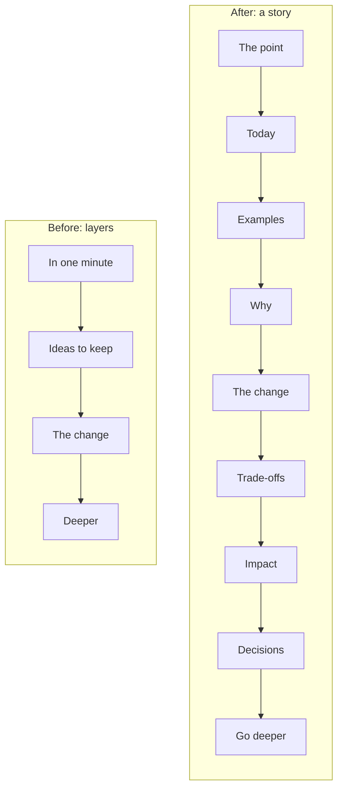
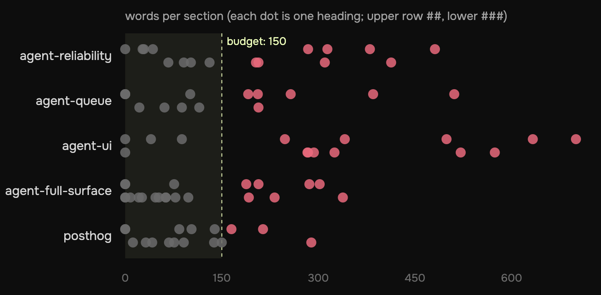
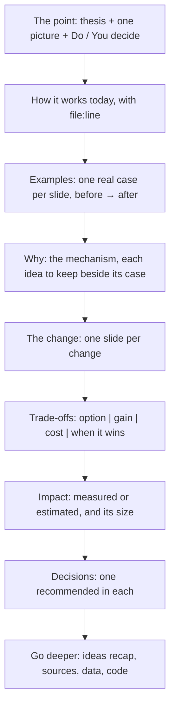
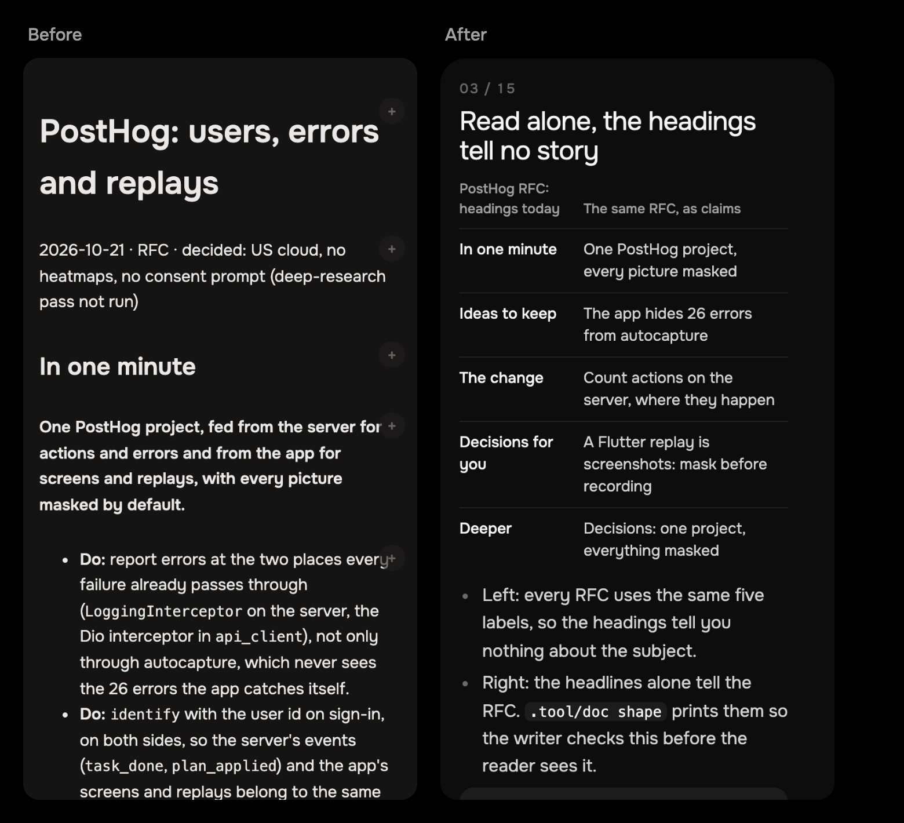
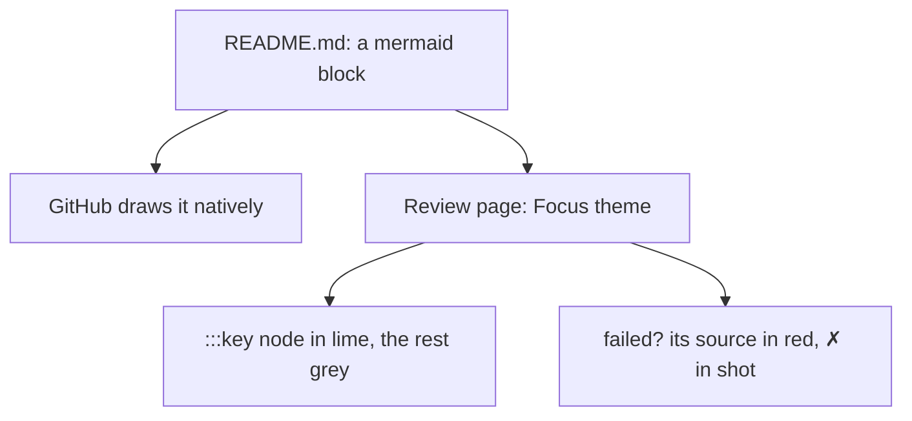

# RFCs now read like a short talk: one point per slide

2026-10-22 · /improve · issue #28, run unattended by the queue

## Each heading now makes one point over one picture

> [!IMPORTANT]
> An RFC is now a deck in Markdown: each `##` is a slide whose headline
> states a claim, over one diagram, table, picture or code excerpt. The
> page draws it in Focus's dark style.



- **Changed:** the `/research` skill (27% shorter), the review page and
  the Mac page (one shared deck style), and `.tool/doc` gains `shape` and `shot`.
- **Kept:** Markdown in the repo, line comments, the notes, the queue.
- **Not done:** the old RFCs stay as written.

## Five RFCs: no diagrams, and four sections in ten run long



- Measured with `.tool/doc shape` on each RFC, Q/A notes left out
  ([code/measure.mjs](./code/measure.mjs), [data/slides.csv](./data/slides.csv)).
- **35 of 82 sections are over 150 words**, the biggest 869 (agent-ui).
- **0 diagrams, 0 images** in any of them. 23 of 39 `##` sections have no
  table or code either.

## Read alone, the headings tell no story

| PostHog RFC: headings today | The same RFC, as claims, in order |
|---|---|
| In one minute | One PostHog project, every picture masked |
| Ideas to keep | The app hides 26 errors from autocapture |
| The change | Count actions on the server, where they happen |
| Decisions for you | A Flutter replay is screenshots: mask before recording |
| Deeper | Decisions: one project, everything masked |

- Left: every RFC uses the same five labels, so the headings tell you
  nothing about the subject.
- Right: the headlines alone tell the RFC. `.tool/doc shape` prints them
  so the writer checks this before the reader sees it.

> [!TIP]
> **"State the point in the headline, show the evidence under it."**
> [Garner & Alley 2013](https://www.ijee.ie/articles/Vol29-6/23_ijee2791ns.pdf):
> with the same narration, sentence-headline + visual slides beat
> topic + bullet slides on comprehension, and still did a week later.
> *For us:* the headline is the one line a person on a phone reads.

## The story runs in a fixed order, the evidence before the decisions



- The first slide holds the whole RFC, so you can stop there.
- *Ideas to keep* are no longer a list on their own: each idea sits on
  the slide whose case shows it, and *Go deeper* recaps them.
- References come last, one line on what each source supports.

## A slide holds one claim, one visual, and at most 150 words

| Rule | Budget | Checked by |
|---|---|---|
| The headline is a sentence | ≤ 12 words | `shape` (length); the writer (is it a claim?) |
| One visual on every `##` | Mermaid, table, image or ≤ 15 lines of code | `shape` |
| The words under it | ≤ 150, ≤ 5 bullets | `shape` |
| A dense subject | more slides, never a longer one | `shape` flags the long one |
| The whole RFC | 8–16 slides, ~1,800 words | `shape` totals |

> [!TIP]
> **"Learners do better with a lesson in learner-paced segments than as
> one continuous unit."** Mayer's segmenting principle
> ([Cambridge Handbook of Multimedia Learning](https://resolve-he.cambridge.org/core/books/cambridge-handbook-of-multimedia-learning/principles-for-reducing-extraneous-processing-in-multimedia-learning-coherence-signaling-redundancy-spatial-contiguity-and-temporal-contiguity-principles/CD5B7AE1279A9AB81F8EEBB53DBEC86E)).
> *For us:* one slide is one segment, and the reader paces it by scrolling.

## The page now looks like Focus: black, Onest, a little lime



- Tokens copied from `app_ui`: true black `#000`, slides on `#0D0D0D`,
  fills `#1C1C1C`, radii 24/14/12, Onest only, headlines in its display
  sizes (40/300, 28/400) ([app_colors.dart](../../../app/packages/app_ui/lib/src/theme/app_colors.dart)).
- Lime `#EEFFBB` only for the point (`[!IMPORTANT]`), an idea to keep
  (`[!TIP]`) and the key node of a diagram. No hairline card borders.
- Body text `#D4D4D4`, not white: off-white on black is easier to read for long.
- One stylesheet in `review.html` (`id="deck"`); `annotate.mjs` copies it.

## Diagrams are text in the Markdown, drawn in Focus's colours



- Mermaid source is a few lines, diffs well, and takes line comments.
  A PNG would take none.
- `:::key` on a node draws it lime; the rest stays grey.
- A diagram that fails to draw shows its source in red on the page, and
  `.tool/doc shot` prints ✗ for it.

## Two commands check a deck before it ships

```text
$ .tool/doc shape posthog
  #  words  visual            slide
  1    165  —                 ✗ In one minute  (>150 words, no visual)
  2    214  —                 ✗ Ideas to keep  (>150 words, no visual)
  ...
The story, headings alone:
  · In one minute · Ideas to keep · The change · Decisions for you · …

$ .tool/doc shot <slug>        # each slide → PNG at 390 px, ✗ per broken diagram
```

- `shape` reads only the file: cheap enough to run after every edit.
- `shot` serves the repo, opens `review.html?md=<file>` in headless Chrome
  ([shot.mjs](../../../.tool/shot.mjs), DevTools protocol, no dependencies)
  and saves one PNG per slide, so the agent sees what you will see.

## What changed, file by file

| Area | Before | After |
|---|---|---|
| `/research` skill | 251 lines, 2,151 words; layers (minute → change → deeper) | 178 lines, 1,569 words; the story order, the slide rules, material first |
| `review.html` | system light/dark, Lunna reds, a flat run of blocks | Focus dark, slides numbered, Mermaid, alerts, `?md=` local preview |
| `annotate.mjs` | its own copy of the old style | the deck style and script from `review.html` |
| `.tool/doc` | `ls`, `open`, `notes` | + `shape`, + `shot` (with `.tool/shot.mjs`) |
| References | `create` skill, `concepts.md`, `AGENTS.md`, `.tool/README.md` | name the new headings and tools |

## Trade-offs: what the deck costs

| Choice | Gain | Cost | Why this way |
|---|---|---|---|
| Sentence headlines | the story is skimmable | harder to write | `shape` prints them to check |
| A visual per slide | the 80% goes into material | more agent time per RFC | asked for: "invest in … diagrams" |
| Mermaid over images | text, diffable, commentable | GitHub draws it in its own theme | the review page is where you read |
| A fixed story order | every RFC reads the same way | a small topic may feel padded | few slides is fine; the order stays |
| CDN fonts and Mermaid | no build step for a static page | needs network on first load | the page already loads marked from a CDN |

## Verified

| Check | Result |
|---|---|
| `.tool/doc shape` on all 5 RFCs | ✓ runs; 82 sections → [data/slides.csv](./data/slides.csv) |
| `.tool/doc shape` on this report | ✓ every slide within budget ([data/shape-after.txt](./data/shape-after.txt)) |
| `.tool/doc shot` on this report | ✓ 15 slides drawn, all three diagrams, no errors; two diagrams redrawn after the prints showed them too tall or too small |
| `annotate.mjs` with the shared deck | ✓ PostHog RFC drawn as 7 slides, no console errors |
| Review page in PR mode (GitHub API), PR #22 | ✓ 7 slides, Q/A notes coloured, no console errors |
| Review page commenting logic on PR #7 | ✓ 13 of 13 ([review-page.mjs](../2026-10-21-github-review-and-rfc-shape/code/review-page.mjs)) |
| Bugs found on the way | Chrome still writing its profile when it was deleted (now waits for exit); the ready check ran before `<body>` existed; `--slides 1,2` read as a doc name |
| Not verified | the live Pages page on an iPhone (it deploys on this branch's push); GitHub's own rendering of `:::key` |

## Decided unattended

1. **Onest stays the only face.** Focus *is* Onest, and the faces tried
   before on Lunna's pages (Bodoni Moda, IBM Plex Mono) were turned down
   as too thin or "vibecoded". What changed is how it is used: the app's
   display sizes and weights for headlines, an off-white for body text.
   Code uses the system mono (SF Mono on Apple), with nothing downloaded.
2. **The page is always dark.** I dropped the light theme, as you asked
   to keep it dark.
3. **Mermaid for diagrams.** Charts are PNGs made by a script in `code/`.
4. **Ideas to keep move into the slides** (`[!TIP]`), recapped in
   *Go deeper*. `concepts.md` stays the ledger.
5. **Old RFCs are not rewritten.** They still render, as slides, on the new page.
6. **`shape` warns and never fails**, so a slide that must run long can.

## Not done

| Proposal | Why not now |
|---|---|
| Re-cut one merged RFC into the new format | old RFCs are records; the next `/research` run is the real test |
| `shape` in CI or in the queue's gate | first see whether its budgets fit real RFCs |
| A semantic check that the headline is a claim | needs a model; the printed headlines are enough for now |
| Self-hosting Onest and Mermaid on Pages | the CDN works; revisit if the page is slow on mobile data |

## The request, verbatim

> Improve the RFCs format
>
> RFCs have improved in terms of size, but I still not happy with the format of presentation.
>
> I have some directions where I want to improve it.
>
> 1. Sticking to the MD model is a good approach for the future, and we should keep it.
> 2. The style of html could be a bit better. Research other fonts and styles that make less vibe coded and nearest to the visual style of focus. I personally like the black background so we should keep it dark.
> 3. Favor the separation of subjects per heading, emulating a presentation. In fact, each header should be really simple and succint, preferably with always some set of bullet points and a diagram or a table.
> 4. There is no problem on using more sections to explain a dense subject. The bad thing is to put too many information in a single section
> 5. When I said about progressive disclosure, going simpler and deeper, I don't think we are doing it in a good way, precisely because the information is dispersed. We should have a more "presentation" "story telling" style to this. That means, presenting the main point that you discovered, it could give a few sections of example, and justifying the trade-offs, etc. The last sections should be about decisions and the final part is about references that the user can go deeper.
> 6. Use the skill to actually do the dirty work of researching internally, externally, having evidences for decision and computing suggestions and impact of the work. We should not be superficial here. But the final artifact must be succint and to the point, in a way that I can comfortably read and have at least one valuable insight that I learned. So the effort must be directed into producing diagrams, images, tables, pieces of code, references to the code that actually explains something to a technical person that is not able to spend much of the time going deeper on the subject and piecing the things by themselves.
> 7. So at the end is almost an explainable artifact, almost a lesson, an exposition, where 80% of your work is preparing the material so just 20% of my effort goes to understand all the brilliance of your exposition
> 8. Final point: even with all those comments, if you need to simplify the prose of the skill and focus on less token consumpiton, just do it. I don't want more text. I want you to invest in more explanation, more nice artifacts like images, diagrams and tables, you can certainly spend more time on refining this part.

## Go deeper

| Idea to keep | The case here | Read |
|---|---|---|
| State the point in the headline, show the evidence under it | PostHog's headings, re-cut as claims | [Garner & Alley 2013](https://www.ijee.ie/articles/Vol29-6/23_ijee2791ns.pdf) · [WashU summary](https://ctl.wustl.edu/in-powerpoint-its-the-headline-that-makes-the-difference/) |
| Segment the lesson; let the reader pace it | 35 of 82 sections over 150 words | [Mayer, Cambridge Handbook](https://resolve-he.cambridge.org/core/books/cambridge-handbook-of-multimedia-learning/principles-for-reducing-extraneous-processing-in-multimedia-learning-coherence-signaling-redundancy-spatial-contiguity-and-temporal-contiguity-principles/CD5B7AE1279A9AB81F8EEBB53DBEC86E) |
| Answer first, then support it | the point is slide 1, decisions last | [Minto's pyramid, SCQA](https://www.hackingthecaseinterview.com/pages/scqa-framework) |

- [GitHub: diagrams with Mermaid](https://github.blog/developer-skills/github/include-diagrams-markdown-files-mermaid/):
  drawn natively in Markdown files, PRs and issues.
- [GitHub: alerts](https://docs.github.com/en/get-started/writing-on-github/getting-started-with-writing-and-formatting-on-github/basic-writing-and-formatting-syntax#alerts):
  `> [!TIP]` syntax; "one or two per article", never back to back.
- [Redesigning for dark mode](https://stuffandnonsense.co.uk/blog/redesigning-your-product-and-website-for-dark-mode/):
  white on black tires the eye over long text; use an off-white.
- Files: [research skill](../../../.claude/skills/research/SKILL.md) ·
  [review.html](../../../.tool/review.html) · [annotate.mjs](../../../.tool/annotate.mjs) ·
  [doc.mjs](../../../.tool/doc.mjs) · [shot.mjs](../../../.tool/shot.mjs) ·
  [.tool/README.md](../../../.tool/README.md)
- Data: [summary](./data/summary.md) · [before, per RFC](./data/shape-before.txt) ·
  code: [measure.mjs](./code/measure.mjs), [before.mjs](./code/before.mjs), [compare.mjs](./code/compare.mjs)
- Earlier: [the layered RFC shape](../2026-10-21-github-review-and-rfc-shape/README.md),
  which this replaces. Cost and time: measured by the queue, in the PR.
