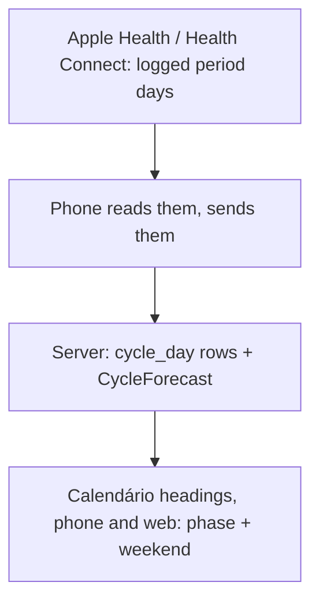
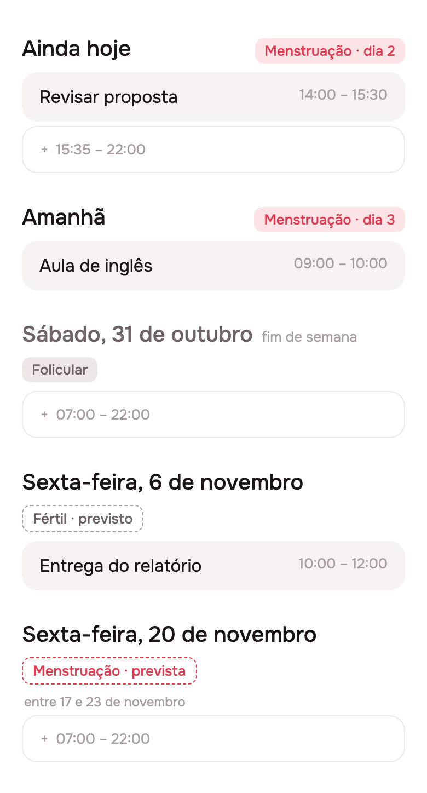
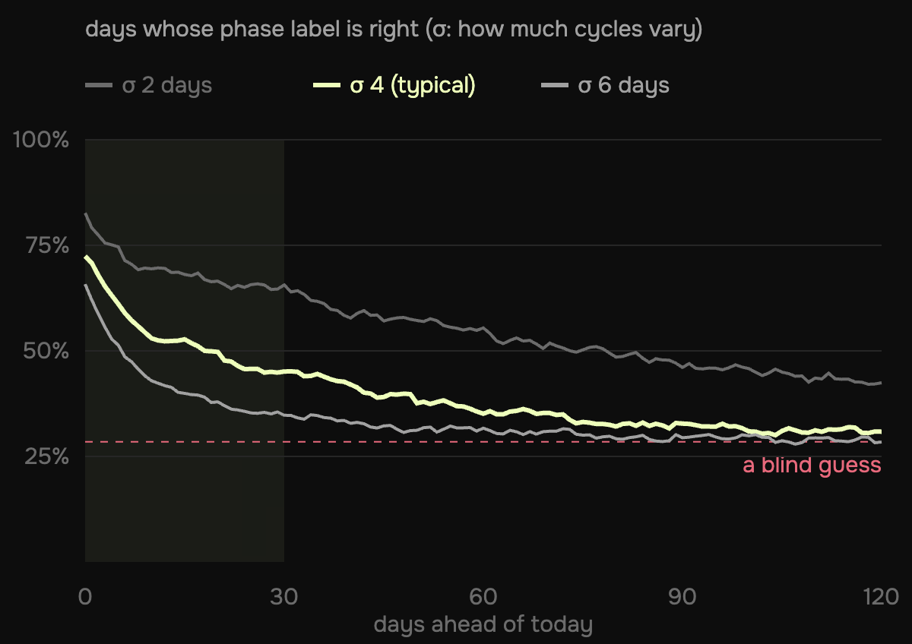
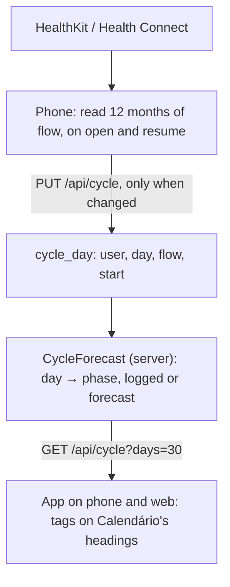

# The cycle can sit on Calendário's day headings, 30 days ahead

2026-10-23 · RFC · revised after review on issue #32 · phone reads Health, server keeps and forecasts, every brand and the web draw it

## Read periods from Health, forecast on the server, tag each day

> [!IMPORTANT]
> HealthKit hands an app the days someone logged, never Apple's forecast.
> So the phone reads the logged periods and sends them to the server,
> which works out all four phases for the next 30 days; Calendário's day
> headings show them on the phone and on the web, and mark weekends.
> **Flo on iPhone reads from Health but does not write periods to it**,
> so the periods must be logged in Health.



- **Do:** read `menstrualFlow`, store the logged days, forecast on the server, tag 30 days of headings, mark weekends.
- **Not needed:** Apple's predictions (no app can read them), the agent seeing the cycle.
- **You decide:** whether the three phases besides the period get colours of their own.

## Today a day heading is one line of text

[`timeline_list.dart:1949`](../../../app/packages/timeline/lib/src/view/timeline_list.dart#L1949)

```dart
String _label(_Heading heading, DateTime now) {
  final l10n = context.l10n;
  if (heading == null) return l10n.sectionNow;
  final today = DateTime(now.year, now.month, now.day);
  final days = heading.difference(today).inDays;
  if (days <= 0) return l10n.sectionToday;
  if (days == 1) return l10n.sectionTomorrow;
  final date = l10n.sectionDay(heading); // "EEEE, d 'de' MMMM"
  ...
```

- `_HeadingRow` (`:2433`) draws it as one `Text` in `AppTypography.title`.
  The pinned heading (`_PinnedHeading`, `:2249`) reuses the same label.
- A heading is drawn when the day's first card or free stretch comes up
  (`:1665`), so every day in Calendário has one, up to 120 days
  (`TimelineState.maxDays`). **Lista has no day headings**, so it gets no tags.
- No health code anywhere: no plugin, no entitlements, no `Info.plist` key.
  Weekends look like every other day.

## Flo on iPhone reads from Health but does not write periods

| App | Writes periods to Apple Health? | Source |
|---|---|---|
| Apple Health's Cycle Tracking | yes, it *is* the store | Apple IFU 4.0 |
| Clue | yes, periods and flow, only those logged after you allow it | Clue help (snippet) |
| Flo, iPhone | **no** since early 2024: it imports from Health, "logged Menstruation data in Flo will not be sent to the Health app" | Flo help, updated 2025-02-20; Flo support, 2024 |
| Flo, Android | yes, to Health Connect (a vendor says so) | Sahha integration page |

> **Q:** https://help.flo.health/hc/en-us/articles/34890229122068-How-to-import-data-from-the-Health-app-to-Flo-iOS this link says otherwise
>
> **A:** That page is the one quoted here, and its title is the other
> direction: *import from the Health app to Flo*. Turning sync on lets Flo
> read what is in Health, and the same page says "Data points with access
> permission will not be transferred from Flo to the Health app. For
> example, logged Menstruation data in Flo will not be sent to the Health
> app." Flo used to write; in March 2024 its support told users on Apple's
> forum that "the feature to sync your Flo data with Apple Health is no
> longer available" ([thread](https://discussions.apple.com/thread/255504055)).
> The rule: log periods in Health and Flo still shows them, since it reads
> from there; log them only in Flo and no other app sees them.

- HealthKit won't say why a read comes back empty: an app "cannot determine whether or not
  a user has granted permission to read data"; a refusal "simply appears
  as if there is no data" (Apple docs). So the empty state names both causes.
- Cheapest check: Health → Browse → Cycle Tracking → Data Sources.
- The quotes are in [data/sources.md](./data/sources.md).

## HealthKit gives the logged days, never Apple's forecast

| HealthKit type | What it holds | We use it |
|---|---|---|
| `menstrualFlow` | each bleeding day; `HKMetadataKeyMenstrualCycleStart` marks day 1 | **yes** |
| `ovulationTestResult` | home LH tests | later, to pin ovulation |
| `basalBodyTemperature`, wrist temperature | the rise after ovulation | no |
| `pregnancy`, `contraceptive`, `lactation` | cycle factors that stop predictions | yes, to stay quiet |
| prediction / fertile window | **no such type** | — |

- 14 cycle types in Apple's list, none a prediction
  ([code/healthkit-types.sh](./code/healthkit-types.sh) → [data](./data/healthkit-cycle-types.txt)).
- The Flutter `health` plugin (13.3.2) reads `MENSTRUATION_FLOW` on iOS
  and Android, with `flow` and `isStartOfCycle`.

> [!TIP]
> **"The platform shares the records, not its conclusions."** Apple
> forecasts from flow plus heart rate and wrist temperature, within ±3
> days in its own trial ([Cycle Tracking IFU](https://www.apple.com/legal/ifu/cycle-tracking/4-0/ct-ifu-4-0-en_GB.pdf)),
> but exposes only the samples. *For us:* we sync the records and forecast
> from them ourselves, more crudely than the Health app does.

## One logged period becomes a month of tagged days



- A sketch in Lunna's tokens ([code/sketch.mjs](./code/sketch.mjs)), not
  the app. Today, 23 Oct, is day 2; the median cycle is 29 days.
- Next period 20 Nov, ovulation 13 days before (7 Nov), fertile 2–7 Nov,
  all inside the 30 days drawn (to 21 Nov).
- **Logged** days are filled; **forecast** ones are outlined, and a
  forecast period carries its ±3-day range.
- Every day has a phase tag; only the period is red.

## Count ovulation back from the next period, not forward

| Phase | Days, from Bull 2019 | How the forecast finds it |
|---|---|---|
| Menstrual | the logged flow; 5 when forecast | logged samples, else 5 days from the start |
| Follicular | mean 16.9, 95% from 10 to 30 | what is left before the fertile window |
| Fertile | ovulation and the 5 days before it | ovulation − 5 … ovulation |
| Luteal | mean 12.4, 95% from 7 to 17 | from ovulation to the next start |

- 612,613 cycles, 124,648 people: the half after ovulation varies little;
  the half before it carries most of the spread. Only 13% of cycles
  were 28 days.
- So ovulation = next start − 13, Apple's own rule, and the next start =
  last start + the median of the last six cycles.

> [!TIP]
> **"The luteal phase is the steady half."** Mean 12.4 days (7–17) against
> a follicular 16.9 (10–30), in [Bull et al. 2019](https://pmc.ncbi.nlm.nih.gov/articles/PMC6710244/).
> *For us:* anchor every phase on the predicted next start and count back.
> Counting forward 14 days from the period is the textbook error.

## Past 30 days, a forecast tag is barely better than a guess



| σ, cycle spread | days 0–30 | days 31–60 | days 61–120 | period days right, days 0–30 |
|---|---|---|---|---|
| 2 days | 69% | 58% | 47% | 68% |
| 4 days, typical | 53% | 40% | 33% | 47% |
| 6 days | 43% | 32% | 30% | 37% |

- A simulation built from published figures ([code/forecast.mjs](./code/forecast.mjs),
  [data](./data/forecast-summary.json)). Within-person spread is 4–6 days
  in most groups of the Apple Women's Health Study. A blind guess scores 28%, or 17% for a period day.
- So the 30 days you chose are where the forecast is worth drawing; the
  shaded band in the chart is them.

> [!TIP]
> **"A forecast's error grows with every cycle it skips."** Each cycle's
> length adds its own few days of error. *For us:* draw 30 days, and
> nothing past them.

## Tag the phase; leave the planning to the person

| Claim heard about "cycle syncing" | What the evidence says |
|---|---|
| plan hard work around the phase | exercise performance "might be trivially reduced" in the early follicular phase only |
| everyone has the same pattern | evidence quality low; the authors recommend "a personalised approach" |

- McNulty et al. 2020 (meta-analysis, *Sports Medicine*) found nothing
  strong enough for general rules.
- So the tag is information, not advice: no hour moves because of a phase,
  and no copy says what to do on a given day.
- What would help is the person's own pattern, which notes or a later
  agent could learn. That is out of scope.

## The phone reads Health; the server keeps and forecasts



- The phone sends the **logged days only**, the whole 12 months each time
  (a few dozen rows); the server replaces that person's rows. One forecast,
  in TypeScript, so phone and web never disagree.
- Web has no Health, so it draws whatever the phone last sent. A person
  who never syncs, or stops, sees no tags, or old ones.
- The rows belong to the user, not the brand, so Focus and Lunna show the same cycle.

> **Q:** So, precisely for this reason, webs need to know. If we sync from
> the phone once, all the data (for the next 30 days only as you said), it
> will need to show on the browser as well, so some server sync will need
> to be done. Of course this data is only available if the user ever syncs
> and keep it in sync on the phone.
>
> **A:** Agreed, and this slide is now that design. A period logged Monday
> on the iPhone reaches the server the next time Lunna opens there, and the
> browser draws it on its next read. The phone sends the logged days, not
> 30 days of tags, so the server can forecast the moving window every day
> without the phone; "Ciclo" in Menu says when the phone last sent.

## Syncing adds a route, a table and three rules

| Piece | What it is |
|---|---|
| `cycle_day` | `user_id`, `day` (`YYYY-MM-DD`, the person's zone), `flow`, `start`; unique on (`user_id`, `day`) |
| `PUT /api/cycle { days, syncedAt }` | replaces the person's rows; the phone sends it only when its hash of the days changed |
| `GET /api/cycle?days=30` | `{ days: [{ day, phase, forecast, range? }], syncedAt }` |
| `DELETE /api/cycle` | switching "Ciclo" off erases the rows |

- **Analytics:** `PUT /api/cycle` gets a row in `events.ts` (`cycle_synced`)
  carrying nothing but its name, as every write does. Replays mask every text.
- **The agent never reads it**: no tool, nothing on the board.
- **Review:** guideline 5.1.3 allows a server with disclosure (no iCloud,
  no ads, no data mining), so the privacy policy and the "Ciclo" screen say
  the days are stored to show them on the web, and erased when switched off.

## A heading gains a phase tag and a weekend mark, in tokens

| Piece | How it is drawn | Where it lives |
|---|---|---|
| period day, logged | filled tag, `cycleFill` / `cycleInk` | new `AppColors` tokens: Lunna's red, Focus's own |
| forecast day | outlined tag, a period also gets "entre 17 e 23 de novembro" | `AppTag` gains an outline style |
| the other three phases | neutral tag: "Folicular", "Fértil", "Lútea" | `app_pt.arb` |
| weekend | title in `ink2`, "fim de semana" after it | any brand, every platform, no Health needed |

- All four phases on every one of the 30 days; one colour, the period's,
  so the calendar stays sober. [`AppDay`](../../../app/packages/app_ui/lib/src/theme/app_day.dart) stays the app's one decorative colour.
- The weekend mark needs nothing but the date, so it ships first.

## Server privacy against web and one forecast

| Option | Gain | Cost | When it wins |
|---|---|---|---|
| On the phone only | no health data on the server | no web, no second phone, two forecasts to keep equal | if nobody uses the web |
| **Synced to Postgres** | web and every phone show it; one forecast | a health table, consent, a privacy policy line, 5.1.3 review | **now: you use the web** |
| Typed into Lunna | works for Flo-only data | a period tracker inside a planner | if Health stays empty |
| Apple's forecast | best accuracy | not readable by any app | never |

- The rows are a few dozen dates per person; erasing them is one `DELETE`.
- Health data in our Postgres is what a breach would now expose. Neon
  encrypts at rest; nothing more is planned.

## Medium to build: a table, a route, a package, a tag

| Piece | Size | Risk |
|---|---|---|
| weekend mark | S | none |
| `CycleForecast` (server) + tests on fixed dates | S | phases wrong at the edges: cover in tests |
| `cycle_day`, the three routes, the analytics row | S | none new |
| `cycle` package: plugin, permissions, four flavors, sync | M | App Review for HealthKit, Android minSdk 26 |
| heading tags, tokens, strings, "Ciclo" screen, empty state | S | crowded headings on 390 px: the sketch fits |

- For the person: each of the next 30 days says where it falls in the
  cycle, on the phone and in the browser; weekends are marked.
- Measured quality: about 53% of days tagged right over those 30 days for
  a typical spread, 69% for a regular one. Logged days are always right.

## Decisions

| Decision | Options | Recommended | Cost of the other |
|---|---|---|---|
| where the cycle lives | phone only · Postgres | **Postgres** (decided) | phone only: no web |
| how far ahead | 30 days · next cycle + range · 120 days | **30 days** (decided) | past 30 days, tags wrong 3 times in 5 |
| which phases | period only · all four | **all four** (decided) | period only hides the fertile window |
| colour of the other phases | neutral · a token each | **neutral** *(recommended)* | three more colours on a sober calendar |
| weekends | mark them · not | **mark** (decided), shipped first | none |
| Flo-only data | log in Health · typed entry | **Health**; typed entry later if needed | a tracker inside a planner |

> **Decision (2026-10-23):** where the cycle lives: server too.
>
> **Decision (2026-10-23):** how far ahead: next 30 days.
>
> **Decision (2026-10-23):** which phases: all phases.
>
> **Decision (2026-10-23):** weekends: mark weekends too.

## Decided unattended

- **The forecast is ours, simple and explained:** median of six cycles,
  13-day luteal, ±3-day range. No heart rate, no temperature.
- **The phone sends logged days, the server forecasts.** Sending tags
  would freeze the web's window on the day of the last sync.
- **The agent doesn't see the cycle**, though it is on the server; that is
  its own decision, later.
- **Both brands, Calendário only.** Lista keeps its run with no day headings.
- **Off until switched on in Menu**; switching it off erases the server's rows.
- **"All phases" read as all four tagged, the period alone coloured.**
  Colouring the rest is the open question.
- **Phase 4 not run:** not asked for. Flo's iOS behaviour, the claim
  questioned, was checked again by hand (its help page and Flo support
  on Apple's forum); Clue's and Flo on Health Connect still rest on a
  snippet and a vendor page.

## Go deeper

| Idea | The case here | Read |
|---|---|---|
| The platform shares the records, not its conclusions | HealthKit has no prediction type; we sync the records and forecast | [HKCategoryTypeIdentifier](https://developer.apple.com/documentation/healthkit/hkcategorytypeidentifier) |
| The luteal phase is the steady half | ovulation = next start − 13 | [Bull et al. 2019](https://pmc.ncbi.nlm.nih.gov/articles/PMC6710244/) |
| A forecast's error grows with every cycle it skips | 53% of days right in the 30 days drawn, 33% in days 61–120 | [code/forecast.mjs](./code/forecast.mjs) |

Added to [concepts.md](../concepts.md) under *Data and forecasts*.

- [Apple, Cycle Tracking IFU 4.0](https://www.apple.com/legal/ifu/cycle-tracking/4-0/ct-ifu-4-0-en_GB.pdf): inputs, ±3 days, two periods before predictions, third-party data accepted.
- [Apple, authorizationStatus(for:)](https://developer.apple.com/documentation/healthkit/hkhealthstore/authorizationstatus(for:)): read refusals look like no data.
- [Flo, import from Health (iOS)](https://help.flo.health/hc/en-us/articles/34890229122068): Flo reads from Health; menstruation not sent to Health.
- [Apple Community, Flo stopped writing to Health](https://discussions.apple.com/thread/255504055): Flo support, March 2024, "no longer available".
- [Clue, Apple Health](https://support.helloclue.com/hc/en-us/articles/20199556038813): periods and flow written, new ones only.
- [Li, Gibson & Jukic 2023](https://pmc.ncbi.nlm.nih.gov/articles/PMC10226714/): mean 28.7 days, within-person variability 4–6 days.
- [McNulty et al. 2020](https://rgu-repository.worktribe.com/output/940959): phase effects on performance trivial, evidence low.
- [App Store Review Guidelines 5.1.3](https://developer.apple.com/app-store/review/guidelines/#health-and-health-research): no iCloud, no ads, disclose.
- [health plugin](https://pub.dev/packages/health): `MENSTRUATION_FLOW` on both platforms.
- Data: [sources.md](./data/sources.md) (the quotes), [forecast-accuracy.csv](./data/forecast-accuracy.csv), [healthkit-cycle-types.txt](./data/healthkit-cycle-types.txt).
