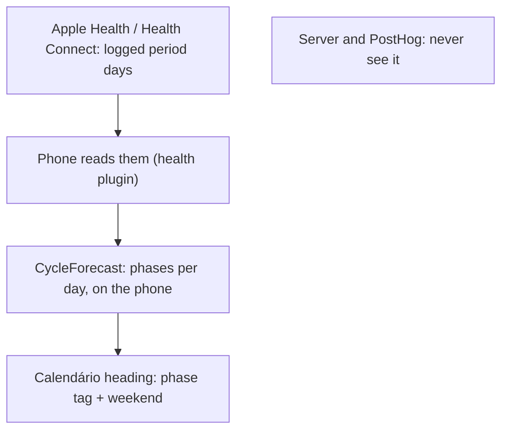
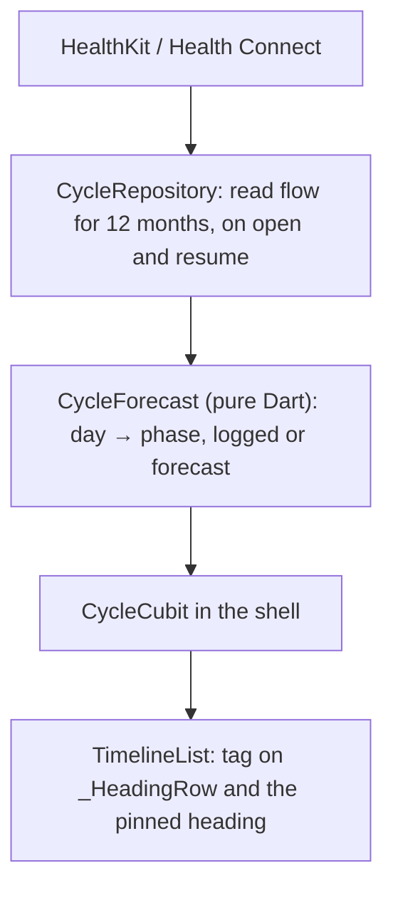

# The cycle can sit on Calendário's day headings, one cycle ahead

2026-10-23 · RFC · draft, run unattended by the queue (issue #32) · app only: HealthKit / Health Connect, a forecast, the day headings

## Read periods from Health, forecast on the phone, tag each day

> [!IMPORTANT]
> HealthKit hands an app the days someone logged, never Apple's forecast.
> So the phone reads the logged periods, works out the phases itself, and
> Calendário's day headings show them. The forecast is only worth showing
> one cycle ahead. **Flo on iPhone does not write periods to Health**, so
> check where your periods are logged first.



- **Do:** read `menstrualFlow`, forecast in Dart, tag Calendário's headings, mark weekends.
- **Not needed:** a server table, a new route, Apple's predictions (we can't read them).
- **You decide:** keep it on the phone or sync it (on the phone is recommended), how far ahead to draw, and where your periods are logged.

## Today a day heading is one line of text

[`timeline_list.dart:1949`](../../../app/packages/timeline/lib/src/view/timeline_list.dart#L1949)

```dart
String _label(_Heading heading, DateTime now) {
  final l10n = context.l10n;
  if (heading == null) return l10n.sectionNow;
  final today = DateTime(now.year, now.month, now.day);
  final days = heading.difference(today).inDays;
  if (days <= 0) return l10n.sectionToday;
  if (days == 1) return l10n.sectionTomorrow;
  final date = l10n.sectionDay(heading); // "EEEE, d 'de' MMMM"
  ...
```

- `_HeadingRow` (`:2433`) draws it as one `Text` in `AppTypography.title`.
  The pinned heading (`_PinnedHeading`, `:2249`) reuses the same label.
- A heading is drawn when the day's first card or free stretch comes up
  (`:1665`), so every day in Calendário has one, up to 120 days
  (`TimelineState.maxDays`). **Lista has no day headings**, so it gets no tags.
- No health code anywhere: no plugin, no entitlements, no `Info.plist` key.
  Weekends look like every other day.

## Flo on iPhone reads from Health but does not write periods

| App | Writes periods to Apple Health? | Source |
|---|---|---|
| Apple Health's Cycle Tracking | yes, it *is* the store | Apple IFU 4.0 |
| Clue | yes, periods and flow, only those logged after you allow it | Clue help (snippet) |
| Flo, iPhone | **no**: "logged Menstruation data in Flo will not be sent to the Health app" | Flo help, updated 2025-02-20 |
| Flo, Android | yes, to Health Connect (a vendor says so) | Sahha integration page |

- The issue assumes Flo exports to Apple Health. On iPhone it reads from
  it. If your periods live only in Flo, Lunna will see nothing.
- HealthKit won't say why either: an app "cannot determine whether or not
  a user has granted permission to read data"; a refusal "simply appears
  as if there is no data" (Apple docs). So the empty state has to name
  both causes.
- Cheapest check: Health → Browse → Cycle Tracking → Data Sources.
- The quotes are in [data/sources.md](./data/sources.md). Flo's behaviour is
  the first claim for the deep-research pass.

## HealthKit gives the logged days, never Apple's forecast

| HealthKit type | What it holds | We use it |
|---|---|---|
| `menstrualFlow` | each bleeding day; `HKMetadataKeyMenstrualCycleStart` marks day 1 | **yes** |
| `ovulationTestResult` | home LH tests | later, to pin ovulation |
| `basalBodyTemperature`, wrist temperature | the rise after ovulation | no |
| `pregnancy`, `contraceptive`, `lactation` | cycle factors that stop predictions | yes, to stay quiet |
| prediction / fertile window | **no such type** | — |

- 14 cycle types in Apple's list, none a prediction
  ([code/healthkit-types.sh](./code/healthkit-types.sh) → [data](./data/healthkit-cycle-types.txt)).
- The Flutter `health` plugin (13.3.2) reads `MENSTRUATION_FLOW` on iOS
  and Android, with `flow` and `isStartOfCycle`.

> [!TIP]
> **"The platform shares the records, not its conclusions."** Apple
> forecasts from flow plus heart rate and wrist temperature, within ±3
> days in its own trial ([Cycle Tracking IFU](https://www.apple.com/legal/ifu/cycle-tracking/4-0/ct-ifu-4-0-en_GB.pdf)),
> but exposes only the samples. *For us:* we forecast ourselves, from
> the logged starts, and our forecast will be cruder than the Health app's.

## One logged period becomes a month of tagged days


- A sketch in Lunna's tokens ([code/sketch.mjs](./code/sketch.mjs)), not
  the app. Today, 23 Oct, is day 2; the median cycle is 29 days.
- Next period 20 Nov, ovulation 13 days before (7 Nov), fertile 2–7 Nov.
- **Logged** days are filled; **forecast** ones are outlined, and the
  period carries its ±3-day range.
- Only the period is red. Everything else is a neutral tag.

## Count ovulation back from the next period, not forward

| Phase | Days, from Bull 2019 | How the forecast finds it |
|---|---|---|
| Menstrual | the logged flow; 5 when forecast | logged samples, else 5 days from the start |
| Follicular | mean 16.9, 95% from 10 to 30 | what is left before the fertile window |
| Fertile | ovulation and the 5 days before it | ovulation − 5 … ovulation |
| Luteal | mean 12.4, 95% from 7 to 17 | from ovulation to the next start |

- 612,613 cycles, 124,648 people: the half after ovulation varies little;
  the half before it carries most of the spread. Only 13% of cycles
  were 28 days.
- So ovulation = next start − 13, Apple's own rule, and the next start =
  last start + the median of the last six cycles.

> [!TIP]
> **"The luteal phase is the steady half."** Mean 12.4 days (7–17) against
> a follicular 16.9 (10–30), in [Bull et al. 2019](https://pmc.ncbi.nlm.nih.gov/articles/PMC6710244/).
> *For us:* anchor every phase on the predicted next start and count back.
> Counting forward 14 days from the period is the textbook error.

## Past one cycle, a forecast tag is barely better than a guess


| σ, cycle spread | 1st month | 2nd month | months 3–4 | period days right, 1st month |
|---|---|---|---|---|
| 2 days | 69% | 58% | 47% | 68% |
| 4 days, typical | 53% | 40% | 33% | 47% |
| 6 days | 43% | 32% | 30% | 37% |

- A simulation built from published figures ([code/forecast.mjs](./code/forecast.mjs),
  [data](./data/forecast-summary.json)). Within-person spread is 4–6 days
  in most groups of the Apple Women's Health Study. A blind guess scores 28%, or 17% for a period day; a forecast period day after the first month is right 23% of the time (σ 4).

> [!TIP]
> **"A forecast's error grows with every cycle it skips."** Each cycle's
> length adds its own few days of error. *For us:* draw the next cycle
> day by day, the period after it only as a range, and nothing past that.

## Tag the phase; leave the planning to the person

| Claim heard about "cycle syncing" | What the evidence says |
|---|---|
| plan hard work around the phase | exercise performance "might be trivially reduced" in the early follicular phase only |
| everyone has the same pattern | evidence quality low; the authors recommend "a personalised approach" |

- McNulty et al. 2020 (meta-analysis, *Sports Medicine*) found nothing
  strong enough for general rules.
- So the tag is information, not advice: no hour moves because of a phase,
  and no copy says what to do on a given day.
- What would help is the person's own pattern, which notes or a later
  agent could learn. That is out of scope.

## The phone reads Health and forecasts; the server never knows



- New package `app/packages/cycle`: `health` plugin, a pure `CycleForecast`
  tested on fixed dates (no device zone, no `DateTime.now()`), a cubit.
- iOS: HealthKit capability and `NSHealthShareUsageDescription` in four
  flavors, read only. Android: Health Connect, menstruation read permission, minSdk 26.
- Web: no Health, so no tags. The landing demo can show a fake cycle.
- A day is the server's `day` (the person's zone), matched by date.
- Off by default: Menu → "Ciclo" asks for access and explains an empty result.

## A heading gains a phase tag and a weekend mark, in tokens

| Piece | How it is drawn | Where it lives |
|---|---|---|
| period day, logged | filled tag, `cycleFill` / `cycleInk` | new `AppColors` tokens: Lunna's red, Focus's own |
| forecast day | outlined tag, period also gets "entre 17 e 23 de novembro" | `AppTag` gains an outline style |
| other phases | neutral tag: "Folicular", "Fértil", "Lútea" | `app_pt.arb` |
| weekend | title in `ink2`, "fim de semana" after it | any brand, no Health needed |

- One colour only, the period's, so the calendar stays sober.
  [`AppDay`](../../../app/packages/app_ui/lib/src/theme/app_day.dart) stays the app's one decorative colour.
- The weekend mark needs nothing but the date, so it ships first and alone if Health slips.
- Focus and Lunna get the same feature; only the tokens differ.

## Staying on the phone buys privacy and costs the agent

| Option | Gain | Cost | When it wins |
|---|---|---|---|
| **On the phone only** | no health data on the server, no breach or subpoena to fear; small | no agent, no web, no second phone | now |
| Synced to Postgres | the agent can plan around it; web shows it | a health table, consent, a privacy policy, 5.1.3 review | when the agent should use it |
| Typed into Lunna | works for Flo-only and on the web | a period tracker inside a planner | if Health is empty for you |
| Apple's forecast | best accuracy | not readable by any app | never |

- Guideline 5.1.3 forbids HealthKit data in iCloud, and in ads or data
  mining. A server is allowed, with disclosure.
- The analytics rule already says nothing a person wrote is ever sent.
  Replays mask every text, so the tag never shows up in one.

## Small to build: one package, one tag, two native capabilities

| Piece | Size | Risk |
|---|---|---|
| weekend mark | S | none |
| `CycleForecast` + tests | S | phases wrong at the edges: cover in tests |
| `cycle` package, plugin, permissions, four flavors | M | App Review for HealthKit, Android minSdk 26 |
| heading tags, tokens, strings, empty state | S | crowded headings on 390 px: the sketch fits |

- What changes for the person: every day for about the next 4–5 weeks
  says where it falls in the cycle; the period after that shows as a range.
- Measured quality: about 53% of days tagged right over the first month
  for a typical spread, 69% for a regular one (the table two slides up).
  Logged days are always right.
- Server, agent, analytics: untouched.

## Decisions

| Decision | Options | Recommended | Cost of the other |
|---|---|---|---|
| where the cycle lives | phone only · Postgres | **phone only** | a health table, consent and review, for an agent use nobody has asked for |
| how far ahead | next cycle + one range · all 120 days | **next cycle + range** | after one cycle, tags that are wrong 2 times in 3 |
| which phases | period only · four phases | **four**, only the period coloured | period only hides the fertile window people ask for |
| weekends | mark them · not | **mark**, shipped first | none: it's text |
| Flo-only data | ask you to log in Health · typed entry | **Health**; typed entry later if needed | a tracker inside a planner |

## Decided unattended

- **The forecast is ours, simple and explained:** median of six cycles,
  13-day luteal, ±3-day range. No heart rate, no temperature.
- **Both brands, Calendário only.** Lista keeps its run with no day
  headings; adding headings there to hang tags on is another change.
- **Off until switched on in Menu**, so nobody gets a HealthKit prompt
  they didn't ask for.
- **Phase 4 not run:** Flo's iOS behaviour, Clue's, Flo on Health
  Connect and the AWHS variability metric rest on help pages, snippets
  and one summary. The deep-research pass checks them.

## Go deeper

| Idea | The case here | Read |
|---|---|---|
| The platform shares the records, not its conclusions | HealthKit has no prediction type; we forecast | [HKCategoryTypeIdentifier](https://developer.apple.com/documentation/healthkit/hkcategorytypeidentifier) |
| The luteal phase is the steady half | ovulation = next start − 13 | [Bull et al. 2019](https://pmc.ncbi.nlm.nih.gov/articles/PMC6710244/) |
| A forecast's error grows with every cycle it skips | 53% → 33% of days right, 1st month → months 3–4 | [code/forecast.mjs](./code/forecast.mjs) |

Added to [concepts.md](../concepts.md) under *Data and forecasts*.

- [Apple, Cycle Tracking IFU 4.0](https://www.apple.com/legal/ifu/cycle-tracking/4-0/ct-ifu-4-0-en_GB.pdf): inputs, ±3 days, two periods before predictions, third-party data accepted.
- [Apple, authorizationStatus(for:)](https://developer.apple.com/documentation/healthkit/hkhealthstore/authorizationstatus(for:)): read refusals look like no data.
- [Flo, iOS sync](https://help.flo.health/hc/en-us/articles/34890229122068): menstruation not sent to Health.
- [Clue, Apple Health](https://support.helloclue.com/hc/en-us/articles/20199556038813): periods and flow written, new ones only.
- [Li, Gibson & Jukic 2023](https://pmc.ncbi.nlm.nih.gov/articles/PMC10226714/): mean 28.7 days, within-person variability 4–6 days.
- [McNulty et al. 2020](https://rgu-repository.worktribe.com/output/940959): phase effects on performance trivial, evidence low.
- [App Store Review Guidelines 5.1.3](https://developer.apple.com/app-store/review/guidelines/#health-and-health-research): no iCloud, no ads, disclose.
- [health plugin](https://pub.dev/packages/health): `MENSTRUATION_FLOW` on both platforms.
- Data: [sources.md](./data/sources.md) (the quotes), [forecast-accuracy.csv](./data/forecast-accuracy.csv), [healthkit-cycle-types.txt](./data/healthkit-cycle-types.txt).
