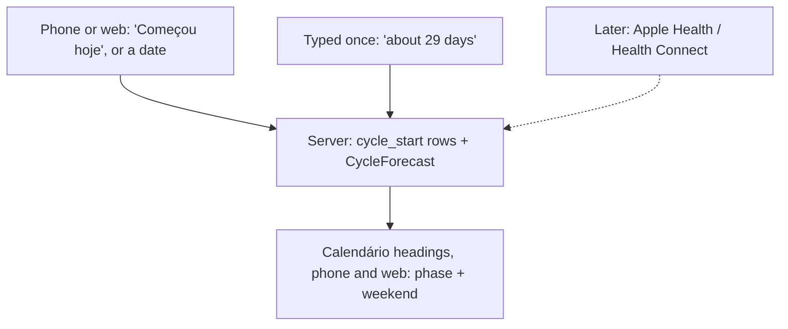
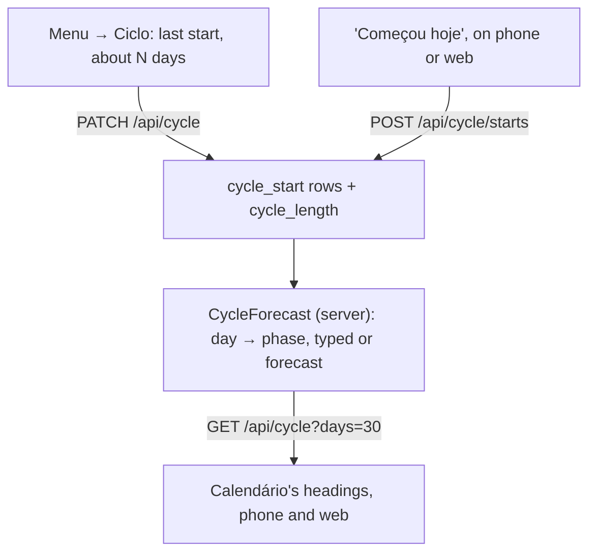

# The cycle can sit on Calendário's day headings, 30 days ahead

2026-10-23 · RFC · revised after the second review on issue #32 · a typed start, forecast on the server, drawn on every brand and the web

## Type the period's start in Lunna; the server tags 30 days

> [!IMPORTANT]
> For 30 days ahead, the forecast rests on one date: when the current
> period began. A start typed into Lunna, plus a cycle length typed once,
> tags those days about as well as six cycles synced from Health (52–56%
> right against 53%, for a typical person). So Lunna asks for that date and
> skips HealthKit, App Review's health rules and the phone-only sync.
> Apple Health can come later and fill the same table.



- **Do:** a "Ciclo" screen in Menu (last start, usual length), a "Começou hoje" tap, the server forecast, 30 days of tagged headings, weekends marked.
- **Not needed now:** HealthKit, Health Connect, a native package, Apple's predictions, the agent seeing the cycle.
- **You decide:** typed first with Health later *(recommended)*, or Health only, as revised before; and whether the three phases besides the period get colours.

## Today a day heading is one line of text

[`timeline_list.dart:1949`](../../../app/packages/timeline/lib/src/view/timeline_list.dart#L1949)

```dart
String _label(_Heading heading, DateTime now) {
  final l10n = context.l10n;
  if (heading == null) return l10n.sectionNow;
  final today = DateTime(now.year, now.month, now.day);
  final days = heading.difference(today).inDays;
  if (days <= 0) return l10n.sectionToday;
  if (days == 1) return l10n.sectionTomorrow;
  final date = l10n.sectionDay(heading); // "EEEE, d 'de' MMMM"
  ...
```

- `_HeadingRow` (`:2433`) draws it as one `Text` in `AppTypography.title`.
  The pinned heading (`_PinnedHeading`, `:2249`) reuses the same label.
- A heading is drawn when the day's first card or free stretch comes up
  (`:1665`), so every day in Calendário has one, up to 120 days
  (`TimelineState.maxDays`). **Lista has no day headings**, so it gets no tags.
- No health code anywhere: no plugin, no entitlements, no `Info.plist` key.
  Weekends look like every other day.

## Flo keeps periods to itself; Clue and Natural Cycles share them

| App | Writes periods to Apple Health? | Source |
|---|---|---|
| Apple Health's Cycle Tracking | yes, it *is* the store; free, also on the Watch | Apple IFU 4.0 |
| Clue | yes, periods and flow, only those logged after you allow it | Clue help |
| Natural Cycles | yes, iOS only: period, flow, spotting, mucus, LH tests, export or import | Natural Cycles help |
| Flo, iPhone | **no** since early 2024: "logged Menstruation data in Flo will not be sent to the Health app" | Flo help, 2025; Flo support, 2024 |

> **Q:** https://help.flo.health/hc/en-us/articles/34890229122068-How-to-import-data-from-the-Health-app-to-Flo-iOS this link says otherwise
>
> **A:** That page is the one quoted here, and its title is the other
> direction: *import from the Health app to Flo*. Flo reads what is in
> Health, and the same page says "logged Menstruation data in Flo will not
> be sent to the Health app." In March 2024 Flo's support said "the feature
> to sync your Flo data with Apple Health is no longer available"
> ([thread](https://discussions.apple.com/thread/255504055)).

> **Q:** Ok, is there any other alternative to Flo? Or maybe we can provide
> a manual input as it is just for the next cycle only
>
> **A:** Yes to both. Clue and Natural Cycles write periods to Health, and
> so does logging in Health itself (Flo then still shows them, since it
> reads from there). But you are right that 30 days need little: one date
> and a length. Typed into Lunna they tag the month about as well as a
> Health sync does ([next slide](#a-typed-start-forecasts-30-days-as-well-as-health)),
> so the RFC now recommends typing first and Health later.

- Moving apps only to feed Lunna costs the person more than one tap a month.

## A typed start forecasts 30 days as well as Health

| σ | Health | typed | typed ±2 | 28 |
|---|---|---|---|---|
| 2 days | 69% | 71% | 63% | 58% |
| 4, typical | **53%** | **56%** | **52%** | 50% |
| 6 days | 43% | 46% | 44% | 42% |

- Days tagged right over the next 30, by cycle spread σ. *Health*: the
  median of six synced cycles; *typed*: the person's usual length; *±2*:
  misremembered; *28*: nothing typed. Same simulation as below ([code/manual.mjs](./code/manual.mjs) → [data](./data/manual-vs-health.json)).
  Every column knows when the current period began; only the length changes.
- The next start is off by 3.5 days from Health, 3.2 from a well-known
  length, 3.6 from a misremembered one. The length barely matters within
  one cycle; the start is what carries the month.
- Health adds only the start without a tap; a forgotten tap is a forgotten log.

> [!TIP]
> **"In one cycle, the anchor is worth more than the history."** In 30
> days, six cycles beat a length typed from memory by 1 point, and
> lose to a well-known one by 3. *For us:* ask for the start, take the
> length as said, and learn it from the starts once there are three.

## One typed start becomes a month of tagged days


- A sketch in Lunna's tokens ([code/sketch.mjs](./code/sketch.mjs)), not
  the app. Today, 23 Oct, is day 2; the cycle is 29 days.
- Next period 20 Nov, ovulation 13 days before (7 Nov), fertile 2–7 Nov,
  all inside the 30 days drawn (to 21 Nov).
- Days counted from a **typed** start are filled; **forecast** ones are
  outlined, and a forecast period carries its ±3-day range.
- Every day has a phase tag; only the period is red.

## Count ovulation back from the next period, not forward

| Phase | Days, from Bull 2019 | How the forecast finds it |
|---|---|---|
| Menstrual | 5 days, or the length typed | from each start |
| Follicular | mean 16.9, 95% from 10 to 30 | what is left before the fertile window |
| Fertile | ovulation and the 5 days before it | ovulation − 5 … ovulation |
| Luteal | mean 12.4, 95% from 7 to 17 | from ovulation to the next start |

- 612,613 cycles, 124,648 people: the half after ovulation varies little;
  the half before it carries most of the spread. Only 13% of cycles
  were 28 days.
- So ovulation = next start − 13, Apple's own rule, and the next start =
  last start + the typed length, or the median of the last six cycles
  once three starts are known.

> [!TIP]
> **"The luteal phase is the steady half."** Mean 12.4 days (7–17) against
> a follicular 16.9 (10–30), in [Bull et al. 2019](https://pmc.ncbi.nlm.nih.gov/articles/PMC6710244/).
> *For us:* anchor every phase on the predicted next start and count back.
> Counting forward 14 days from the period is the textbook error.

## Past 30 days, a forecast tag is barely better than a guess


| σ, cycle spread | days 0–30 | days 31–60 | days 61–120 | period days right, days 0–30 |
|---|---|---|---|---|
| 2 days | 69% | 58% | 47% | 68% |
| 4 days, typical | 53% | 40% | 33% | 47% |
| 6 days | 43% | 32% | 30% | 37% |

- A simulation built from published figures ([code/forecast.mjs](./code/forecast.mjs),
  [data](./data/forecast-summary.json)). Within-person spread is 4–6 days
  in most groups of the Apple Women's Health Study. A blind guess scores 28%, or 17% for a period day.
- So the 30 days you chose are where the forecast is worth drawing; the
  shaded band in the chart is them.

> [!TIP]
> **"A forecast's error grows with every cycle it skips."** Each cycle's
> length adds its own few days of error. *For us:* draw 30 days, and
> nothing past them.

## Tag the phase; leave the planning to the person

| Claim heard about "cycle syncing" | What the evidence says |
|---|---|
| plan hard work around the phase | exercise performance "might be trivially reduced" in the early follicular phase only |
| everyone has the same pattern | evidence quality low; the authors recommend "a personalised approach" |

- McNulty et al. 2020 (meta-analysis, *Sports Medicine*) found nothing
  strong enough for general rules.
- So the tag is information, not advice: no hour moves because of a phase,
  and no copy says what to do on a given day.

## The person types a start anywhere; the server forecasts



- A start is a date in the person's zone, typed on the phone **or the
  browser**: the web no longer waits for a phone to sync.
- "Começou hoje" sits on the Ciclo screen, and on today's tag while a
  forecast period is in its ±3-day range ("Já começou?").
- The rows belong to the user, not the brand, so Focus and Lunna show the same cycle.

> **Q:** So, precisely for this reason, webs need to know. If we sync from
> the phone once, all the data (for the next 30 days only as you said), it
> will need to show on the browser as well, so some server sync will need
> to be done. Of course this data is only available if the user ever syncs
> and keep it in sync on the phone.
>
> **A:** Agreed, and typing makes it simpler still: the starts live on the
> server from the first tap, whichever screen it was on, and the server
> forecasts the moving window every day. A Health import, later, would
> post its starts to the same table.

## Typing adds a table, four routes and no native code

| Piece | What it is |
|---|---|
| `cycle_start` | `user_id`, `day` (`YYYY-MM-DD`, the person's zone), `source` (`typed`, later `health`); unique on (`user_id`, `day`) |
| `user.cycle_length`, `user.period_length` | typed once; null means 28 and 5 |
| `PATCH /api/cycle { on, length, periodLength }` · `POST /api/cycle/starts { day }` · `DELETE /api/cycle/starts/:day` | switch, lengths, a start and its undo |
| `GET /api/cycle?days=30` | `{ days: [{ day, phase, forecast, range? }] }`; `DELETE /api/cycle` erases it all |

- **Analytics:** the writes get rows in `events.ts` (`cycle_start_logged`,
  `cycle_set`), carrying nothing but their names. Replays mask every text.
- **The agent never reads it**: no tool, nothing on the board.
- **Review:** no HealthKit, so guideline 5.1.3 and the HealthKit entitlement
  don't apply; the privacy policy still says the dates are stored to draw
  them, and erased when switched off.

## A heading gains a phase tag and a weekend mark, in tokens

| Piece | How it is drawn | Where it lives |
|---|---|---|
| period day, from a typed start | filled tag, `cycleFill` / `cycleInk` | new `AppColors` tokens: Lunna's red, Focus's own |
| forecast day | outlined tag, a period also gets "entre 17 e 23 de novembro" | `AppTag` gains an outline style |
| the other three phases | neutral tag: "Folicular", "Fértil", "Lútea" | `app_pt.arb` |
| weekend | title in `ink2`, "fim de semana" after it | any brand, every platform |

- All four phases on every one of the 30 days; one colour, the period's,
  so the calendar stays sober. [`AppDay`](../../../app/packages/app_ui/lib/src/theme/app_day.dart) stays the app's one decorative colour.
- The weekend mark needs nothing but the date, so it ships first.

## A tap a month against a Health sync

| Option | Gain | Cost | When it wins |
|---|---|---|---|
| **Typed in Lunna** | any tracker, web too, no native code, no HealthKit review | one tap a month; a forgotten tap leaves the forecast on the last start | **now** |
| Synced from Health | no tap, flow days exact | Flo users must log in Health; plugin, four flavors, App Review, minSdk 26; web waits for the phone | a person who already logs in Health or Clue |
| Both: typed, Health later | the tap now, the sync as an import into `cycle_start` | the Health package later | **the path recommended** |
| Apple's forecast | best accuracy | not readable by any app: HealthKit has no prediction type | never |

- Either way health dates sit in our Postgres, a few dozen per person;
  Neon encrypts at rest, erasing them is one `DELETE`.

## Small to build: a table, four routes, a screen, a tag

| Piece | Size | Risk |
|---|---|---|
| weekend mark | S | none |
| `CycleForecast` (server) + tests on fixed dates | S | phases wrong at the edges: cover in tests |
| `cycle_start`, the two user columns, the routes, the analytics rows | S | none new |
| "Ciclo" screen, "Começou hoje", "Já começou?" | S | a forgotten tap: the tag asks in the range |
| heading tags, tokens, strings | S | crowded headings on 390 px: the sketch fits |

- The Health sync, the only M piece before, leaves the first build.
- For the person: each of the next 30 days says where it falls in the
  cycle, on the phone and in the browser, whatever app they track in.
- Measured quality: about 52–56% of days tagged right over those 30 days
  for a typical spread, the same as a Health sync.

## Decisions

| Decision | Options | Recommended | Cost of the other |
|---|---|---|---|
| where the cycle lives | phone only · Postgres | **Postgres** (decided) | phone only: no web |
| how far ahead | 30 days · next cycle + range · 120 days | **30 days** (decided) | past 30 days, tags wrong 3 times in 5 |
| which phases | period only · all four | **all four** (decided) | period only hides the fertile window |
| weekends | mark them · not | **mark** (decided), shipped first | none |
| where the start comes from | typed · Health · typed now, Health later | **typed now, Health later** *(recommended)* | Health only: Flo users switch apps, an M build and App Review |
| colour of the other phases | neutral · a token each | **neutral** *(recommended)* | three more colours on a sober calendar |

> **Decision (2026-10-23):** where the cycle lives: server too.
>
> **Decision (2026-10-23):** how far ahead: next 30 days.
>
> **Decision (2026-10-23):** which phases: all phases.
>
> **Decision (2026-10-23):** weekends: mark weekends too.

## Decided unattended

- **The note read as a proposal, not a Decision:** typing became the
  recommendation and the Health sync a later import into the same table;
  "Health only" stays an option above.
- **The forecast is ours, simple and explained:** last start + typed length
  (28 if none), the median of six gaps once three starts are known, 13-day
  luteal, ±3-day range.
- **A start is a date, not flow days:** the period is the typed length, 5 by default.
- **"Já começou?"** on today's tag inside a forecast period's range is the
  only nudge: no notification.
- **The agent doesn't see the cycle**; **both brands, Calendário only**;
  **off until switched on in Menu**, and switching off erases the rows.
- **Phase 4 not run:** not asked for. Clue's and Natural Cycles' behaviour
  rest on their help pages read through search (both refused a fetch).

## Go deeper

| Idea | The case here | Read |
|---|---|---|
| The platform shares the records, not its conclusions | HealthKit has no prediction type; whoever syncs must forecast | [HKCategoryTypeIdentifier](https://developer.apple.com/documentation/healthkit/hkcategorytypeidentifier) |
| In one cycle, the anchor is worth more than the history | typed start and length: 52–56% right, Health 53% | [code/manual.mjs](./code/manual.mjs) |
| The luteal phase is the steady half | ovulation = next start − 13 | [Bull et al. 2019](https://pmc.ncbi.nlm.nih.gov/articles/PMC6710244/) |
| A forecast's error grows with every cycle it skips | 53% of days right in the 30 days drawn, 33% in days 61–120 | [code/forecast.mjs](./code/forecast.mjs) |

Added to [concepts.md](../concepts.md) under *Data and forecasts*.

- [Apple, Cycle Tracking IFU 4.0](https://www.apple.com/legal/ifu/cycle-tracking/4-0/ct-ifu-4-0-en_GB.pdf): inputs, ±3 days, two periods before predictions, third-party data accepted.
- [Flo, import from Health (iOS)](https://help.flo.health/hc/en-us/articles/34890229122068): Flo reads from Health; menstruation not sent to Health.
- [Apple Community, Flo stopped writing to Health](https://discussions.apple.com/thread/255504055): Flo support, March 2024, "no longer available".
- [Clue, Apple Health](https://support.helloclue.com/hc/en-us/articles/20199556038813): periods and flow written, new ones only, no import.
- [Natural Cycles, sync with Apple Health](https://help.naturalcycles.com/hc/en-us/articles/4405598610577-How-to-sync-with-Apple-Health): period, flow, spotting, mucus, LH tests; export or import; iOS only.
- [Li, Gibson & Jukic 2023](https://pmc.ncbi.nlm.nih.gov/articles/PMC10226714/): mean 28.7 days, within-person variability 4–6 days.
- [McNulty et al. 2020](https://rgu-repository.worktribe.com/output/940959): phase effects on performance trivial, evidence low.
- [App Store Review Guidelines 5.1.3](https://developer.apple.com/app-store/review/guidelines/#health-and-health-research): what a HealthKit app takes on, for the later sync.
- [health plugin](https://pub.dev/packages/health): `MENSTRUATION_FLOW` on both platforms, for the later sync.
- Data: [sources.md](./data/sources.md) (the quotes), [manual-vs-health.json](./data/manual-vs-health.json), [forecast-accuracy.csv](./data/forecast-accuracy.csv), [healthkit-cycle-types.txt](./data/healthkit-cycle-types.txt).
