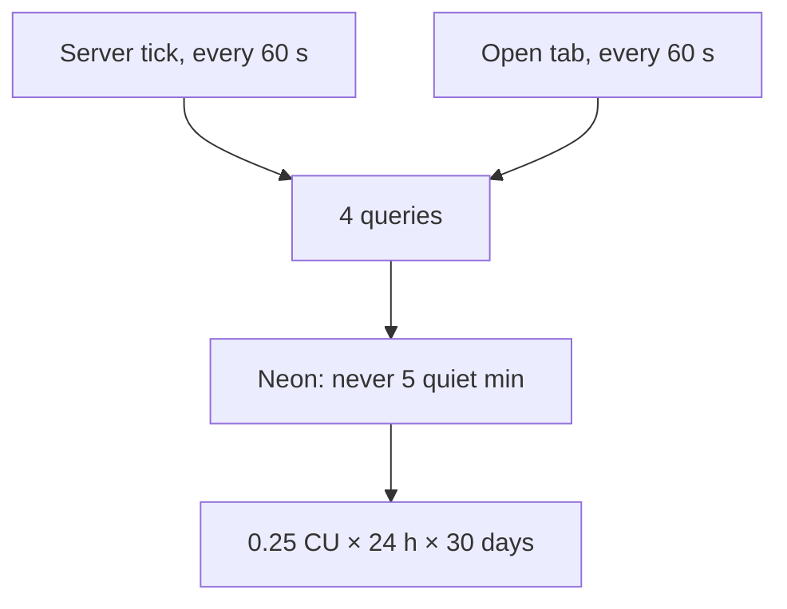
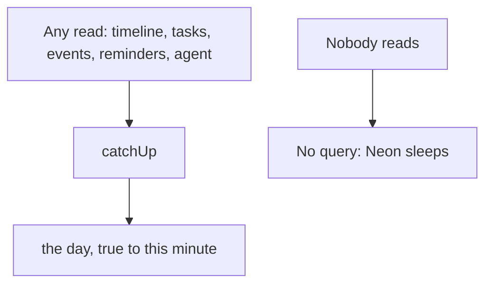
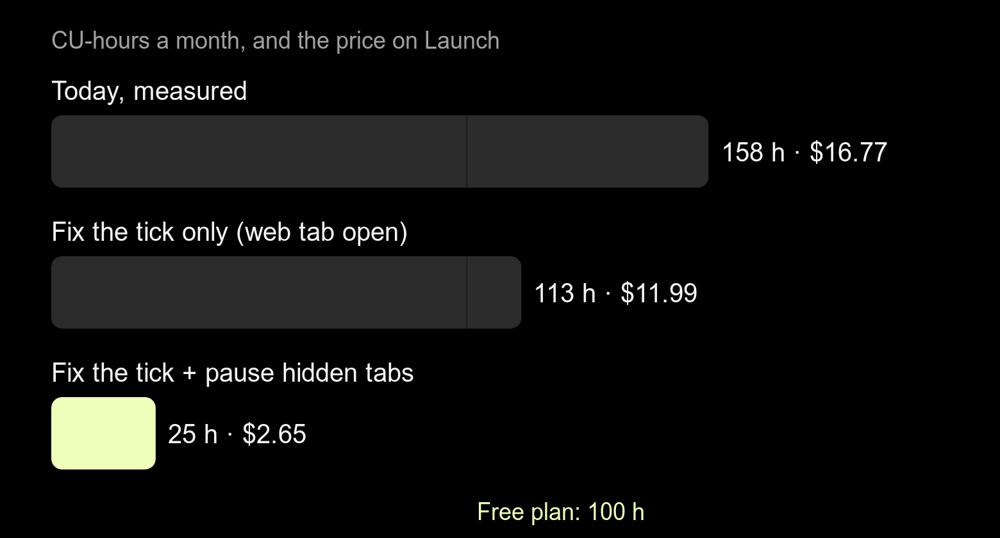

# A minute tick keeps Neon awake all day, for two people

2026-10-23 · RFC · built in [the delivery](../../delivery/2026-10-23-neon-compute/README.md) (deep-research pass not run) · server, app, Neon settings · issue #35

## Neon bills hours awake, and our server never lets it sleep

> [!IMPORTANT]
> Neon charges for the hours the database is awake, not for the queries.
> It falls asleep after 5 quiet minutes, and the server sends 4 queries
> every minute, day and night, so it never does. Stop the tick and pause
> hidden tabs: about 158 → 25 CU-hours a month, $17 → under $3, and back
> inside the free plan.



- **Do:** delete the server's minute tick; catch the day up on every read instead.
- **Do:** stop the app's minute refresh while it is hidden; refresh on return.
- **Do:** cap the compute at 0.25 CU in the Neon console.
- **Not needed:** a new host, a cache layer, fewer queries per read.
- **You decide:** Free or Launch after the fix (stay on Launch one month, *recommended*).

> **Q:** Those ticks work that way mainly to update the times of the tasks
> that haven't started and sit in the queue. So we either update it every
> time or compare against the last time it was read or edited. How would
> you approach that?
>
> **A:** Neither, because the queue's hours are never written down: every
> read works them out from the rows and the clock
> ([slide](#the-queues-hours-are-never-stored-so-nothing-goes-stale)).
> Measured over a day with a paused task, catching up on read gives the
> tick's day at 28 of 28 reads and writes 63 rows instead of 1,647. It
> needs one fix in `catchUp`, which the tick was hiding
> ([slide](#measured-catch-up-on-read-matches-the-tick-after-one-fix)).
> The rule: store when something happened, work out the rest from now. A
> "last read" watermark is never needed.

## The bill is one small machine, awake every hour

| Line on the console | 19 days | What it means |
|---|---|---|
| Compute | 100.17 CU-h | 5.3 a day ≈ 0.25 CU × 21 h |
| Storage | 0.07 GB | nothing |
| Network | 1.1 GB | of 5 GB free |

- A **CU** (compute unit) is ¼ of a CPU's worth of Postgres; 0.25 is the
  smallest. Awake all month it is 0.25 × 720 = **180 CU-hours**.
- The free plan gives **100 CU-hours a month** and then suspends the
  database until the next month ([Neon pricing](https://neon.com/pricing)).
  The console stopped at 100.17: the cap, reached on day 19.
- Launch is **$0.106 per CU-hour**, no minimum: 158 h a month is the
  $17 estimated.
- Storage and network are not the problem; the hours are.

## The server queries every minute, whether anyone looks or not

[`server/src/events/pause-ticker.service.ts:41`](../../../server/src/events/pause-ticker.service.ts#L41)

```ts
onModuleInit(): void {
  this._timer = setInterval(() => void this.tick(), TICK_MS); // 60_000
  this._timer.unref();
}

async tick(now = new Date()): Promise<void> {
  for (const user of this._users.values()) {
    await this._layout.catchUp(user, Trace.start(user.id), now);
  }
}
```

- Everyone who called the server once since it started is in `_users`,
  forever.
- `catchUp` ([`event-layout.service.ts:916`](../../../server/src/events/event-layout.service.ts#L916))
  reads the day (the 30-second cache is always stale a minute later) and
  the pending tasks: **4 statements, sometimes 5**.
- It exists for paused blocks, whose end slides a minute every minute, and
  for tasks whose hour ran out. On most days nothing is paused.

## Measured: 1,440 ticks a day, none of them quiet

| With nobody using the app, 24 h | Count |
|---|---|
| Ticks that queried | **1,440 of 1,440** |
| Statements sent | **5,761** |
| Longest quiet stretch | **0 minutes** (Neon needs 5) |
| Ticks that changed anything | 1 (a routine day written off) |

- [`code/count-queries.ts`](./code/count-queries.ts) builds the real
  stores and services over in-process Postgres (PGlite), gives one person
  four tasks, two routines and a delivery, and runs the tick for a day of
  minutes ([`data/queries.json`](./data/queries.json)).
- One `GET /api/timeline` costs 9–11 statements, 3 inside the cache's half
  minute (the session lookup not counted).
- The tick works for one write a day and keeps the database up for 1,440
  minutes to do it.

## An open browser tab does the same thing

[`app/lib/home/view/home_page.dart:291`](../../../app/lib/home/view/home_page.dart#L291)

```dart
void _schedule() {
  final now = DateTime.now();
  final next = DateTime(now.year, now.month, now.day, now.hour)
      .add(Duration(minutes: now.minute + 1));
  _timer = Timer(next.difference(now), () {
    if (!mounted) return;
    _refresh();     // GET /api/timeline
    _schedule();
  });
}
```

- Tempo asks for the day on every minute boundary, and nothing stops it
  when the app is out of sight.
- A phone suspends the app in the background, so there it stops. A **web
  tab** does not: Chrome slows a hidden tab's timers to **once a minute**
  ([Chrome 88 timer throttling](https://developer.chrome.com/blog/timer-throttling-in-chrome-88)),
  which is exactly this timer's rhythm.
- So with the server fixed, one Lunna tab left open on a laptop still keeps
  Neon up for the whole working day: about **113 CU-hours** a month.

## Someone else's bill, same shape: a poller under 5 minutes

> [!TIP]
> **"Scale to zero is a property of your quietest loop, not of your
> traffic."** ([neondatabase/neon#12909](https://github.com/neondatabase/neon/discussions/12909))
> *For us:* any timer that touches Postgres more often than every 5
> minutes, anywhere, costs the full month.

| | Their project | Ours |
|---|---|---|
| The loop | Neon Auth, every ~4.5 min | `PauseTickerService`, every 1 min |
| Compute | 0.25–0.5 CU, never asleep | 0.25 CU, never asleep |
| Month | ~180 CU-h vs 100 free | ~158 CU-h vs 100 free |

- Neon suspends after "no active queries for 5 minutes"; Free can't change
  it, paid plans can only turn it off
  ([compute lifecycle](https://neon.com/docs/introduction/compute-lifecycle),
  [scale to zero](https://neon.com/docs/introduction/scale-to-zero)).
- Waking up takes "a few hundred milliseconds", plus a cold cache for the
  first queries. That is the whole price of sleeping.
- There, capping at 0.25 CU halved the bill but never let it sleep.

## Catch up when someone reads, not when the clock ticks

> [!TIP]
> **"Poll only what you can't compute; derive the rest on read."** Chrome's
> advice on throttled timers: "in most cases there's a push equivalent… so
> you don't have to keep checking"
> ([Chrome 88](https://developer.chrome.com/blog/timer-throttling-in-chrome-88)).
> *For us:* a paused block's end is `now + owed`, so it can be worked out
> at the moment anyone asks.



- `catchUp` already runs before `GET /timeline`, and in the same minute
  it is safe to run any number of times. After a long gap it is not
  ([two slides on](#measured-catch-up-on-read-matches-the-tick-after-one-fix)).
- Today only `GET /timeline` does. The reminder plan, the agent and the
  writes rely on the tick having run. **Change 1:** one interceptor runs
  `catchUp` before every route that reads the day, `catchUp` stops taking
  a moved paused block for finished, and `PauseTickerService` goes.
- Nothing is lost: the tick never pushed anything to a phone. A day nobody
  reads is a day nobody sees.

## The queue's hours are never stored, so nothing goes stale

| What changes with the clock | Stored? | Who keeps it true |
|---|---|---|
| A queued task's hour | **no** | `relayout`, on each read ([`timeline.service.ts:171`](../../../server/src/events/timeline.service.ts#L171)) |
| A paused block's end | yes, `endTime` | the tick: `now + owed`, every minute |
| A begun task whose hour ran out | `done_at` | the tick; reads already hide it |
| A routine day nobody began | `cancelled` | the tick; reads already hide it |

- So the tick updates no queued hour. The queue moves only because a
  paused block's stored end, which it flows around, moves.
- Each of the three writes depends only on `now` and the row (when it
  was paused, how much it owed), not on how long since the last run. No
  "last read" to compare against.

## Measured: catch-up on read matches the tick, after one fix

| Same day, 09:00–23:00, "Email" paused at 09:20 | Reads equal to the tick's | Rows written |
|---|---|---|
| Tick every minute (today) | 28 of 28 | **1,647** |
| No tick, `catchUp` on read, as written | **1 of 28** | 64 |
| No tick, `catchUp` on read, **fixed** | **28 of 28** | **63** |
| No tick, no `catchUp` | 0 of 28 | 29 |

- The bug: `catchUp` moves the paused end, then checks "is its hour over?"
  against the list read *before* the move
  ([`event-layout.service.ts:932`](../../../server/src/events/event-layout.service.ts#L932)).
  Read at 10:00 after a 09:55 end, paused "Email" is written off as done.
- The tick hides it; a restart longer than the owed minutes already hits it.
- **The fix:** judge "over" by the moved end, plus a test that reads a
  paused day an hour later.
- [`code/tick-vs-read.ts`](./code/tick-vs-read.ts),
  [`data/tick-vs-read.json`](./data/tick-vs-read.json).

> [!TIP]
> **"A key is passively expired when a client tries to access it and the
> key is timed out."** Redis stores expiry "as absolute Unix timestamps…
> the time is flowing even when the Redis instance is not active"
> ([Redis EXPIRE](https://redis.io/docs/latest/commands/expire/)).
> *For us:* keep `pausedAt` and what is owed, and settle on access; never a
> delta since the last run.

## Pause the refresh while the app is hidden

| State | Today | After |
|---|---|---|
| Tempo in front | refresh each minute | same |
| Tab hidden / app in background | refresh each minute (web) | **no timer** |
| Back in front | next minute boundary | **refresh at once**, then each minute |

- **Change 2:** `_MinuteRefresh` listens to `AppLifecycleListener`; on
  `hidden` it cancels the timer, on `resumed` it asks for the day and
  schedules again. Flutter web reports page visibility through the same
  lifecycle (to confirm on the build).
- The phone's 6-hourly background refresh stays: 4 wake-ups a day, ~5
  minutes each.
- **Change 3 (console, no code):** set autoscaling max to 0.25 CU, and check
  that Neon Auth is off (we use Better Auth), since it is the poller in the
  case above.

## Trade-offs

| Option | Gain | Cost | When it wins |
|---|---|---|---|
| **Fix the loops, stay on Neon** | ~25 CU-h, fits Free | first request after sleep +~0.3–0.5 s | now *(recommended)* |
| Wake the tick only when due | keeps a server clock | a timer per person to get right | if something must happen with nobody reading |
| Postgres on the Pi | $0, no sleep | backups, SD card wear, one more container to run | if Neon's free plan shrinks |
| Supabase Free | no hour meter | 500 MB, paused after a week idle, a migration | not now |
| Stay as is on Launch | nothing to do | ~$17 a month, and more per person | never |

- The **first request after a quiet spell** pays Neon's wake-up. With
  `pg`'s default 10-second idle timeout the pool holds no connection by
  then, so no stale-socket errors; an `on('error')` on the pool is still
  cheap insurance ([`db.ts:19`](../../../server/src/db/db.ts#L19)).

## Impact: from $17 to under $3, or to free



- Measured: **5,761 → 0** statements a day with nobody using the app.
- Estimated ([`code/estimate.mjs`](./code/estimate.mjs),
  [`data/estimate.csv`](./data/estimate.csv)): two people, ten openings a
  day, three minutes each, plus the 5-minute tail and the phones'
  background refresh: **~25 CU-hours, $2.65 on Launch, $0 on Free**.
  An upper bound: openings that overlap share their tail.
- It scales with use, not with people signed up: a tenth person who never
  opens the app costs nothing, where today each one ever seen is in the tick.
- Network (1.1 GB) shrinks with the polling, and was already inside 5 GB.

## Decisions

| Decision | Options | Recommended | Cost of the other |
|---|---|---|---|
| The minute tick | delete, catch up on read · wake when due · keep | **delete** | a per-person timer to keep right · $17 a month |
| Hidden app | pause the refresh · keep it | **pause** | ~113 CU-h a month per tab left open |
| Plan after the fix | Launch one month, then Free if under 50 h · Free now · stay on Launch | **Launch one month, then Free** | Free now: a regression suspends the app on day ~19 · Launch: a few dollars |
| Compute cap | max 0.25 CU · autoscale | **0.25 CU** | a spike bills more, for queries this small |
| A paused block's end | written on read by `catchUp` (fixed) · worked out in `day()`, never stored | **written on read** | not storing it touches every reader of `endTime`: the cards, the reminders, the agent |

## Decided unattended

- Wrote Phases 1–3 only; the deep-research pass (Phase 4) waits until asked.
- The usage pattern (two people, ten openings a day, three minutes) is an
  assumption, not a measurement; it sets the 25 h, not the finding.
- The Neon console wasn't reachable from here: whether Neon Auth is on, and
  the current min/max CU, are things to look at, written as Change 3.
- Recommended **delete** over "wake when due": no screen shows a day that
  wasn't read, so the server clock buys nothing.
- The answer to the question on slide 1 got two slides after the change it
  is about (catch up on read), not after slide 1, to keep the story's order.
- Fixing `catchUp` is in this RFC's build, not a separate issue: deleting
  the tick without it loses paused tasks. Not changed in `server/` here.
- Phase 4 was not asked for in the reply; still not run.

## Go deeper

| Idea | The case here | Read |
|---|---|---|
| Scale to zero is your quietest loop | the minute tick, the open tab | [neon#12909](https://github.com/neondatabase/neon/discussions/12909) |
| Derive on read, don't poll | `catchUp` before every read | [Chrome 88 timers](https://developer.chrome.com/blog/timer-throttling-in-chrome-88) |
| Settle on access, from absolute times | a paused end is `pausedAt` + owed, not a minute per tick | [Redis EXPIRE](https://redis.io/docs/latest/commands/expire/) |

- [Neon pricing](https://neon.com/pricing): Free 100 CU-h, suspension past it; Launch $0.106/CU-h, no minimum.
- [Compute lifecycle](https://neon.com/docs/introduction/compute-lifecycle): "no active queries for 5 minutes"; wake in a few hundred ms.
- [Scale to zero](https://neon.com/docs/introduction/scale-to-zero): 5 minutes, fixed on Free.
- [Supabase pricing](https://supabase.com/pricing): Free 500 MB, paused after a week idle.
- [Redis EXPIRE](https://redis.io/docs/latest/commands/expire/), "How Redis expires keys": passive expiry on access, plus a sampled sweep for keys nobody reads.
- Data: [`data/queries.json`](./data/queries.json) (tick and read counts), [`data/estimate.csv`](./data/estimate.csv), [`data/tick-vs-read.json`](./data/tick-vs-read.json) (the day read four ways, every 30 min).
- Code: [`code/count-queries.ts`](./code/count-queries.ts), [`code/tick-vs-read.ts`](./code/tick-vs-read.ts) (both run from `server/` with `NODE_PATH=$PWD/node_modules npx tsx …`), [`code/estimate.mjs`](./code/estimate.mjs).
