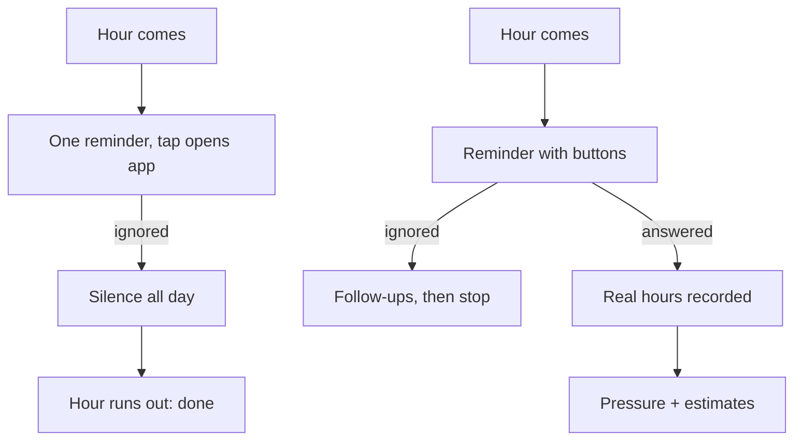
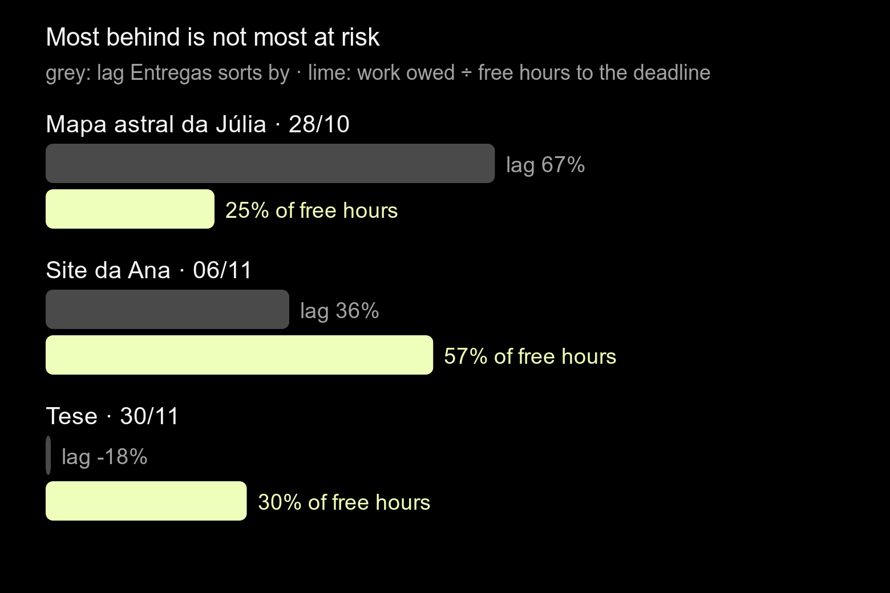
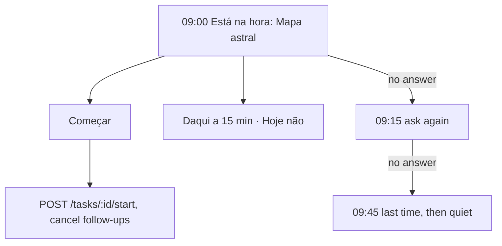
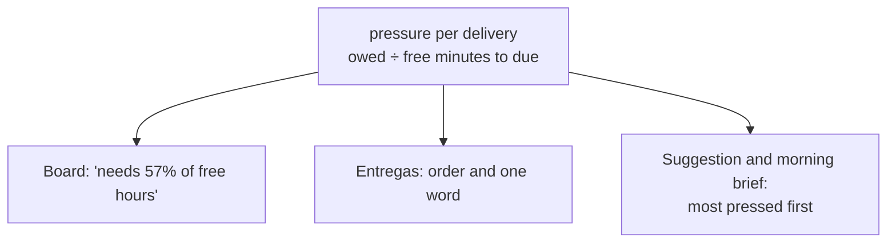

# Off the screen, Lunna asks once, then guesses "done"

2026-10-24 · RFC · proposed (deep-research pass not run) · notifications, agent, Entregas, the creation sheets · issue #45

## The MVP is the loop that runs while the phone is down

> [!IMPORTANT]
> On a day the app is not opened, Lunna asks about one task, then says
> nothing, and every task whose hour runs out is written down as done
> without asking. The agent reads deadlines but no pressure. Close the
> loop off the screen first: reminders answered from the lock screen and
> followed up, silence read as "still working", and one pressure number
> per delivery that the agent, the bars and the forms all read.



- **Do:** reminders with buttons and follow-ups, queued on the phone.
- **Do:** one server-side `pressure` per delivery; forms that guess.
- **Not needed:** push, a server cron, goals, a new Tempo.
- **You decide:** what silence at a task's end means (continue, 30 min cap).

## A day without the app: one question, then silence

The real `NotificationsService.plan`, run on a Monday of five tasks and a
lunch, synced at 08:30 and again by the background refresh at 14:30
([`code/silent-day.ts`](./code/silent-day.ts)):

| Fires | Kind | About |
|---|---|---|
| 09:00 | `confirmStart` | Mapa astral da Júlia, "Está na hora. Começamos?" |
| 12:00 | `starting` | Almoço |
| 12:50 | `almostFinishing` | Almoço, "Finaliza em 10 minutos" |
| 21:00 | `evening` | "Hora de desacelerar. O dia já foi." |

- 5 tasks planned, **1 question**, about the first; the other 4 never come up.
- The 14:30 refresh plans **nothing** for the waiting task: it sits at the
  current minute, and the plan drops every item not after now
  ([`notifications.service.ts:92`](../../../server/src/notifications/notifications.service.ts)).
- Only the next task earns a reminder (`nextTaskItems`, `:104`); the lunch
  earns two.

## A task whose hour runs out is written down as done

[`event-layout.service.ts:949`](../../../server/src/events/event-layout.service.ts), in `catchUp`, before every read:

```ts
const over = events.filter(
  (event) =>
    event.taskId !== undefined &&
    Date.parse(event.endTime) <= now.getTime(),
);
// …
for (const event of over) {
  trace.log('task.over', { taskId: task.id });
  await this._tasks.update(user, { ...task, doneAt: event.endTime });
}
```

- Silence means **done, on time**, the most optimistic reading there is.
- A delivery's progress counts the **planned** minutes of done tasks, not
  worked ones ([`artifacts.service.ts:387`](../../../server/src/artifacts/artifacts.service.ts)).
- So every unanswered task records "took exactly its estimate". The data a
  feedback loop would learn from is overwritten by the default.

## No reminder can be answered without opening the app

| Kind | Asks something | Answerable from lock screen | Mentions the day |
|---|---|---|---|
| `morning`, `evening` | no | — | no (20 fixed sentences) |
| `starting`, `almostFinishing` | no | — | the block's name |
| `confirmStart` | yes | **no**: the tap opens the app | the task's name |

- One handler, the tap; no categories
  ([`notification_queue.dart:130`](../../../app/packages/notifications/lib/src/service/notification_queue.dart)).
- The plugin already does buttons: iOS categories, Android actions, and a
  background isolate (`onDidReceiveBackgroundNotificationResponse`).
- The background refresh asks every 6 h; iOS promises nothing
  ([`background_refresh.dart:36`](../../../app/lib/notifications/background_refresh.dart)).

## The agent reads due dates, not how tight they are

What the board gives the model for a delivery
([`board.ts:640`](../../../server/src/agent/board.ts)):

```
p2 · Site da Ana · due 06/11 · 9 open tasks, 3 with an hour · 10h of 30h
```

- No free hours before 06/11, nothing owed by the deliveries due before it.
  The model must do calendar arithmetic it is bad at.
- Urgency lives only in the app: `lagOf` sorts Entregas
  ([`pace_bars.dart:168`](../../../app/packages/artifacts/lib/src/view/pace_bars.dart)),
  from calendar days since creation
  ([`models.dart:280`](../../../app/packages/artifacts/lib/src/models/models.dart)),
  blind to the agenda.
- The one proactive offer is the first of 3 backlog tasks that fits today
  ([`agent.service.ts:760`](../../../server/src/agent/agent.service.ts)):
  order, not need. No wonder the suggestions "mostly don't make sense".

## Example: the most behind is not the most at risk



Three deliveries on Monday 26/10, 4 free hours a weekday
([`code/pressure.mjs`](./code/pressure.mjs), [`data/pressure.csv`](./data/pressure.csv)):

- Entregas puts **Júlia** first (lag 67%): 3 h owed, 12 free hours to Wednesday.
- **Site da Ana** needs 57% of every free hour to 06/11, Júlia's included.
  That is the one to protect, and today it is second.
- Pressure = work owed by a deadline (its own and everything due before it,
  earliest deadline first) ÷ free working minutes until it. Over 100%
  cannot be done, and can be said in one sentence.

## Why: decide when in code, let "nothing" win most of the time

> [!TIP]
> "Provide nothing" is an intervention option at every decision point.
> Nahum-Shani et al., [JITAIs in mobile health](https://pmc.ncbi.nlm.nih.gov/articles/PMC5364076) (2018).
> *For us:* list the moments Lunna may speak, what it knows there, and the default when it stays quiet.

> [!TIP]
> Proactive LLM agents "fail to stay silent": GPT-4o's false alarms were 52%.
> Lu et al., [Proactive Agent](https://arxiv.org/html/2410.12361v3) (ICLR 2025).
> *For us:* code picks the moment and the fact; the model only words it.

| JITAI part | In Lunna |
|---|---|
| Decision point | an hour comes, a task ends, the app opens |
| Tailoring variable | pressure, real vs planned minutes |
| Options | ask, propose a plan, **nothing** |

Useful content still disrupts ([Mehrotra, CHI 2016](https://discovery.ucl.ac.uk/id/eprint/1502364/)).

## Change 1: a reminder that waits for an answer



- Buttons on `confirmStart`, answered in the background isolate with the
  stored token, as the background refresh already does.
- **Follow-ups are queued in advance and cancelled by the answer**: no
  server timer, so Neon still sleeps ([neon-compute](../2026-10-23-neon-compute/README.md)).
- An awaiting task gets its follow-ups even after a refresh (fix `:92`).
- Fixed blocks lose `almostFinishing` (nothing to do about a lunch ending).

## Change 2: at a task's end, ask; silence means "still working"

| Fires | Says | Buttons |
|---|---|---|
| end − 10 | "Mapa astral termina em 10 min" | Concluí · +15 min |
| end | "Acabou o tempo do Mapa astral" | Concluí · Continuar |
| no answer | the task keeps running, the queue slides behind it | |
| end + 30 | "Ainda no Mapa astral?" | Concluí · Pausar |
| no answer | stop at the cap; written as *unconfirmed*, asked at next open | |

- `catchUp` stops writing `doneAt` for an over task; it extends it to the
  cap, next fixed block first.
- An answer records the **real** end: the first honest data on how long things take.

## Change 3: one pressure number per delivery, on the server



- The server already does this once, for the month: `needMinutes` against
  `freeMinutes` ([`artifacts.service.ts:122`](../../../server/src/artifacts/artifacts.service.ts)).
  Do it per deadline, earliest first, and add it to `ArtifactView`.
- The bars keep their look; the order and the sentence come from pressure
  ("folgada", "apertada", "não cabe"), not from `lagOf`.
- `doneMinutes` counts worked minutes once Change 2 records them.

## Change 4: five moments Lunna speaks first

| Moment | Knows | Says (or nothing) |
|---|---|---|
| Day opens | pressure, today's room | "Hoje: Site da Ana 2h. O resto cabe." |
| A task ends | real vs planned | asks, Change 2 |
| A reminder ignored ×3 | nothing begun | quiet until the next open |
| Next open after silence | unconfirmed tasks | "Terminou o Mapa astral?" |
| A delivery would not fit | pressure > 100% | one plan: move or drop |

- Each line is code with a fact from the server (workflow before agent);
  the model only words it, and only when the fact crosses a threshold.
- In the app this is **one line** above Tempo, never a feed; the morning
  text replaces the 10 fixed sentences.

## Change 5: every form guesses, the person corrects

| Form | Today | Guesses |
|---|---|---|
| New task | no delivery unless opened from one ([`write_down.dart:19`](../../../app/packages/timeline/lib/src/view/write_down.dart)) | chip "É do Site da Ana?" |
| New delivery | 60 min ([`artifact_sheet.dart:81`](../../../app/packages/artifacts/lib/src/view/artifact_sheet.dart)) | its kind's measured minutes |
| Saving it | nothing | "Com essa, o Site da Ana não cabe até 06/11. Começar depois dele?" |

> [!TIP]
> People finished theses in 55.5 days against a best guess of 33.9.
> Buehler, Griffin & Ross, [planning fallacy](https://bear.warrington.ufl.edu/brenner/mar7588/Papers/buehler-et-al-1994.pdf) (1994).
> *For us:* estimate from what the same kind took before, never from the plan.

## Trade-offs: local first, push only if it goes stale

| Option | Gain | Cost | When it wins |
|---|---|---|---|
| Local follow-ups (proposed) | works offline, Neon sleeps | stale if the day changes unseen | always first |
| Server push (APNs/FCM) | always current | a server timer, keys, Neon awake | after launch, if follow-ups go stale |
| Silence = continue (proposed) | honest durations | queue slides behind a forgotten task | with a 30 min cap |
| Silence = done (today) | queue never stalls | every estimate looks right | never, for learning |
| Live Activity for the running task | a timer on the lock screen | a Swift widget extension | after Change 2 |

## Impact: every reminder answerable, and the first honest durations

| What | Today | After | Size (estimate) |
|---|---|---|---|
| Reminders on the silent day | 4, 0 answerable | ~7, all answerable, ≤3 asks a task | notifications package |
| Task lengths measured | 0 (silence = plan) | one per answered end | `catchUp` + a mark |
| Agent's urgency | arithmetic in the prompt | one number per delivery | a server function |
| Ranking in the example | Júlia first | Site da Ana first | one sort |

Changes 1–2 about a week, 3 days, 4–5 a week; no new table but an `unconfirmed` mark.

## Decisions

| Decision | Options | Recommended | Cost of the other |
|---|---|---|---|
| Silence at a task's end | done · continue to a cap · continue forever | **continue, 30 min cap** | done keeps lying; forever stalls the day |
| Follow-ups | local chain · server push | **local chain** | push needs a timer and keys |
| Urgency | `lagOf` · pressure | **pressure, server-side** | two rules that disagree |
| Order of work | 1+2 → 3 → 4+5 | **this order** | insights on fake data |
| Goals | now · after the loop | **after the loop** | goals measured on planned minutes |

## Decided unattended

- Wrote the RFC only; no code changed. Phase 4 left for when asked.
- Took "Period sync" as cycle-aware planning and left it out: it is one
  more input to pressure and the morning brief once they exist. See the question.
- The silent day and the deliveries are made up to match the code's
  rules; no production data was read.
- Open question: does "Period sync" mean the menstrual cycle, and should
  it shape the plan (energy per phase) or only what the agent says?
- Open question: is Hanna on iPhone? A Live Activity (a running timer on
  the lock screen) is iOS-only and needs a Swift widget extension.

## Go deeper

| Idea | The case here | Read |
|---|---|---|
| "Provide nothing" is an option | follow-ups that stop; one line, not a feed | [Nahum-Shani 2018](https://pmc.ncbi.nlm.nih.gov/articles/PMC5364076) |
| Proactive agents fail by speaking | suggestions that "don't make sense" | [Lu et al. 2025](https://arxiv.org/html/2410.12361v3) |
| Estimate from the reference class | a delivery's length from its kind's history | [Buehler et al. 1994](https://bear.warrington.ufl.edu/brenner/mar7588/Papers/buehler-et-al-1994.pdf) |

- [Mehrotra et al., My Phone and Me](https://discovery.ucl.ac.uk/id/eprint/1502364/) (CHI 2016): 10,372 notifications; useful ones still disrupt.
- [flutter_local_notifications](https://pub.dev/packages/flutter_local_notifications): actions per category on iOS, per notification on Android; background isolate.
- Not re-read here (PDFs would not extract): Horvitz, [Mixed-initiative UIs](https://erichorvitz.com/uiact.htm) (act only when it beats doing nothing); Amershi et al., [Guidelines for Human-AI Interaction](https://www.microsoft.com/en-us/research/project/guidelines-for-human-ai-interaction/) (time services by context, efficient dismissal). Phase 4 candidates.
- Earlier RFCs: [neon-compute](../2026-10-23-neon-compute/README.md) (no server timer), [agent-ui](../2026-10-17-agent-ui/README.md) (plans and Aplicar).
- Data: [`data/silent-day.json`](./data/silent-day.json), [`data/pressure.csv`](./data/pressure.csv).
- Code: [`code/silent-day.ts`](./code/silent-day.ts) (from `server/`: `npx tsx ../product/research/2026-10-24-mvp-autonomy/code/silent-day.ts`), [`code/pressure.mjs`](./code/pressure.mjs).
