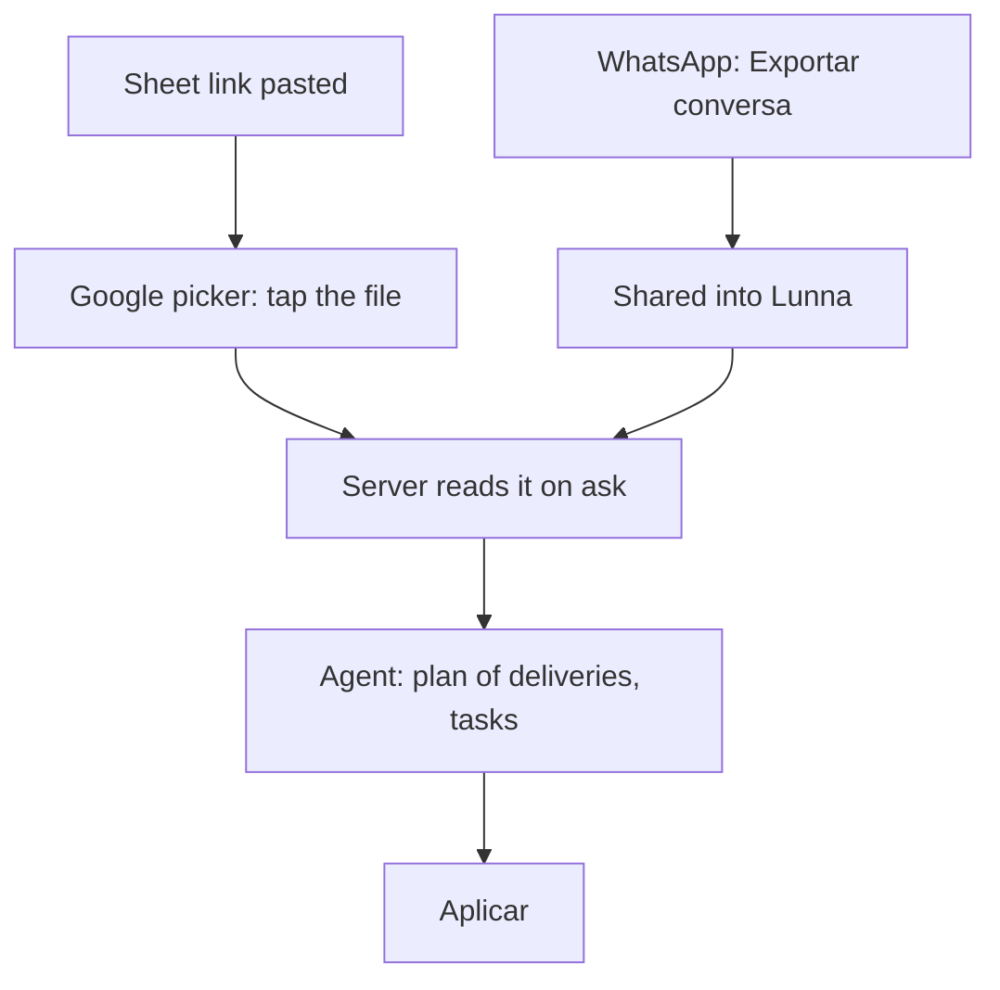
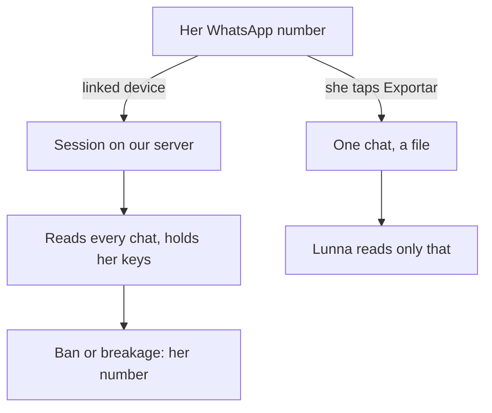
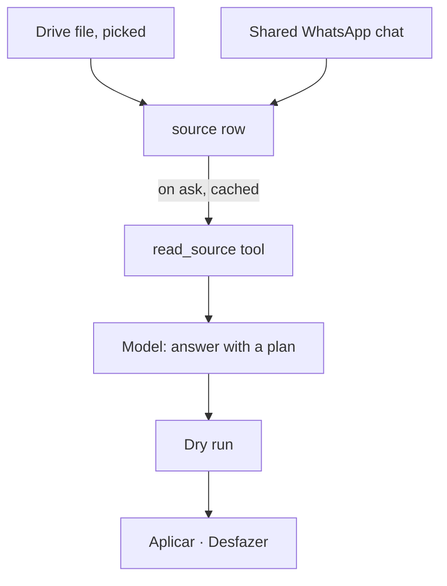

# Lunna can read a picked sheet now; WhatsApp only what she shares

2026-10-28 · RFC · proposed (deep-research pass not run) · server (agent, auth, a new `sources/`), app (agent, share sheet) · issue #57

## Read what she picks, propose deliveries, hear WhatsApp by sharing

> [!IMPORTANT]
> The agent reads only Lunna's own rows. Let it read two more things, and
> keep writing only through plans. **Drive:** she pastes a sheet's link and
> taps it once in Google's picker. That grants one file (`drive.file`,
> which needs no audit from Google), and the agent turns its rows into a
> plan of deliveries. **WhatsApp:** she shares a chat into Lunna from
> WhatsApp's own menu. Nothing logs in to her number, so nothing can get
> it banned.

- **Do:** a `source` the agent can read (a Drive file or a shared chat); plans larger than 12 changes for imports; a share target on the phones.
- **Not needed:** editing sheets, reading all of her Drive, WhatsApp Web, a WhatsApp number of Lunna's own, a timer on the server.
- **You decide:** whether the whole inbox is worth Meta's business onboarding later (*not yet*, recommended).

## Today the agent sees only Lunna's own rows

| What it reads | Where |
|---|---|
| The day, deliveries, their tasks, the catalogue, goals: the board | [`agent.service.ts:446`](../../../server/src/agent/agent.service.ts#L446) |
| The page it was opened on: a task or a delivery, nothing else | [`agent.controller.ts:216`](../../../server/src/agent/agent.controller.ts#L216) |
| What she types or says, **cut at 4,000 characters** | [`agent.controller.ts:187`](../../../server/src/agent/agent.controller.ts#L187) |
| Links: only a public page's title and picture, for the card | [`page-fetcher.ts:42`](../../../server/src/links/page-fetcher.ts#L42) |

- Google sign-in asks for `openid email profile` only ([`auth.ts:77`](../../../server/src/auth/auth.ts#L77)), but the `account` table already stores an access token, a refresh token and the granted scope ([`schema.ts:89`](../../../server/src/db/schema.ts#L89)).
- A plan holds **at most 12 changes** ([`actions/index.ts:43`](../../../server/src/agent/actions/index.ts#L43)).
- A second delivery with the same open title is refused unless the model says `duplicate: true` ([`artifacts.ts:36`](../../../server/src/agent/actions/artifacts.ts#L36)). That is the start of an import you can run twice.

## Example: her client sheet becomes a plan of deliveries

| Cliente | Serviço | Prazo | Valor | Status |
|---|---|---|---|---|
| Ana Souza | Identidade visual | 2026-11-08 | R$ 1.800 | Em produção |
| Bruno Lima | Posts do mês | 2026-11-30 | R$ 900 | Briefing |
| Carla Dias | Cardápio | 2026-11-12 | R$ 650 | Aprovado |

| Step | Today | Proposed |
|---|---|---|
| She asks "cria as entregas da planilha dos clientes" | the agent has no sheet; pasting it is cut at 4,000 characters | the agent reads the picked file |
| The plan | — | 2 new deliveries with day and value; "Cardápio" left out because it is *Aprovado* (the model says why) |
| A week later, "olha a planilha de novo" | — | only the rows that are new: Ana's is already a delivery, and the server refuses the duplicate |
| The sheet | — | untouched: Lunna never writes to it |

- Every row is a `new_artifact` the person could have typed, so Aplicar and Desfazer work as they do today.

## A whole sheet fits the model; a message doesn't

| What | Rows or chats | As CSV | As key: value | One message (4,000 chars)? |
|---|---|---|---|---|
| Client sheet | 30 | ~580 tokens | ~990 | yes, barely |
| Client sheet | 100 | ~1,900 | ~3,300 | no |
| Client sheet | 300 | ~5,800 | ~10,000 | no |
| Inbox, last 10 messages each | 30 | ~4,400 | — | no |

- From [`code/sizes.mjs`](./code/sizes.mjs) → [`data/sizes.csv`](./data/sizes.csv): synthetic Portuguese rows, 4 characters per token. The agent's fixed prompt is ~4,000 tokens ([agent-full-surface](../2026-10-21-agent-full-surface/data/schema-size.txt)), so even 300 rows less than triples a turn.
- So the limits are the **channel** (no way in but typing) and the **plan** (12 changes), not the model's context. The same rule as before: [long context before retrieval](../concepts.md#long-context-before-retrieval).

> [!TIP]
> On 1,000 records, a small model found the asked field 60.7% of the time
> from `key: value` blocks and 44.3% from CSV, at 2.7× the tokens.
> Improving Agents, [Which table format do LLMs understand best?](https://www.improvingagents.com/blog/best-input-data-format-for-llms)
> *For us:* write each row as a block of `Coluna: valor`, empty cells dropped.
> A sheet costs a few thousand tokens, and it is read on ask, not every turn.

## Example: "quem eu preciso responder?"

| Step | Today | Proposed |
|---|---|---|
| In WhatsApp Business | Ana asked for a quote yesterday; Bruno sent a payment receipt | same |
| She shares | — | Ana's chat: ⋮ → Mais → **Exportar conversa** → sem mídia → Lunna |
| Lunna | — | "Ana pediu orçamento ontem às 16h e ainda espera resposta", and a plan: task "Responder Ana: orçamento", 10 min, today |
| Later | — | asked about Ana, the agent reads the chat again; sharing it again replaces it |

- An export is a `.txt` (in a `.zip` on iOS) of dated lines, `27/10/2026 16:02 - Ana: …`. Lunna can parse that without a model.
- **What it can't do:** see chats she didn't share. "Who's waiting on me across the inbox" needs the whole inbox, and only Meta's API gives that (slide 8).

## Five ways into Drive; only the picker asks for one file

| Way | She does | Google's review | Exposes |
|---|---|---|---|
| Public link, as CSV | "anyone with the link" | none | **her clients, to anyone** |
| Lunna's own address | shares with `lunna@…iam…` | none | that file |
| **Picker + `drive.file`** | pastes the link, taps once | **none** | that file |
| `drive.readonly` | one consent | **yearly audit** | all of her Drive |
| Upload a file | picks an `.xlsx` | none | a copy, soon stale |

- Google classes `drive.file` as non-sensitive and `drive`, `drive.readonly` as restricted ([Drive scopes](https://developers.google.com/workspace/drive/api/guides/api-specific-auth)).
- A sheet can be read either as CSV, through Drive's export, or tab by tab, through Sheets; both accept a `drive.file` token. A Doc exports as Markdown.

## The picker now works on phones, through the browser

> [!TIP]
> "The `drive.file` OAuth scope lets users choose which files they want to
> share with your app." Google, [Drive API scopes](https://developers.google.com/workspace/drive/api/guides/api-specific-auth).
> *For us:* ask for the file, never for the Drive. One tap of consent,
> and no security assessment for the app.

| Fact | For us |
|---|---|
| On phones the picker opens "in a new tab of the user's default system browser", no longer in a webview ([guide](https://developers.google.com/workspace/drive/picker/guides/desktop-mobile-picker)) | one flow for web, iOS and Android: an OAuth URL with `trigger_onepick=true` |
| `file_ids` filters the picker | the link she pasted opens the picker on that one file |
| It answers `picked_file_ids` and a code | the server swaps the code for a token and keeps it |
| Only `drive.file`, "cannot be combined with other scopes" | a grant of its own, apart from sign-in |
| A consent screen still in *Testing* gets refresh tokens that die in 7 days ([reports](https://www.unipile.com/google-oauth-refresh-token/)) | publish both brands' consent screens first |

## Four ways into WhatsApp; two of them risk her number

| Way | Whole inbox | Her number | What we keep up |
|---|---|---|---|
| WhatsApp Web inside Lunna (a webview or a scraper) | yes | **at risk**: an unofficial client | a moving target |
| Unofficial libraries (Baileys, whatsapp-web.js) | yes | **at risk**: unauthorized by WhatsApp, as they say themselves | a server session per person |
| **Share a chat into Lunna** | no, one chat at a time | safe | a share target and a parser |
| Cloud API with *coexistence* | yes, and up to 6 months of history | safe, and she keeps the Business app | Meta business verification, a provider, webhooks |

- Coexistence (2025) links a number already on the WhatsApp Business app to Meta's API, so both see the same chats ([360dialog](https://docs.360dialog.com/docs/hub/embedded-signup/whatsapp-coexistence)). It is official, but it is onboarding for a business, not a toggle for a layperson.
- Lunna answering *her clients* is out of scope: Meta's January 2026 terms limit AI assistants on the API, and Brazil's CADE suspended that clause ([CADE](https://www.gov.br/cade/en/matters/news/cade-upholds-interim-measure-against-whatsapp)). Reading for her is a different use.

## A WhatsApp Web session rents her number

> [!TIP]
> "This project is not affiliated, associated, authorized, endorsed by, or
> in any way officially connected with WhatsApp." The most used unofficial
> library, [Baileys](https://github.com/WhiskeySockets/Baileys), on itself.
> *For us:* never hold a session to her number. Read what she hands over,
> or go through Meta's own API ([About unofficial apps](https://faq.whatsapp.com/1217634902127718/)).

- A held session reads everything and breaks whenever WhatsApp Web changes; a shared export is a file and nothing more.
- Coexistence posts **every message** to a webhook. Stored as it arrives, each would wake the database, which [neon-compute](../2026-10-23-neon-compute/README.md) removed. Sharing is a write only when she shares.

## The change: a source is something to read; writes stay plans

- A **source** is something she gave Lunna to read: a Drive file id with its name, or a parsed chat. It belongs to one person, and the board lists sources by name, like deliveries ([just-in-time context](../concepts.md#just-in-time-context)).
- `read_source` returns the content as `Coluna: valor` blocks or dated lines, read fresh from Drive when asked and kept for a few minutes. Nothing polls ([derive on read](../concepts.md#derive-on-read-dont-poll)).
- No new write verbs: deliveries, tasks and goals already have them.

## The pieces, server and app

| Change | Where |
|---|---|
| `source` table (user, kind `drive`\|`chat`, external id, name, content, read_at) and a Drive grant (refresh token, kept apart from sign-in's) | `server/src/db/schema.ts`, new `server/src/sources/` |
| Picker flow: `POST /sources/drive/pick { link? }` returns Google's URL; `GET /sources/drive/callback` swaps the code and writes the sources | `sources/`, both brands' Google projects (Drive API on) |
| `POST /sources/chat` takes an export (`.txt` or `.zip`) and parses it into dated lines | `sources/whatsapp-export.ts` |
| `read_source` tool; sources on the board; `about: { sourceId }` | `agent/agent.service.ts`, `board.ts`, `agent.controller.ts:216` |
| Imports past 12 changes: one plan of up to ~60 `new_artifact`, shown as a list with a count | `actions/index.ts:43`, the plan card |
| A share target: iOS Share Extension, Android `ACTION_SEND`, opening the agent on the new source | `app/ios`, `app/android`, `packages/agent` |
| A paste of a `docs.google.com` link in the bar offers "Ler com a Lunna" | `packages/agent` |

## Trade-offs

| Option | Gain | Cost | When it wins |
|---|---|---|---|
| Picker + `drive.file` *(recommended)* | one file, one tap, no audit | a Google flow on two Cloud projects | client data that must stay private |
| Public link as CSV | ships in a day on the existing fetcher | the sheet is open to anyone with the link | demo data only |
| Service-account address | no OAuth at all | she has to find an odd address and type it in | a team sheet already shared widely |
| Share a chat *(recommended)* | zero risk, zero onboarding | one chat at a time, a snapshot | now |
| Coexistence via a provider | the whole inbox, live | business verification, a provider's fee, webhooks | when sharing proves she wants the inbox |
| WhatsApp Web session | the whole inbox, no Meta | her number at risk, constant breakage | never |

## One tap per sheet, one share per chat, nothing polling

| What | Today | Proposed |
|---|---|---|
| A 30-row client sheet into deliveries | typed by hand, 30 times | one tap in the picker, one Aplicar |
| Its size to the model | — | ~1,000 tokens, read on ask, beside a ~4,000-token prefix |
| Plans for one sheet | 3 (12 changes each) | 1 |
| "Who is waiting on me" | she scrolls WhatsApp | answered per shared chat, replies owed become tasks |
| Upkeep | — | one Google flow, one export parser; no sessions, no webhooks |

- It can't see the whole inbox, and the agent should say so when asked.
- **Not measured:** how often she would share, and what real iOS and Android exports look like. The first build logs both, as counts only ([nothing she wrote](../../spec/analytics.md)).

## Decisions

| Decision | Options | Recommended | Cost of the other |
|---|---|---|---|
| How Lunna reaches a Drive file | picker + `drive.file` · public link · service account · `drive.readonly` | **picker + `drive.file`** | public link: client data open; `drive.readonly`: a yearly security assessment |
| How Lunna reaches WhatsApp | share a chat · coexistence · WhatsApp Web session | **share a chat** | coexistence: Meta onboarding now; Web: her number |
| The whole inbox (coexistence) | later, if sharing is used · now · never | **later** | now: weeks of Meta setup before knowing she wants it |
| How a re-read sheet avoids duplicates | same title, as today · store the row's key on the delivery | **same title** first | a key: a column and a migration, for edge cases not yet seen |
| Import size | one plan up to ~60 changes · several plans of 12 | **one plan** | several: three Aplicar taps for one sheet |

## Decided unattended

- **Scope stops at reading.** Lunna never writes to a sheet or sends a WhatsApp message, as the issue said.
- **Sheets and Docs first.** PDFs and photos of documents are left for later: they need the model to read files, which OpenRouter's current model may not do.
- **Phase 4 not run.** The weakest claims, left for the deep-research pass: coexistence's history and eligibility in Brazil, the 7-day testing token, WhatsApp's wording on unofficial clients, and the picker on Android today.

## Go deeper

| Idea | The case here | Read |
|---|---|---|
| Ask for the file, not the drive | `drive.file` + picker: one sheet, no audit | Google, [Drive API scopes](https://developers.google.com/workspace/drive/api/guides/api-specific-auth) |
| Rows as `key: value` blocks | a sheet written for a small model | Improving Agents, [table formats](https://www.improvingagents.com/blog/best-input-data-format-for-llms) |
| Never hold a session to her account | WhatsApp: share, or Meta's API | [Baileys](https://github.com/WhiskeySockets/Baileys)' disclaimer; WhatsApp, [About unofficial apps](https://faq.whatsapp.com/1217634902127718/) |

Sources:

- Google, [Picker for desktop and mobile apps](https://developers.google.com/workspace/drive/picker/guides/desktop-mobile-picker): the browser flow, `trigger_onepick`, `file_ids`, `picked_file_ids`, `drive.file` only.
- Better Auth, [OAuth](https://www.better-auth.com/docs/concepts/oauth): `linkSocial` with extra scopes and `getAccessToken` refresh, if the grant ever joins sign-in's account.
- Unipile, [Google OAuth refresh token](https://www.unipile.com/google-oauth-refresh-token/): the 7-day limit in Testing (secondary).
- 360dialog, [WhatsApp coexistence](https://docs.360dialog.com/docs/hub/embedded-signup/whatsapp-coexistence): the app and the API on one number, 6 months of history (a provider's docs, not Meta's).
- TechCrunch, [WhatsApp bars general-purpose chatbots](https://techcrunch.com/2025/10/18/whatssapp-changes-its-terms-to-bar-general-purpose-chatbots-from-its-platform/); CADE, [interim measure upheld](https://www.gov.br/cade/en/matters/news/cade-upholds-interim-measure-against-whatsapp).
- Data: [`data/sizes.csv`](./data/sizes.csv), from [`code/sizes.mjs`](./code/sizes.mjs) (`node code/sizes.mjs > data/sizes.csv`).
