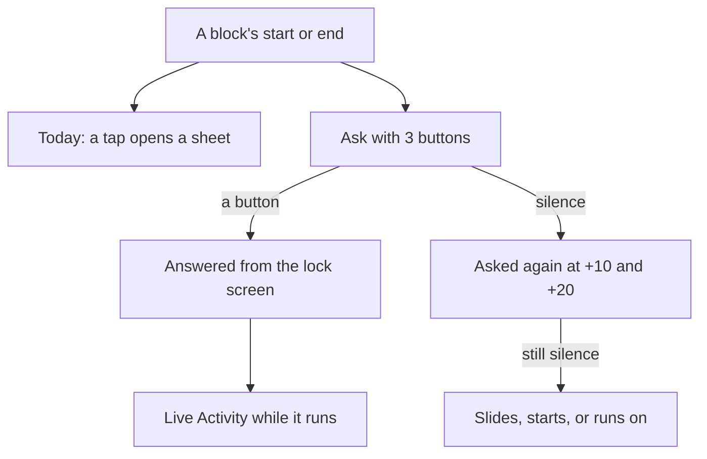
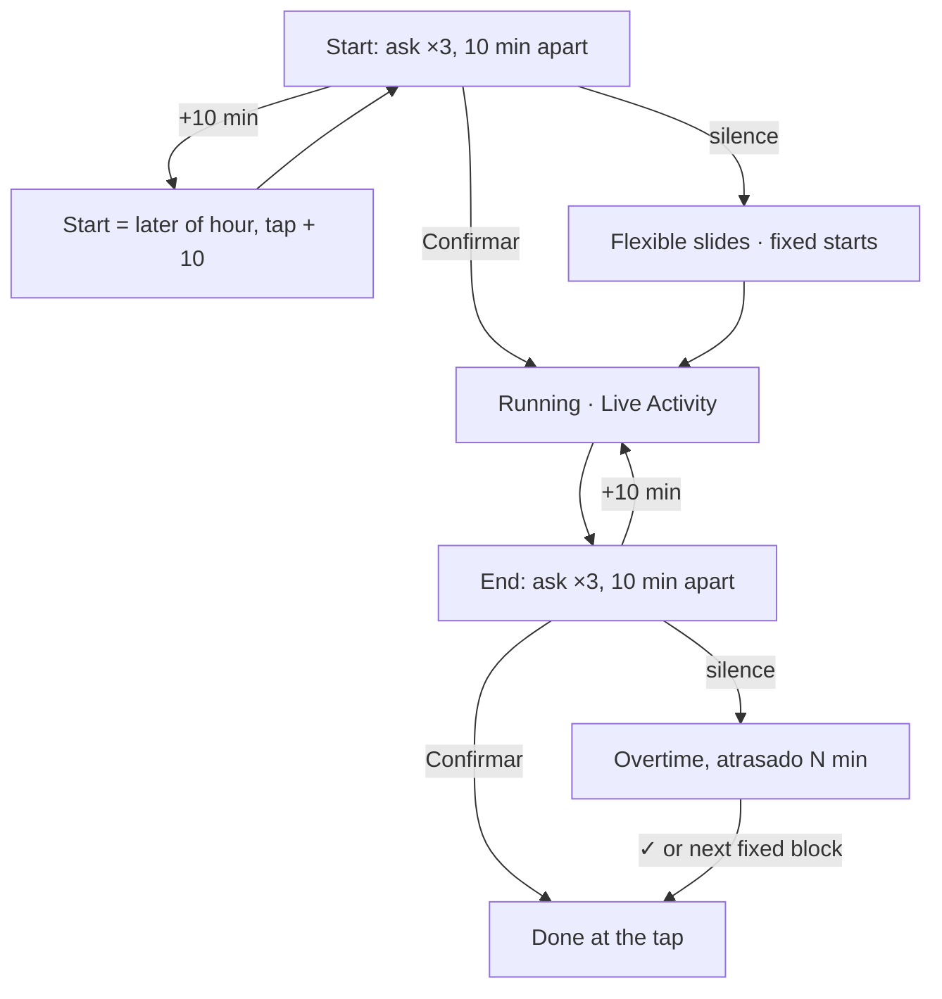
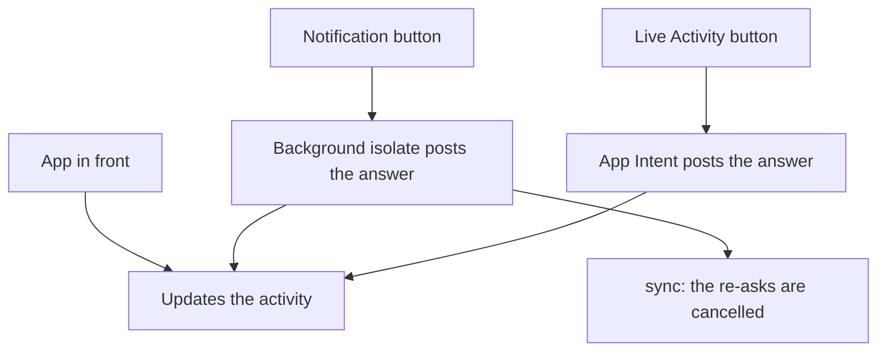
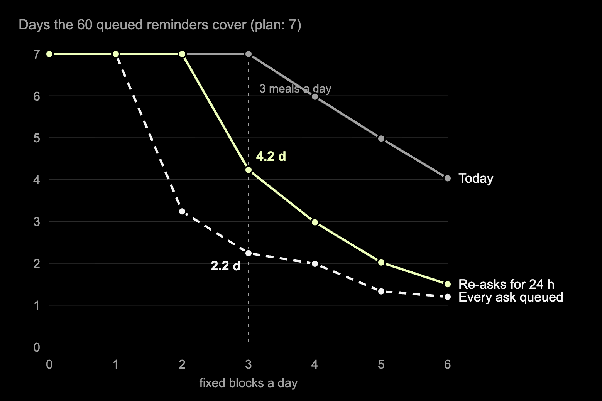

# A reminder should take the answer, not open the app

2026-10-28 · RFC · approved 2026-10-28 (deep-research pass not run) · server, app (iOS, Android) · issue #50

## Every block gets two asks with three buttons, and silence is safe

> [!IMPORTANT]
> Today a reminder only opens the app, and a block's end passes in
> silence, written down as done. Ask at both edges of every block, up to
> three times, with **Confirmar · +10 min · Falar com a Lunna** on the
> notification. Silence breaks nothing: a flexible task slides, a fixed
> one starts, an ending runs on as overtime. While a block runs, a Live
> Activity carries ⏯ −10 +10 ✓.

- **Do:** buttons on reminders; asks at start and end; overtime, not "done"; every routine fixed; a Live Activity (iOS) and an ongoing notification (Android).
- **Not needed:** a push server, a timer on the server, the "Finaliza em 10 minutos" reminder.
- **You decide:** when unanswered overtime stops (at the next fixed block or the end of the working day, *recommended*).

## Today a reminder opens the app, and an ending says nothing

| Reminder | When | A tap does |
|---|---|---|
| `confirmStart` | the next task's hour | opens the app, then a sheet: Começar agora / Esperar 15 min |
| `starting` | a fixed block's start | opens the card |
| `almostFinishing` | 10 min before a block ends | opens the card |
| `morning`, `evening` | 07:00, 21:00 | opens the app |
| *(nothing)* | a block's end | `catchUp` writes the task down as done |

- The server builds the plan ([`notifications.service.ts:85`](../../../server/src/notifications/notifications.service.ts#L85)); the phone mirrors it into local notifications, so reminders work offline.
- No reminder has a button: `zonedSchedule` gets no category ([`notification_queue.dart:177`](../../../app/packages/notifications/lib/src/service/notification_queue.dart#L177)), so every answer goes through the app ([`reminders_listener.dart:119`](../../../app/lib/notifications/view/reminders_listener.dart#L119)). Each task is asked about **once**.
- A begun task whose end passes is marked done on the next request, finished or not ([`event-layout.service.ts:966`](../../../server/src/events/event-layout.service.ts#L966)); a test pins it ([`events.controller.spec.ts:1163`](../../../server/src/events/events.controller.spec.ts#L1163)). Feitas keeps the **planned** hour.

## Example: breakfast, a fixed routine, at 08:00

| Time | Today | Proposed |
|---|---|---|
| 08:00 | "Café · Começa agora, até 08:30" | "Café começou" · Confirmar · +10 min · Falar com a Lunna, and the Live Activity starts |
| 08:04, +10 | — | Café moves to **08:14–08:44**: 10 minutes from the tap, not from 08:00 |
| 08:20 | "Finaliza em 10 minutos" | — (the Live Activity counts down) |
| 08:44 | Café is no longer drawn | "Café terminou?" · Confirmar · +10 min · Falar com a Lunna |
| 08:45, silence | — | Café runs on, marked "atrasado 1 min" |
| 08:54, 09:04 | — | asked again, then no more; it keeps growing |

- "Fixed" now means **never pushed by what comes before**. Only the person moves it, with +10.
- This is the same ask as for a flexible task. The difference is silence: a fixed block starts anyway, a flexible task waits and slides (`awaitingStart`, as today).

## Example: lunch, with a task running into it

| Time | Today | Proposed |
|---|---|---|
| 11:00 | "Relatório" begun, planned to 11:55 | same |
| 11:30 | extended +15: ends 12:10 | same |
| 11:45 | — | **"Almoço em 15 minutos"** · Confirmar · +10 min · Falar com a Lunna |
| 11:47, +10 | — | Almoço moves to **12:10–13:10** |
| 12:00, silence | "Almoço · Começa agora", over a task still running | Almoço starts anyway; Relatório is closed at 12:00 |

- The heads-up fires only when something runs right up to a fixed block, so the end ask of the task before would be too late.
- +10 on a heads-up counts from the block's hour, because 10 minutes from the tap (11:57) would make lunch *earlier*. The rule for both asks is **start = later of (planned hour, tap) + 10**.

## Example: nobody answers the end of a task

| Time | Today | Proposed |
|---|---|---|
| 14:00 | "Relatório" begun, 45 min | same, Live Activity 45:00 counting down |
| 14:35 | "Finaliza em 10 minutos" | — |
| 14:45 | written down as done at 14:45 | "Relatório terminou?" · Confirmar · +10 min · Falar com a Lunna |
| 14:46 | the next task waits at Agora | Relatório runs on, "atrasado 1 min"; the queue after it slides |
| 14:55, 15:05 | — | asked again, then no more |
| 15:20, ✓ | — | done at 15:20: Feitas holds 80 minutes, what really happened |

- Overtime reuses the paused block's machinery: the end is dragged along with the clock on read ([`catchUp`](../../../server/src/events/event-layout.service.ts#L926)), so no timer is needed, and Neon keeps sleeping ([neon-compute](../2026-10-23-neon-compute/README.md)).
- +10 during overtime sets the end to 10 minutes from the tap, which is what `_extend` already does once the end has been dragged to now.

## Why ask at the edges: they are the day's coarsest breakpoints

> [!TIP]
> "Deferring delivery of notifications until breakpoints are reached can
> meaningfully reduce costs of interruption, and deferring until coarser
> breakpoints further reduces these costs."
> Iqbal & Bailey, [CHI 2007](https://www.interruptions.net/literature/Iqbal_Bailey-CHI07.pdf).
> *For us:* the start and end of a block are the coarsest breakpoints a
> planner knows of, so they are where it should ask.

| Wait for the next breakpoint | Minutes (their field data) | Here |
|---|---|---|
| fine (switching paragraphs) | ~2 | — |
| medium (switching documents) | ~4 | — |
| coarse (switching activity) | ~7 | the re-ask, 10 min later; the heads-up, 15 min before |

- A re-ask 10 minutes after one that landed mid-sentence is likely to land on a better moment.
- Three asks and then quiet bound the cost: an ignored reminder means "busy", not "broken".

## Why a Live Activity: it counts by itself and needs no server

> [!TIP]
> "Unlike a widget, a Live Activity can't access the network": only the
> app or a push updates it, but a timer view counts on its own. Apple,
> [Live Activities](https://developer.apple.com/documentation/activitykit/displaying-live-data-with-live-activities).
> *For us:* it changes only when the block's **state** does, never once a
> minute: [derive on read](../concepts.md#derive-on-read-dont-poll) on the lock screen.

| Limit | What it means here |
|---|---|
| Starts only with the app in front, a `LiveActivityIntent`, or (iOS 26) scheduled for a date | the phone queues the next block's activity as it queues reminders |
| Buttons are App Intents (iOS 17+), in the app's process | ⏯ −10 +10 ✓ can call the API |
| 8 hours active, 4 more on the Lock Screen | a block is shorter |
| Android: "actively in progress", not "upcoming calendar events" ([Live Updates](https://developer.android.com/develop/ui/views/notifications/live-update)) | it starts with the block, not before |

## The change: one lifecycle for every block

- Fixed and flexible differ in one place: what silence means at the start.
- An answer is a write the app already makes (start, snooze, extend, done), so every rule stays on the server.
- The asks themselves are derived on read: an answered edge has no asks left in the next plan.

## The server: answers are rows, silence is worked out

| Change | Where |
|---|---|
| Every routine is fixed: `fixed` defaults to true, flexible routines are migrated, and the flexible-routine path goes (`routineDays`, `isMissed`) | [`routines.service.ts:58`](../../../server/src/routines/routines.service.ts#L58), `timeline.service.ts` |
| A block's end is no longer "done": unanswered, it runs on, its end dragged with the clock; the card carries `overtimeMinutes` | `catchUp`, [`event-layout.service.ts:966`](../../../server/src/events/event-layout.service.ts#L966) |
| A fixed block's start is confirmed (`confirmed_at` on `event`), and its end is `doneEvent`, as a task's is | `schema.ts`, `events.controller.ts` |
| +10 counts from the later of the hour and the tap, for starts (`POST /events/:id/delay`, snooze) and ends (extend) | `event-layout.service.ts` |
| The plan: 3 asks per unanswered edge, the 15-minute heads-up, no `almostFinishing`, re-asks only for the next 24 h | [`notifications.service.ts`](../../../server/src/notifications/notifications.service.ts) |

- Nothing runs on a timer: each change is stored when it happens and settled by `catchUp` on the next request.
- The reminder copy ("Almoço em 15 minutos", "Café terminou?") stays on the server, in Portuguese.

## The phone: buttons answer without opening the app

- **Actions:** one category, "ask", on every block reminder. Confirmar and +10 min run in the background (`onDidReceiveBackgroundNotificationResponse`, a `@pragma('vm:entry-point')` function, as `background_refresh.dart` already is). Falar com a Lunna opens the app on the agent, about that card.
- **Labels** live in `app_pt.arb`: the server knows no brand, and the button names it (`appName(AppBrand.id)`).
- **iOS:** a widget extension in SwiftUI. The app stays on iOS 14; the activity needs 16.1 and buttons 17. Its state is title, start, end, paused, overtime and delivery, about 200 bytes of the 4 KB allowed.
- **Android:** an ongoing notification with a countdown and four actions. On Android 16 it is promoted to a Live Update (`POST_PROMOTED_NOTIFICATIONS`).

## Three asks per edge fill the phone's 60 slots in two days

- iOS holds 64 pending notifications per app, and the scheduler keeps 60 ([`notification_scheduler.dart:64`](../../../app/packages/notifications/lib/src/service/notification_scheduler.dart#L64)). Past that, a reminder is simply not queued.
- With breakfast, lunch and dinner every day, queuing every ask for the 7-day plan needs 157 slots: the 60 run out at **2.2 days**. The background refresh comes "once or twice a day", with no guarantee ([`background_refresh.dart:36`](../../../app/lib/notifications/background_refresh.dart#L36)).
- With the re-asks queued only for the next 24 hours (later syncs add them), the same week needs 85 slots and the 60 reach **4.2 days**.
- Measured with the real `NotificationsService` ([`code/plan-count.ts`](./code/plan-count.ts), [`data/plan-count.csv`](./data/plan-count.csv)).

## Trade-offs

| Option | Gain | Cost | When it wins |
|---|---|---|---|
| Re-asks queued for 24 h | 4.2 days covered, 7 with ≤ 2 fixed blocks | a phone not opened for a day gets first asks only | always, unless push arrives |
| Every ask queued, 7 days | simplest plan | 2.2 days covered, then silence | at most 1 fixed block a day |
| Local only, no push | no APNs/FCM keys, no server timer | an answer on the web leaves the phone's re-asks until its next sync | one person, mostly on the phone |
| APNs push (and push-to-start) | re-asks cancelled at once; the activity starts with the app closed (iOS 17.2) | keys, device tokens, a sender, and wakes Neon on each send | when the web is used as much as the phone |
| iOS 26 scheduled activity | the next block's activity appears offline, at its hour | iOS 26 only; counts against the activity limit | iOS 26 phones, next block only |

## Impact: one tap to answer, and a day that records what happened

| | Today | Proposed |
|---|---|---|
| Steps to answer a start | 4: tap, unlock, wait for the app, tap the sheet | 2: expand, tap a button |
| Steps to answer an end | not asked | 2, or one on the Live Activity |
| Reminders a day (3 meals, 6 tasks) | 14 | 22 answered at once · 58 if nothing is answered |
| Days queued ahead (3 meals) | 7 | 4.2 |
| A task that ran 35 min over | Feitas says 45 min | Feitas says 80 min |

- The counts are from [`code/per-day.mjs`](./code/per-day.mjs) ([`data/per-day.csv`](./data/per-day.csv)). The steps are counted by hand on today's flow.
- 58 is the worst day, and it is bounded: three asks per edge, then quiet.
- The cost is mostly native: a Swift extension and a small Swift client for four routes, the first native code in the app beyond its entry point.

## Decisions

| Decision | Options | Recommended | Cost of the other |
|---|---|---|---|
| Unanswered overtime ends | at the next fixed block or the working day's end · never · at the third ask | **next fixed block or day's end** | never: a task runs all night · third ask: Feitas loses the real hour |
| Routines | all fixed · keep flexible ones | **all fixed** (as asked) | two kinds of routine day, two code paths |
| The step | 10 min everywhere · keep 15 in the app | **10 everywhere** | the card says 15 and the notification says 10 |
| Re-asks queued | next 24 h · whole plan · soonest block only | **next 24 h** | whole plan: 2.2 days covered |
| Push from the server | not now · APNs + FCM now | **not now** | stale re-asks after an answer on the web |
| iOS Live Activity start | app, intent and iOS 26 scheduling · push-to-start | **app, intent, iOS 26** | a push server |
| `almostFinishing` | drop · keep | **drop** | a fourth reminder a block, while the countdown is on screen |
| End asks for meetings | every fixed block · routines only | **every fixed block** (as asked) | two rules for "fixed" |

> **Decision (2026-10-28):** Approved as written: every recommended option above, including the PR's two open questions. Unanswered overtime ends at the next fixed block or the working day's end, written down as done there; meetings and every other fixed block get the three end asks, not only routines.

## Decided unattended

- After approval: took "I liked everything" as every *(recommended)* option and both PR questions answered as recommended. No option was dropped, so no slide changed beyond the status and the decision note.
- Phase 4 was not asked for, so it was not run. The three unverified claims below are for the build to check on a device before it relies on them.
- Wrote Phases 1–3 only. The deep-research pass (Phase 4) waits until asked.
- Read "even those that are recurring are all fixed" as: every routine becomes fixed, and flexible routines go.
- +10 on the 15-minute heads-up counts from the block's hour, not from the tap, so a tap can never move lunch earlier. The general rule is "later of the hour and the tap, + 10".
- A fixed block that starts in silence closes the overtime of the block before at its start, rather than letting two blocks run at once.
- The Live Activity's buttons are ⏯, −10, +10 and ✓. A tap on the activity opens the card, and Falar com a Lunna stays on the notification.
- The ordinary-day counts (3 meals, 6 tasks) are an assumption, not a measurement. They set the sizes, not the finding.
- Not verified: the exact iOS version of scheduled Live Activities (26, from Apple's reference page), whether a notification action can start an activity in the background, and whether `flutter_local_notifications` exposes Android's chronometer countdown and promotion. Phase 4 should check them.

## Go deeper

| Idea | The case here | Read |
|---|---|---|
| Ask at the edges | start and end asks, the heads-up 15 min before lunch, re-asks 10 min apart | [Iqbal & Bailey, CHI 2007](https://www.interruptions.net/literature/Iqbal_Bailey-CHI07.pdf) |
| The lock screen counts by itself | the activity changes on state, never per minute | [Apple, Live Activities](https://developer.apple.com/documentation/activitykit/displaying-live-data-with-live-activities) |
| [Derive on read](../concepts.md#derive-on-read-dont-poll) (met before) | overtime dragged on read like a pause; asks derived from unanswered edges | [neon-compute](../2026-10-23-neon-compute/README.md) |

- [Apple, Displaying live data with Live Activities](https://developer.apple.com/documentation/activitykit/displaying-live-data-with-live-activities): 8 + 4 hours, 4 KB, foreground start except `LiveActivityIntent`, scheduling at a date, buttons through App Intents.
- [Apple, `request(…start:)`](https://developer.apple.com/documentation/activitykit/activity/request(attributes:content:pushtype:style:alertconfiguration:start:)): scheduled start, iOS 26, needs an alert configuration.
- [Android, Live Updates](https://developer.android.com/develop/ui/views/notifications/live-update): promotion requirements, "actively in progress", chronometer in the chip.
- [flutter_local_notifications](https://pub.dev/packages/flutter_local_notifications): actions per category on iOS, the background isolate handler. Its README says iOS keeps the 64 *last set*, while our scheduler's comment says "soonest" (to verify).
- [Iqbal & Bailey, CHI 2007](https://www.interruptions.net/literature/Iqbal_Bailey-CHI07.pdf): breakpoints of three granularities, ~7 min to the next coarse one.
- Data: [`data/plan-count.csv`](./data/plan-count.csv) (queue reach by fixed blocks a day), [`data/per-day.csv`](./data/per-day.csv).
- Code: [`code/plan-count.ts`](./code/plan-count.ts) (from `server/`: `NODE_PATH=$PWD/node_modules npx tsx …`), [`code/reach-chart.mjs`](./code/reach-chart.mjs), [`code/per-day.mjs`](./code/per-day.mjs).
