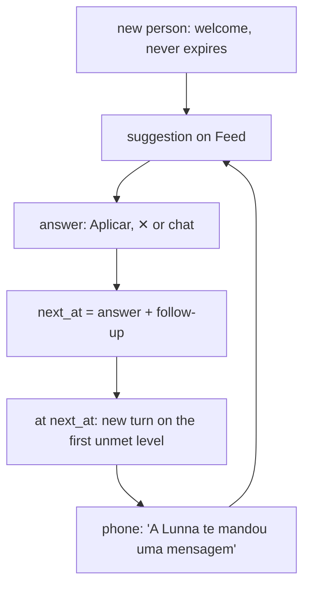
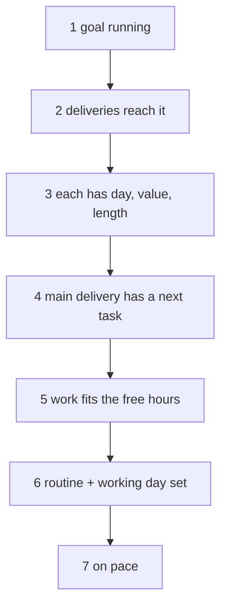
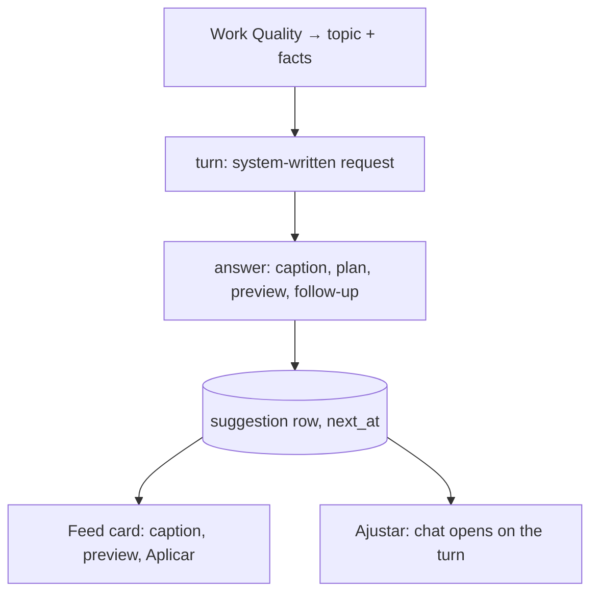
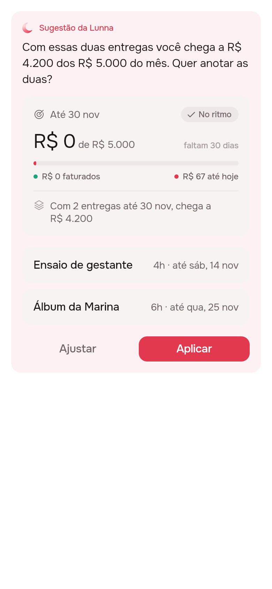
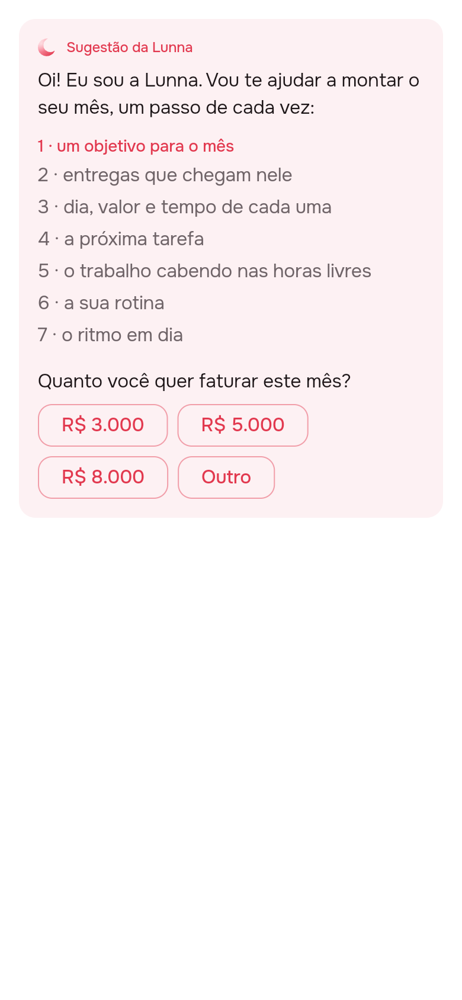
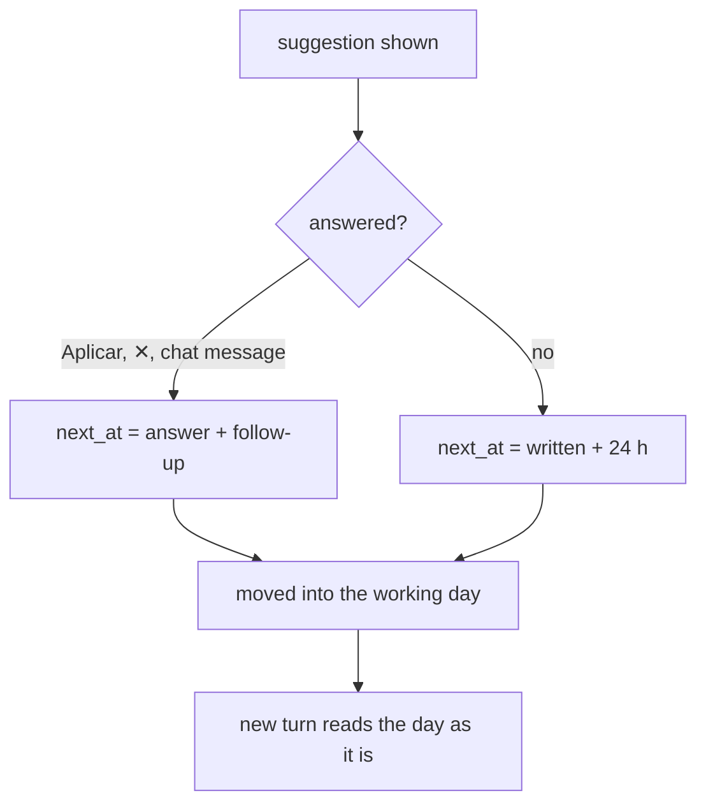
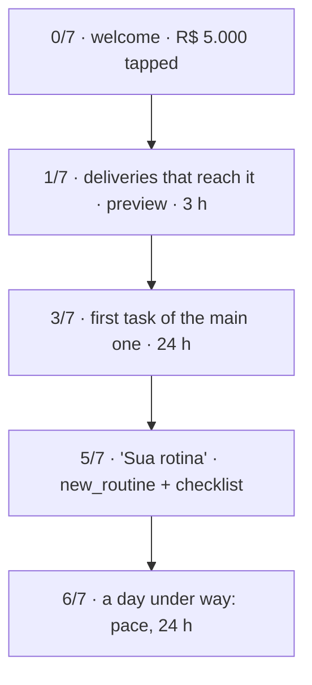

# A suggestion is a turn the agent asks itself, about Work Quality

2026-10-29 · RFC · draft, review 1 answered (phases 1–3; deep-research pass not run) · server agent, Feed, notifications, agent package · [issue #69](https://github.com/pietroid/lunna/issues/69), after [#67](https://github.com/pietroid/lunna/issues/67)

## Code picks the topic; the model writes the turn and its hour

> [!IMPORTANT]
> A suggestion should be an ordinary agent turn the server asks on the person's behalf, about the **first Work Quality level** that isn't met yet (goal → deliveries that reach it → tasks → time → routine → pace). The model writes the words, the plan, a **preview drawn with the real widgets**, and **when the next one is due** (3–24 h after the answer). A new person starts on a **welcome that never expires**. At that hour a timer per person writes the next turn and the phone says so. Nothing polls.



- **Do:** Work Quality, the self-asked turn, a `preview` block, the welcome, `next_at`, routines in the agent's registry.
- **Not needed:** an hourly scan, a separate onboarding wizard, a second model path, a push server.
- **You decide:** the goal model for the golden scenario (money only today), and whether a one-shot timer per person may touch Postgres.

> **Q:** Consider an onboarding user or a user that never had a suggestion. It already should have a placeholder with infinite expiration that welcomes the user and walks through their journey from the beginning, using the structure you did there.
>
> **A:** Yes. Anyone with no suggestion yet gets the welcome. It is fixed copy, costs no model call and never expires. It lists the seven Work Quality levels and opens the first one with the amounts to choose from ([slide](#a-new-person-starts-on-a-welcome-that-never-expires)). It goes when it is answered, and from then on the turns take over.

> **Q:** I'm in doubt about this model, because the user should see a suggestion based on post-suggestion editing. Each suggestion adds a follow-up time (3 h or 24 h, the model's evaluation); with none, or past the expiration, the new one arrives at that time; the first expires after 1 day; schedule notifications when the user rejects or finishes the chat; a backend queue checks expired suggestions hour by hour; a daily notification reminds that Lunna sent a message. Propose a simplified and consumption-friendly job.
>
> **A:** Taken almost whole. Each answer sets `next_at`: the model's follow-up, 3–24 h, counted from the last Aplicar, ✕ or chat message, 24 h if it gives none ([slide](#the-next-suggestion-comes-when-the-last-one-said)). The hourly scan is the one part changed. It would wake Neon 720 times a month (+14.6 CU-h). A timer per person, armed at `next_at`, does the same job with 100 wakes (+2.0 CU-h), and the phone holds the notification ([slide](#one-timer-per-person-not-an-hourly-scan)).

## Today the suggestion is one backlog rule, held in memory

[`agent.service.ts:747`](../../../server/src/agent/agent.service.ts) works out the only suggestion there is with arithmetic: it takes the first of three backlog tasks that fits today.

```ts
for (const task of view.backlog.slice(0, 3)) {
  const slot = nextFreeSlot(from, task.durationMinutes, busy, zone, workDay);
  if (!sameDayIn(slot.start, now, zone)) continue;
  …
  text: `"${task.title}" está esperando no Para depois. ` + …
```

- It never looks at goals, deliveries or routines. A new person, whose backlog is empty, gets **nothing**.
- "Offered once" lives in `_suggested`, a `Map` in memory ([`:222`](../../../server/src/agent/agent.service.ts)), so it is lost on every deploy.
- #67 (PR #68, being built) adds the stored row, `validUntil`, a basis hash and three tiers: goal, delivery, routine. That is the shell this RFC fills in.

## The agent can't write the routine the onboarding needs

[`tool/coverage.mjs`](../../../server/tool/coverage.mjs), run today ([data/coverage.txt](data/coverage.txt)): the agent reaches **15 of 42** routes a person drives.

| What the person listed | Agent can create | Agent can change |
|---|---|---|
| Goal | ✓ `new_goal` | ✓ `edit_goal` |
| Delivery, product (kind) | ✓ `new_artifact`, `new_kind` | ✓ delivery; kind ✗ |
| Task, fixed block | ✓ `new` on `place`/`at_hour` | hour ✓; length, notes, checklist ✗ |
| **Routine** | **✗ (0 of 4 routes)** | **✗** |
| Working day | ✗ | ✗ |

- The last Work Quality levels ask for a routine and a working day, and today only a hand can write those.
- So **routines join the registry**: `new_routine`, `edit_routine` (hour, rule, checklist) and `set_work_day`. That's one `Action` each, as [agent.md](../../spec/agent.md) promises.

## Example: three of five people get the wrong topic

[`code/ladder.mjs`](code/ladder.mjs) runs both rules over five states ([data/ladder.csv](data/ladder.csv)):

| Person | #67's tiers | Work Quality (first unmet level) |
|---|---|---|
| New, nothing written | goal | goal (0/7) |
| Goal R$ 5.000, deliveries worth R$ 4.200 | routine/backlog | **reach** (1/7) |
| Goal covered, no tasks, no routine | routine/backlog | **tasks** (3/7) |
| All written, 40 h owed, 25 h free | routine/backlog | **fits** (4/7) |
| Demo: behind pace | delivery | pace (6/7) |

- #67's tiers only see whether a goal exists and whether it's behind pace. A goal that **can't** be reached, a delivery with no next step, or a month that doesn't fit the hours all fall through to "fit a backlog task".
- Every level is arithmetic the server already does: `done`/`queued` on goals, `Schedule.needMinutes`/`freeMinutes`, routines.

## Work Quality: what "defined" means, in seven levels



- The **first level not met is the topic**. It is also the metric you asked for: "Work Quality 4/7" is how defined a person's plan is, and it can go to PostHog as a number (`work_quality`), never as text.
- Topics run from top to bottom: no goal outranks everything, as #67 asks.
- Level 6 comes after the work on purpose, since a routine is built around what the month holds. Swap it with level 4 if you'd rather the routine come earlier.

> **Q:** Let's replace the rung term with Work Quality.
>
> **A:** Done everywhere: the seven checks are **Work Quality levels**, a person's score is "Work Quality 4/7", the PostHog number is `work_quality`, and `ladder.mjs` and `ladder.csv` use the same words.

## Why: models misjudge *when*, so code decides it

| Study | Finding | For us |
|---|---|---|
| ProactiveBench (Lu et al. 2024) | the best fine-tuned model judges *when* to help at **66% F1** (an 8B model: 55%) | the topic is code's; the model only proposes a follow-up inside bounds |
| Chen et al., CHI 2025 | proactive help raised tasks done by **12–18%**; at a higher frequency, preference fell **90% → 47%** | one suggestion at a time, never sooner than 3 h |
| Chen et al., CHI 2025 | a short summary that expands into the chat did best | the card is the caption; Ajustar opens the turn |

> [!TIP]
> "Increasing the frequency of suggestions can negatively impact user experience, reducing participant preference … by half." Chen et al., [Need Help?](https://arxiv.org/html/2410.04596v2)
> *For us:* the agent's voice is scarce, and the 3 h floor and one stored row keep it so.

Horvitz (1999) says it too: account for attention when timing a service ([Workflow before agent](../concepts.md#workflow-before-agent)).

## The change: the suggestion is a stored agent turn



- The request is written by code, not typed by the person: "Topic: reach. Goal R$ 5.000 by 30/11; open deliveries worth R$ 4.200. Propose the next step." It runs through **the same `turn()`**, tools and dry run as any message.
- **The card's text is the answer's caption.** Aplicar applies the turn's plan, and Ajustar opens the chat with the turn already drawn. These are your points 1 and 5.
- No number to go on? Then the turn ends in `choices` and has no plan, as #67's mockup draws it.

## The change: show the goal as the goal tab will


Left: the plan card today, with three lines of text. Right: the same plan drawn with the real `GoalCard` and `ArtifactRow` ([code](code/suggestions_rfc_preview.dart)). Only the right one shows that the two deliveries reach **R$ 4.200 of 5.000**.

- A new `preview` block draws the result of the plan's creations with the tabs' own widgets, in draft. The server fills in the forecast from the dry run, so the model never types a number ([the server states facts](../concepts.md#the-model-arranges-the-server-states-facts)).
- One widget per kind: goal → `GoalCard`, delivery → `ArtifactRow`, routine → a row of the Rotina page. That's your point 4: "how a goal would look".

> **Q:** Ajustar and Aplicar will also come after the rendered preview?
>
> **A:** Yes: caption, then the preview, then Ajustar and Aplicar at its foot, on Feed and in the chat alike ([slide](#ajustar-and-aplicar-sit-under-the-preview)). The buttons act on what was just drawn.

## Ajustar and Aplicar sit under the preview



- The order is the one people read in: what the agent says, what it would look like, what to do about it ([code](code/suggestions_rfc_preview.dart), `?s=3`).
- The preview replaces the plan's text lines for what it can draw. A change it can't draw (a task moved to an hour) keeps its line, between the preview and the buttons.
- **Ajustar** opens the chat on this turn; **Aplicar** makes the plan through the same path as the plan card. That's two buttons, not three: Ajustar takes the place of a separate Conversar.

## A new person starts on a welcome that never expires



- Whoever has **never had a suggestion** gets this one ([code](code/suggestions_rfc_preview.dart), `?s=4`). It is fixed copy in `app_pt.arb`, so it costs no model call, and it never expires (`next_at` is null).
- It walks the journey from the start: the seven Work Quality levels as the plan for the month, the first one lit, and its question with amounts to tap.
- An amount opens the chat with it as the first message ("Quero faturar R$ 5.000 este mês"), which is an ordinary turn. From the answer on, `next_at` runs as for everyone else.
- ✕ puts it away for 24 h. After that comes the first generated suggestion, which is about level 1 anyway.

## The next suggestion comes when the last one said



- **The model proposes the follow-up** in its answer (`followUp`, in hours): 3 h when a step is under way ("anote as tarefas e eu volto"), 24 h when the next step is tomorrow's. The server holds it to **3–24 h** and uses **24 h** when none is given.
- **It counts from the last answer.** Each message in the chat the suggestion opened moves `next_at` again, so a conversation 20 minutes after Aplicar still gets its full follow-up.
- **`next_at` is also the expiry**: one timestamp in place of `validUntil`. The new turn reads the day as it is then, so whatever was edited after the suggestion is in it.
- An hour past the working day moves to the next day's start, so a suggestion never lands at 23:00.
- If the person changes the very thing a suggestion is about (its basis hash), the card hides, and nothing is written early.

## One timer per person, not an hourly scan

[`code/followup.mjs`](code/followup.mjs), two people over 30 days ([data/followup.csv](data/followup.csv)), against today's ~25 CU-h a month:

| Job | Server wakes / month | Neon extra | Ready when the phone rings |
|---|---|---|---|
| Hourly scan for expired rows | 720 | +14.6 CU-h (+$1.54), +58% | up to an hour late |
| **Timer per person at `next_at`** | 100 | **+2.0 CU-h (+$0.21)** | on time |
| On read only | 0 | 0 | no: written on the tap, ~5 s |

- **The job:** a `Map<userId, timeout>` in the server, armed when `next_at` is written, re-armed at boot by one query. It never asks who is due.
- **A missed timer costs seconds, not a suggestion:** the next read finds `next_at` passed and writes the turn then ([settle on access](../concepts.md#settle-on-access-from-absolute-times)).
- **The phone holds the notification:** the plan it mirrors (`NotificationsService.plan`) gets a `suggestion` item at `next_at` + 1 min, "A Lunna te mandou uma mensagem". No push server.
- **The daily reminder is the morning one** (`MORNING_MESSAGES`), which names an unseen suggestion instead of its usual line.

> [!TIP]
> "A key is passively expired when a client tries to access it." Redis, [EXPIRE](https://redis.io/docs/latest/commands/expire/)
> *For us:* `next_at` is an absolute time. The timer is how the suggestion is on time; the read is how it is never lost.

## Example: the golden scenario, level by level

Your wife opens Lunna on a Saturday with nothing written. She is met by the welcome. After that, each answer sets the next hour, and each new turn finds a level further on. **The onboarding is Work Quality, not a separate flow.**



- While she stays in the chat, each Aplicar lets the next level's turn come **into the same conversation** at once, so she moves from goal to routine in one place. `next_at` only waits for her once she leaves.
- The preview teaches the vocabulary: she sees an "entrega" drawn before she reads the word.
- Planning by her cycle doesn't fit today's routine rules (`daily`/`weekdays`/`weekend`). The agent can only spread fixed blocks and anchors by day, so this goes under *Decisions*.

## Trade-offs: Work Quality wins once routines are in

| Option | Gain | Cost | When it wins |
|---|---|---|---|
| **Work Quality + stored turn + `next_at`** (recommended) | right topic; on time; one code path | a timer per person; routine actions to build | always, once routines are in the registry |
| #67's tiers + template text | no model, instant | wrong topic in 3 of 5 states; no preview | as the fallback when a turn fails |
| Model picks the topic too | finds odd cases | timing at ~66% F1 | never alone; it only picks the follow-up |
| A fixed onboarding wizard | predictable | a second UI to keep; nothing after day one | if the welcome + turns can't hold a beginner's hand (eval it) |

## Impact: a few cents a month buys the right topic, on time

| What | Size | Source |
|---|---|---|
| Model cost | ~50 turns a month: **~$0.05/person/month** (Haiku 5.5), $0.13 (3.1 Flash-Lite) | [cost.csv](data/cost.csv) at $0.001 and $0.0027 a turn × [followup.csv](data/followup.csv) |
| Neon | **+2.0 CU-h a month** for two people (+8%), still inside the free plan | [followup.csv](data/followup.csv), an estimate |
| Topic | the real gap instead of a backlog nudge in **3 of 5** states | [ladder.csv](data/ladder.csv) |
| Agent reach | 15 → **18 of 42** routes, so the onboarding works end to end | [coverage.txt](data/coverage.txt) |

- To measure later: `work_quality` (0–7) per person per day in PostHog. A score that climbs is the product's goal, as a number.

## Decisions

| Decision | Options | Recommended | Cost of the other |
|---|---|---|---|
| Who picks the topic | code (Work Quality) / model | **code** | the model would get the timing wrong a third of the time |
| Who writes it | stored agent turn / template | **stored turn**, template if it fails | templates can't converse or preview |
| When the next one comes | model's follow-up, 3–24 h, default 24 h / fixed 1 day | **follow-up** | a fixed day ignores a step under way |
| How it's made on time | timer per person / hourly scan / on read only | **timer per person**, on read as catch-up | the scan adds 7× the Neon hours; on read makes the tap wait |
| The rule "no timer touches Postgres" (AGENTS.md) | allow one-shots at an hour someone was told to look / keep it | **allow one-shots**, never periodic | keeping it means on read only |
| A new person | fixed welcome, never expires / a model turn | **fixed welcome** | a model call for the same words every time |
| Previews | real widgets in a `preview` block / richer plan lines | **real widgets** | plain lines hide the shortfall |
| Routines for the agent | `new_routine`, `edit_routine`, `set_work_day` / none | **add them** | level 6 is reached by hand only |
| Goal model for the golden scenario | money only / open `count` goals / free-text goal | **ask you** (below) | — |

## Decided unattended

- **Phase 4 (deep research) not run**: the review didn't ask for it. The Horvitz paper didn't extract, so its three regions (act, ask, wait) come from course summaries and are unverified.
- **Level order:** routine after work, not before. It's one line in `ladder.mjs` to swap.
- **The hourly scan became a timer per person**, because it does the same job for 7× fewer Neon hours. The scan stays in the table if you'd rather keep it.
- **"Finalizes the conversation"** is read as "the last message in it": there's no end event in a chat, so each message moves `next_at`.
- **The first suggestion's 24 h** is the default for all of them when the model gives no follow-up. The welcome alone never expires.
- **Conversar became Ajustar**, so the card has two buttons under the preview. Ajustar already opens the chat on the plan card.
- **✕** puts a suggestion away until its `next_at` (the welcome: 24 h). That answers #67's open question.
- **"A list of users"** in the issue is read as "a list of deliveries" (clients as deliveries).
- **Open questions:** is your wife's goal an amount to bill (today's only goal), or something else, which would mean opening `count` goals? And should "based on her cycle" mean phases the routine knows about, or is it enough for the agent to place blocks by day?

## Go deeper

| Idea | The case here | Read |
|---|---|---|
| Code says when, model says what | Work Quality picks the topic; the turn writes it and proposes its follow-up | Chen et al. 2025; Lu et al. 2024 |
| Preview the outcome, not the diff | `GoalCard` in draft shows R$ 4.200 of 5.000, Aplicar under it | Chen et al. 2025 (*Suggest and Preview*) |
| Arm a timer per due time, not a scan | `next_at` armed in memory; the read catches up a lost one | Redis EXPIRE; neon-compute |

- Chen et al., [Need Help? Designing proactive AI assistants for programming](https://arxiv.org/html/2410.04596v2) (CHI 2025): the frequency and preference numbers, summary-then-expand.
- Lu et al., [Proactive Agent](https://arxiv.org/abs/2410.12361) (2024): ProactiveBench, 66.47% F1 on when to help.
- Horvitz, [Principles of mixed-initiative user interfaces](https://erichorvitz.com/uiact.htm) (CHI 1999): attention and timing, and the cost of poor guesses (summaries only, unverified).
- Gollwitzer & Sheeran, [Implementation intentions](https://kops.uni-konstanz.de/entities/publication/2e749bfb-8533-437c-8203-7e788c910c5f) (2006), d = 0.65: a goal with a *when* (levels 4–6) is reached more often than a goal alone.
- Redis, [EXPIRE](https://redis.io/docs/latest/commands/expire/): absolute expiry times, settled when read.
- [neon-compute](../2026-10-23-neon-compute/README.md): why a periodic query keeps the database awake, and the ~25 CU-h baseline.
- Data: [ladder.csv](data/ladder.csv), [coverage.txt](data/coverage.txt), [cost.csv](data/cost.csv), [followup.csv](data/followup.csv). Code: [ladder.mjs](code/ladder.mjs), [cost.mjs](code/cost.mjs), [followup.mjs](code/followup.mjs), [the previews](code/suggestions_rfc_preview.dart) (copy to `app/lib/` and run `.tool/preview suggestions_rfc 1 2 3 4`).
