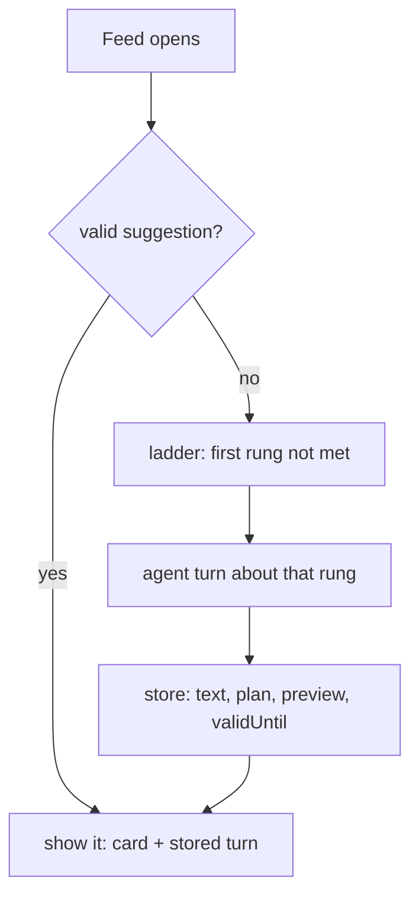
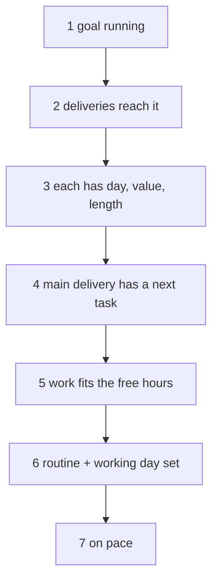
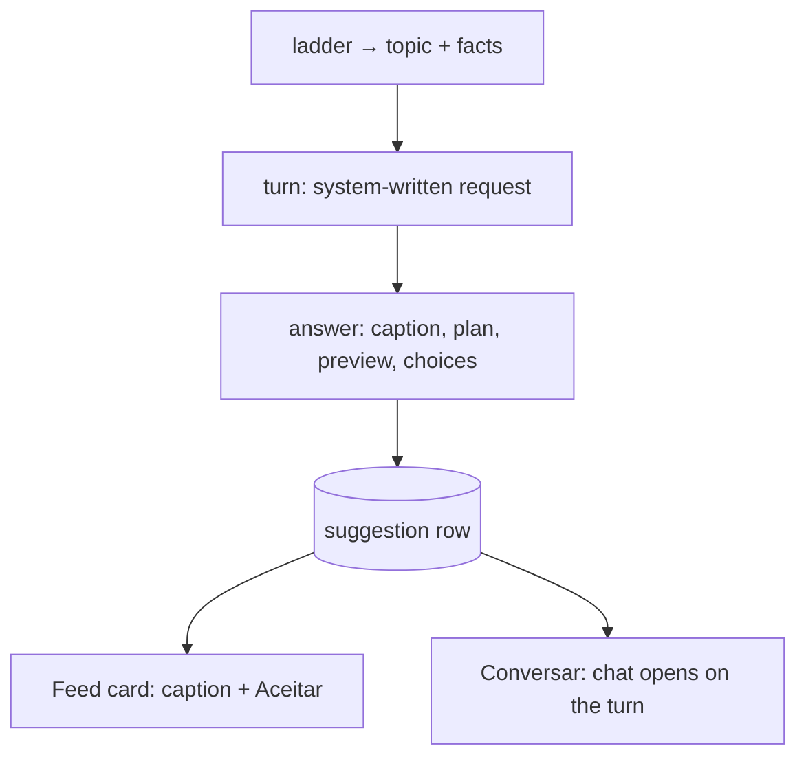
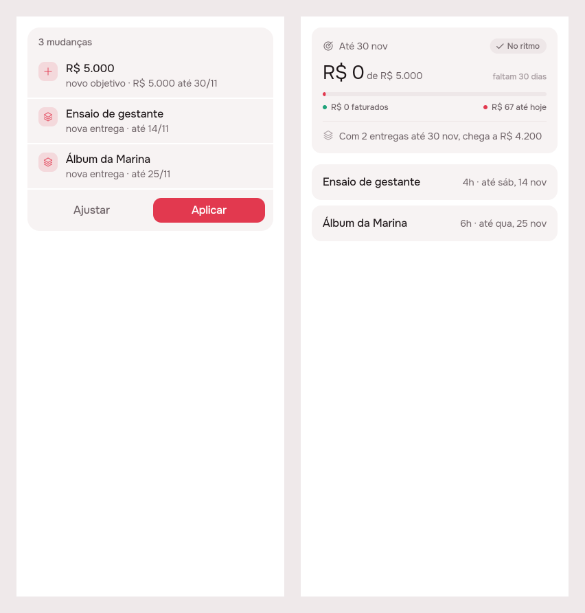
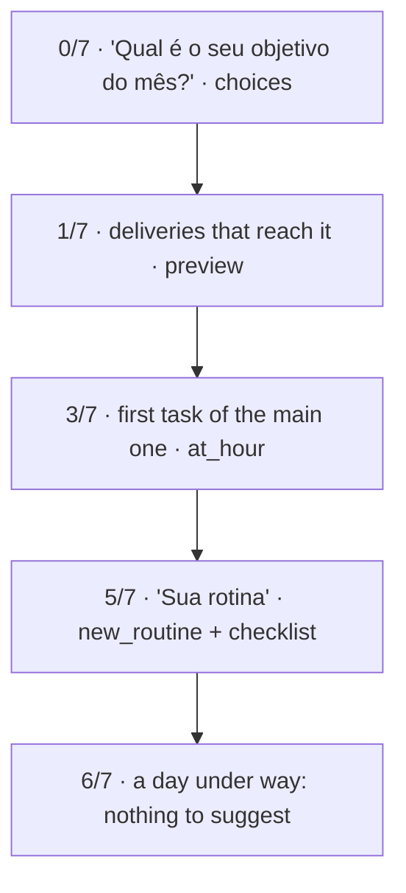

# A suggestion is a turn the agent asks itself, on a ladder

2026-10-29 · RFC · draft (phases 1–3; deep-research pass not run) · server agent, Feed, agent package · [issue #69](https://github.com/pietroid/lunna/issues/69), after [#67](https://github.com/pietroid/lunna/issues/67)

## Code picks what to talk about; the model writes the turn

> [!IMPORTANT]
> A suggestion should be an ordinary agent turn the server asks on the person's behalf, about the **first rung of a readiness ladder** that isn't met yet (goal → deliveries that reach it → tasks → time → routine → pace). Code climbs the ladder. The model only writes the words, the plan and a **preview drawn with the real widgets**. The turn is stored until it expires, so the agent speaks at most once per day per person, and nothing runs on a timer.



- **Do:** the ladder, the self-asked turn, a `preview` block, routines in the agent's registry.
- **Not needed:** a scheduler, a separate onboarding wizard, a second model path.
- **You decide:** the goal model for the golden scenario (money only today), the expiry bounds.

## Today the suggestion is one backlog rule, held in memory

[`agent.service.ts:747`](../../../server/src/agent/agent.service.ts) works out the only suggestion there is with arithmetic: it takes the first of three backlog tasks that fits today.

```ts
for (const task of view.backlog.slice(0, 3)) {
  const slot = nextFreeSlot(from, task.durationMinutes, busy, zone, workDay);
  if (!sameDayIn(slot.start, now, zone)) continue;
  …
  text: `"${task.title}" está esperando no Para depois. ` + …
```

- It never looks at goals, deliveries or routines. A new person, whose backlog is empty, gets **nothing**.
- "Offered once" lives in `_suggested`, a `Map` in memory ([`:222`](../../../server/src/agent/agent.service.ts)), so it is lost on every deploy.
- #67 (PR #68, being built) adds the stored row, `validUntil`, a basis hash and three tiers: goal, delivery, routine. That is the shell this RFC fills in.

## The agent can't write the routine the onboarding needs

[`tool/coverage.mjs`](../../../server/tool/coverage.mjs), run today ([data/coverage.txt](data/coverage.txt)): the agent reaches **15 of 42** routes a person drives.

| What the person listed | Agent can create | Agent can change |
|---|---|---|
| Goal | ✓ `new_goal` | ✓ `edit_goal` |
| Delivery, product (kind) | ✓ `new_artifact`, `new_kind` | ✓ delivery; kind ✗ |
| Task, fixed block | ✓ `new` on `place`/`at_hour` | hour ✓; length, notes, checklist ✗ |
| **Routine** | **✗ (0 of 4 routes)** | **✗** |
| Working day | ✗ | ✗ |

- The ladder's last rungs ask for a routine and a working day, and today only a hand can write those.
- So **routines join the registry**: `new_routine`, `edit_routine` (hour, rule, checklist) and `set_work_day`. That's one `Action` each, as [agent.md](../../spec/agent.md) promises.

## Example: three of five people get the wrong topic

[`code/ladder.mjs`](code/ladder.mjs) runs both rules over five states ([data/ladder.csv](data/ladder.csv)):

| Person | #67's tiers | Ladder (first unmet rung) |
|---|---|---|
| New, nothing written | goal | goal (0/7) |
| Goal R$ 5.000, deliveries worth R$ 4.200 | routine/backlog | **reach** (1/7) |
| Goal covered, no tasks, no routine | routine/backlog | **tasks** (3/7) |
| All written, 40 h owed, 25 h free | routine/backlog | **fits** (4/7) |
| Demo: behind pace | delivery | pace (6/7) |

- #67's tiers only see whether a goal exists and whether it's behind pace. A goal that **can't** be reached, a delivery with no next step, or a month that doesn't fit the hours all fall through to "fit a backlog task".
- Every rung is arithmetic the server already does: `done`/`queued` on goals, `Schedule.needMinutes`/`freeMinutes`, routines.

## The ladder: what "defined" means, in order



- The **first rung not met is the topic**. It is also the metric you asked for: "4/7" is how defined a person's plan is, and it can go to PostHog as a number, never as text.
- Topics run from top to bottom: no goal outranks everything, as #67 asks.
- Rung 6 comes after the work on purpose, since a routine is built around what the month holds. Swap it with rung 4 if you'd rather the routine come earlier.

## Why: models misjudge *when*, so code decides it

| Study | Finding | For us |
|---|---|---|
| ProactiveBench (Lu et al. 2024) | the best fine-tuned model judges *when* to help at **66% F1** (an 8B model: 55%) | the timing call is code's: validity plus the ladder |
| Chen et al., CHI 2025 | proactive help raised tasks done by **12–18%**; at a higher frequency, preference fell **90% → 47%** | one suggestion, held until it expires |
| Chen et al., CHI 2025 | a short summary that expands into the chat did best | the card is the caption; Conversar opens the turn |

> [!TIP]
> "Increasing the frequency of suggestions can negatively impact user experience, reducing participant preference … by half." Chen et al., [Need Help?](https://arxiv.org/html/2410.04596v2)
> *For us:* the agent's voice is scarce, and the stored row is what keeps it so.

Horvitz (1999) says it too: account for attention when timing a service ([Workflow before agent](../concepts.md#workflow-before-agent)).

## The change: the suggestion is a stored agent turn



- The request is written by code, not typed by the person: "Topic: reach. Goal R$ 5.000 by 30/11; open deliveries worth R$ 4.200. Propose the next step." It runs through **the same `turn()`**, tools and dry run as any message.
- **The card's text is the answer's caption.** Aceitar applies the turn's plan, and Conversar opens the chat with the turn already drawn. These are your points 1 and 5.
- No goal and no number to go on? Then the turn ends in `choices` (R$ 3.000 · 5.000 · 8.000 · Outro) and has no action, as #67's mockup draws it.

## The change: show the goal as the goal tab will



Left: the plan card today, with three lines of text. Right: the same plan drawn with the real `GoalCard` and `ArtifactRow` ([code](code/suggestions_rfc_preview.dart)). Only the right one shows that the two deliveries reach **R$ 4.200 of 5.000**.

- A new `preview` block draws the result of the plan's creations with the tabs' own widgets, in draft. The server fills in the forecast from the dry run, so the model never types a number ([the server states facts](../concepts.md#the-model-arranges-the-server-states-facts)).
- One widget per kind: goal → `GoalCard`, delivery → `ArtifactRow`, routine → a row of the Rotina page. That's your point 4: "how a goal would look".

## The change: generate on read, serve the old one meanwhile

A turn takes seconds, and Feed can't wait on it. Nothing may run on a timer either ([neon-compute](../2026-10-23-neon-compute/README.md)).

| Step | When | What |
|---|---|---|
| 1 | `GET /agent/suggestion` | answers the stored row at once, or `null` |
| 2 | same request, row stale or missing | starts the turn in the background (one per person at a time) |
| 3 | turn ends | stores the row; the next Feed open shows it |
| 4 | Aceitar / ✕ / basis changed | retires the row; the next read starts a new turn |

> [!TIP]
> Return the stale response "while revalidating in the background, hiding … latency." [RFC 5861](https://www.rfc-editor.org/rfc/rfc5861), stale-while-revalidate.
> *For us:* reading the suggestion never waits on the model, and the model is only called when a person is there to read the result.

- **Expiry:** the model proposes `validUntil` within bounds the server enforces: at least 2 h, at most the end of tomorrow, the end of today by default. An offer tied to an hour expires at that hour.

## Example: the golden scenario, rung by rung

Your wife opens Lunna on a Saturday with nothing written. The suggestion changes after each Aceitar, because the basis changed and the ladder moved up a rung. **The onboarding is the ladder, not a separate flow.**



- In the chat, each Aplicar posts the next rung's turn **into the same conversation**, so she stays in one place from goal to routine.
- The vocabulary is taught by the preview: she sees an "entrega" drawn before she reads the word.
- Planning by her cycle doesn't fit today's routine rules (`daily`/`weekdays`/`weekend`). The agent can only spread fixed blocks and anchors by day, so this goes under *Decisions*.

## Trade-offs: the ladder wins once routines are in

| Option | Gain | Cost | When it wins |
|---|---|---|---|
| **Ladder + stored turn** (recommended) | right topic every time; one code path; chat continues it | a background turn; routine actions to build | always, once routines are in the registry |
| #67's tiers + template text | no model, instant | wrong topic in 3 of 5 states; no preview, no words | as the fallback while a turn runs |
| Model picks the topic too | finds odd cases | timing at ~66% F1; costs a call on every open | never alone; maybe to word it |
| A fixed onboarding wizard | predictable | a second UI to keep; nothing after day one | if the turn can't hold the beginner's hand (eval it) |

## Impact: three cents a month buys the right topic

| What | Size | Source |
|---|---|---|
| Model cost | **~$0.03/person/month** (Haiku 5.5), $0.08 (3.1 Flash-Lite) | [cost.mjs](code/cost.mjs) → [cost.csv](data/cost.csv), an estimate |
| Neon | no new wake-ups: one read per open, of a row that's already read | [neon-compute](../2026-10-23-neon-compute/README.md) |
| Topic | the real gap instead of a backlog nudge in **3 of 5** states | [ladder.csv](data/ladder.csv) |
| Agent reach | 15 → **18 of 42** routes, so the onboarding works end to end | [coverage.txt](data/coverage.txt) |

- To measure later: `suggestion_rung` (0–7) per person per day in PostHog. A rung count that climbs is the product's goal, as a number.

## Decisions

| Decision | Options | Recommended | Cost of the other |
|---|---|---|---|
| Who picks the topic | code ladder / model | **code ladder** | the model would get the timing wrong a third of the time |
| Who writes it | stored agent turn / template | **stored turn**, template while it runs | templates can't converse or preview |
| When it's made | on read, in the background / blocking / cron | **on read, background** | a blocking read takes seconds; a cron keeps Neon awake |
| Expiry | model within 2 h…end of tomorrow / fixed 1 day | **model within bounds** | a fixed day misses offers tied to an hour |
| Previews | real widgets in a `preview` block / richer plan lines | **real widgets** | plain lines hide the shortfall |
| Routines for the agent | `new_routine`, `edit_routine`, `set_work_day` / none | **add them** | the ladder stops at rung 6 by hand |
| Goal model for the golden scenario | money only / open `count` goals / free-text goal | **ask you** (below) | — |

## Decided unattended

- **Phase 4 (deep research) not run**, as the issue asks. The Horvitz paper didn't extract, so its three regions (act, ask, wait) come from course summaries and are unverified.
- **Rung order:** routine after work, not before. It's one line in `ladder.mjs` to swap.
- **The ✕ on a rung-1 suggestion** rests until `validUntil`, like any other, so a person who dismisses it sees it again the next day. That answers #67's open question.
- **"A list of users"** in the issue is read as "a list of deliveries" (clients as deliveries).
- **Open questions:** is your wife's goal an amount to bill (today's only goal), or something else, which would mean opening `count` goals? And should "based on her cycle" mean phases the routine knows about, or is it enough for the agent to place blocks by day?

## Go deeper

| Idea | The case here | Read |
|---|---|---|
| Code says when, model says what | the ladder picks the rung; the turn writes it | Chen et al. 2025; Lu et al. 2024 |
| Serve stale, refresh behind | the stored suggestion, regenerated on read | RFC 5861 |
| Preview the outcome, not the diff | `GoalCard` in draft shows R$ 4.200 of 5.000 | Chen et al. 2025 (*Suggest and Preview*) |

- Chen et al., [Need Help? Designing proactive AI assistants for programming](https://arxiv.org/html/2410.04596v2) (CHI 2025): the frequency and preference numbers, summary-then-expand.
- Lu et al., [Proactive Agent](https://arxiv.org/abs/2410.12361) (2024): ProactiveBench, 66.47% F1 on when to help.
- Horvitz, [Principles of mixed-initiative user interfaces](https://erichorvitz.com/uiact.htm) (CHI 1999): attention and timing, and the cost of poor guesses (summaries only, unverified).
- Gollwitzer & Sheeran, [Implementation intentions](https://kops.uni-konstanz.de/entities/publication/2e749bfb-8533-437c-8203-7e788c910c5f) (2006), d = 0.65: a goal with a *when* (rungs 4–6) is reached more often than a goal alone.
- Nottingham, [RFC 5861](https://www.rfc-editor.org/rfc/rfc5861): stale-while-revalidate.
- Data: [ladder.csv](data/ladder.csv), [coverage.txt](data/coverage.txt), [cost.csv](data/cost.csv). Code: [ladder.mjs](code/ladder.mjs), [cost.mjs](code/cost.mjs), [the preview](code/suggestions_rfc_preview.dart) (run from `app/lib/` with `.tool/preview`).
